# UniWork Office G5/G6/G7 — Plan bàn giao triển khai

> **Trạng thái:** in-progress — plan v2.6 bàn giao (lập bằng BMad: UX spines + cây ticket; đã xử lý review r1–r7; review r8 PASS, 10 minor còn lại ghi ở plan-review-log; v2.6 bỏ Dify theo U-12 của spec v1.2), ngày 2026-10-12; spec v1.2 đã duyệt (U-13, 2026-10-12; C1 xong); triển khai bằng cook-plan từ 2026-10-12 (U-14); v2.7 (2026-10-13) thêm epic E5 — G8 cộng tác trên tài liệu (UNI-1331, UNI-1328, plan §5.7); v2.8 (2026-10-13) xử lý review FE r1 + BE r1 của G8, thêm G8-20, quyết định G8 đã ký (Advisor thay người dùng theo ủy quyền), G8-D3 còn mở; v2.9 (2026-10-13) đóng 5 finding medium của review delta r2 (nguồn slug deep link Inbox, cổng batch `FilterReadableDocuments`, claim `notified_at` trong tx của consumer, `list_token` thay `since`, đăng ký G8-A01..A10 vào ma trận nghiệm thu máy đọc); v2.10 (2026-10-13) thêm epic E6 — Thư mục Documents (UNI-1425, plan §5.8; FD-D1 đã ký: gộp vào UNI-923), đã xử lý review FE r1 + BE r1 của plan thư mục, FD-D2..FD-D10 chờ người dùng ký; v2.10 r2 (2026-10-13) xử lý review delta r2 (trần hàng CTE lưu trữ, `RepeatableRead` cho `archive-impact`, gate FD-D10 của G8-17); v2.11 (2026-10-13, FD-01 UNI-1461) ghi quyết định đã ký FD-D2..FD-D10 (đúng các khuyến nghị) vào phụ lục thư mục v1.0 (§4 đóng băng), đóng gate FD-D10 của G8-17 (tên trùng tài liệu → được), FD-11 hoãn (FD-D8 = a), đăng ký FD-A01..FD-A12 và khóa issue UNI-1461..UNI-1471 cho thẻ E6.

**Issue tài liệu:** UNI-923, parent UNI-437; Roadmap C-01, liên quan C-15/C-16.
**Issue triển khai:** G5 UNI-660 · G6 UNI-635 · G7 UNI-661 (sub-issue đã tạo theo plan §5, bảng dưới) · G8 UNI-1331, UNI-1328 (v2.7–v2.8; sub-issue do Advisor tạo, plan §5.7) · E6 UNI-1425 (v2.10; sub-issue do Advisor tạo, plan §5.8; v2.11: FD-01 UNI-1461 · FD-02 UNI-1462 · FD-03 UNI-1463 · FD-04 UNI-1464 · FD-05 UNI-1465 · FD-06 UNI-1466 · FD-07 UNI-1467 · FD-08 UNI-1468 · FD-09 UNI-1469 · FD-10 UNI-1470 · FD-12 UNI-1471 (FD-11 hoãn, chưa có issue)).

**Sub-issue đã tạo (2026-10-12, 51 issue, stage = wave + 1):**

| Nhóm | Task → issue |
| --- | --- |
| Chung (UNI-923) | X-01 UNI-1338 · X-02 UNI-1339 · X-03 UNI-1340 · U-01 UNI-1341 · U-02 UNI-1342 |
| G5 (UNI-660) | G5-04g UNI-1343 · G5-01a UNI-1344 · G5-07 UNI-1345 · G5-01b UNI-1346 · G5-02 UNI-1347 · G5-09w UNI-1348 · G5-04 UNI-1349 · G5-08s UNI-1350 · G5-03w UNI-1351 · G5-06 UNI-1352 · G5-08c UNI-1353 · G5-03a UNI-1354 · G5-06u UNI-1355 · G5-09 UNI-1356 · G5-10 UNI-1357 · G5-11 UNI-1358 · G5-05 UNI-1359 · G5-05u UNI-1360 · G5-12 UNI-1361 · G5-13 UNI-1362 |
| G6 (UNI-635) | G6-01 UNI-1363 · G6-02 UNI-1364 · G6-13 UNI-1365 · G6-12 UNI-1366 · G6-03a UNI-1367 · G6-03c UNI-1368 · G6-14 UNI-1369 · G6-03b UNI-1370 · G6-05 UNI-1371 · G6-05u UNI-1372 · G6-08 UNI-1373 · G6-09 UNI-1374 · G6-10 UNI-1375 |
| G7 (UNI-661) | G7-01 UNI-1376 · G7-02 UNI-1377 · G7-06 UNI-1378 · G7-10 UNI-1379 · G7-03a UNI-1380 · G7-07 UNI-1381 · G7-03b UNI-1382 · G7-09 UNI-1383 · G7-12 UNI-1384 · G7-08 UNI-1385 · G7-04 UNI-1386 · G7-05 UNI-1387 · G7-11 UNI-1388 |

**Thiết kế đầu vào:** [spec G5/G6/G7 v1.2](../specs/2026-10-02-office-g5-g6-g7-design.md). `§n` trong plan này trỏ
vào spec đó; mục của chính plan ghi **plan §n**. Khi plan và spec lệch, spec thắng và plan phải sửa.
**UI/UX:** [DESIGN.md](../../office/g5g6g7/ux/DESIGN.md) · [EXPERIENCE.md](../../office/g5g6g7/ux/EXPERIENCE.md) ·
[mockups](../../office/g5g6g7/ux/mockups/). Spine UX thắng mockup; spec thắng spine. Hành vi UI (trạng thái, luật,
chuỗi, ARIA) chỉ viết ở spine; task trong plan trỏ tới mục spine và chỉ nêu file, test và AC.
**Lịch sử review:** [plan-review-log.md](../../office/g5g6g7/plan-review-log.md) (finding r1–r8, mục "U-12 bỏ Dify" và chỗ đã sửa).
**Người thực hiện:** phiên Advisor của UNI-923 qua cook-plan (spec U-14, thay U-10); lead agent giữ vai trò owner ở plan §1, người dùng ký mọi điểm *hitl*.

## 1. Cách đọc

Plan chia phase thành **7 epic** và **83 task** (51 task v2.6 + 20 task G8 của v2.7–v2.8 + 12 task E6 của v2.10), mỗi task cỡ một sub-issue (một PR, hoặc một cặp PR fork + vendor mang
cùng một key). Khuôn một task nêu ở đầu plan §5; trong mỗi epic, task xếp theo wave. Plan §6 cho thấy task nào chạy song
song, đường găng, seam bắt buộc nối tiếp và điều kiện ra mốc — người điều phối nên đọc plan §6 trước plan §5. Plan §7 nối
bề mặt UI với task và mục spine.

**Mã đã bỏ (U-12, spec v1.2 — nguồn duy nhất của danh sách này):** G6-04 (adapter Dify), G6-06 (corpus: validator và
XLSX/DOCX), G6-07a (Dify staging), G6-07s (nhập corpus vào Dify staging), G6-07b (Dify production, pipeline nhập,
manifest), G6-11 (corpus Tool contracts) — **đã bỏ (U-12)**; lane L8 (Dify provider) và L13 cũ (Knowledge) bỏ theo. Mã
không được dùng lại. Việc còn cần chuyển sang G6-02 (đổi thành spike upstream), G6-13 (capability + vòng tool-result +
cấu hình upstream, mới), G6-14 (instruction pack, mới) và G6-08 (đổi thành dev set + tinh chỉnh instruction pack).

Ký hiệu: **D** = repo `dev-uniwork`, **F** = repo fork `uniwork-office`, **D+F** = hai repo, **F→D** = PR ở F trước rồi
PR vendor + đổi pin ở D. ***hitl*** = task cần người quyết định hoặc ký (không agent nào tự đóng được), ghi trên cây
ticket là `hitl = true`.

Plan là bản đứng một mình: mọi trường của cây ticket BMad đã chép vào plan §5. Cách lập: `bmad-ux` sinh UX spines +
mockup (chép vào `docs/office/g5g6g7/ux/`); `bmad-ticket` sinh initiative → epic → entry (ngoài repo,
`_bmad-output/initiative-office-g5g6g7`); tiêu đề/mô tả/kiểm của entry đồng bộ từ thẻ plan §5 bằng script, phụ thuộc
của thẻ so khớp với `after` bằng script, và `tickets.py status` không có `unpinned_after`/`undeclared_after`/
`order_conflict`.

| Epic | Mã task | Issue cha | Nội dung |
| --- | --- | --- | --- |
| E0 Hợp đồng P0 | X-01..X-03 | UNI-660 (body ghi `Refs: UNI-635, UNI-661`) | Điều kiện, owner seam, frame protocol rev, registry flags/lỗi, route capability của app |
| E1 UX | U-01, U-02 | UNI-660 (body ghi `Refs: UNI-635`) | Duyệt spine, chuỗi vi/en vào i18n fork |
| E2 G5 | G5-01a..G5-13, G5-04g | UNI-660 | Feed, intent, queue, conflict, sync center, offline, lease |
| E3 G6 | G6-01..G6-14 (trừ mã đã bỏ U-12) | UNI-635 | Façade UniWork AI, upstream bằng cấu hình, instruction pack, adapter fork, UI panel |
| E4 G7 | G7-01..G7-12 | UNI-661 | Fixture/runner, eval, fault, E2E, platform, UX, vận hành, quyết định phát hành |
| E5 G8 (v2.7–v2.8) | G8-01..G8-20 | UNI-1331, UNI-1328 | Comment có neo, Discussion, Mention, Inbox, đồng bộ giữa hai host; liên kết sau đăng nhập ([phụ lục G8](../specs/2026-10-13-office-g8-collab-addendum.md)) |
| E6 Thư mục (v2.10) | FD-01..FD-12 | UNI-1425 (sub-issue UNI-1461..UNI-1471, v2.11; FD-11 hoãn) | Thư mục nhiều cấp trong Documents: độ sâu, tên duy nhất + "(n)", URL thư mục, menu cây, nội dung thư mục, xóa có số đếm, tìm theo tên có đường dẫn ([phụ lục thư mục](../specs/2026-10-13-documents-folders-addendum.md)) |

| Repo | Luật |
| --- | --- |
| **D** `UNIAI-TEAM/uniwork` | `CLAUDE.md` của repo; PR vào `develop` mang `UNI-nnn` (`.github/workflows/uniai-link.yml`); branch `feature/UNI-nnn-<slug>` |
| **F** `UNIAI-TEAM/uniwork-office` | `CLAUDE.md`/CI của fork; branch mang key sub-issue; package `@genoffice/*` giữ tên để đồng bộ upstream |

Task D+F: **một sub-issue, một key**, hai PR (F rồi D) cùng mang key đó; PR ở D vendor nguyên văn + đổi pin (bất biến 9, §3).

Vai trò owner (tên người chốt ở X-01): **Lead D** (server/web dev-uniwork), **Lead F** (app fork, frame bundle),
**AI Platform** (Gateway, upstream, instruction pack), **G1/FileService** (Documents, upload, idempotency), **Auth** (phiên, quyền,
lease), **UX** (spine, review UI), **QA**, **OPS**, **Product**, **Coordinator**.

## 2. Điều kiện trước khi giao lane đầu tiên

| # | Điều kiện | Ai xác nhận | Ghi ở |
| --- | --- | --- | --- |
| C1 | Spec v1.2 được người dùng duyệt | Người dùng | X-01 |
| C2 | PR #219 (UNI-1001) đã merge vào `develop`, hoặc X-01 ghi SHA nền thay thế | Lead D | X-01 |
| C3 | Gỡ G3/`apps/office-desktop` (GO-B7, lane UNI-1240) đã merge | Lead D | X-01 |
| C4 | Mô tả UNI-660/635/661 đã reconcile với U-08/U-09; sub-issue tạo theo plan §5 | Coordinator | X-01 |
| C5 | Handoff packet §10.3: SHA D và F, pin bundle, bản cài server đang phục vụ, tag fork | Lead F | X-01 |

Nếu X-01 dùng SHA nền thay thế cho C2 rồi PR #219 merge sau, mọi nhánh lane đang mở rebase lên `develop` trong một
wave và chạy lại test của mình trước merge tiếp theo. Quy tắc chặn — nguồn duy nhất; bảng wave plan §6.1 đánh dấu đúng
các task này bằng `[C2]`/`[C3]`, không thêm, không bớt:
- **C2 chặn** mọi task sửa code D dựa trên PR #219: X-02 (phần D), X-03, G5-01a, G5-07, G5-08s, G5-12 (phần D), G6-13
  (PR #219 cũng sửa `provider.go`/`openai.go`/`policy.go`), G6-14 (`prompts.go`), G6-03a, G6-03b, G6-03c, G7-06 (job đọc pin của D); task phụ thuộc chúng bị chặn qua phụ thuộc.
- **C3 chặn** mọi task chạm `packages/core/office`, `packages/views/office` hoặc `apps/web/platform/office-frame`: X-02
  (phần D), G5-09w, G5-03w, G6-05.
- Trước C2/C3 chỉ chạy được: X-01; U-01; U-02 (sau U-01); X-02 phần F; G5-04g; G6-01; G6-12; G6-02 (nhánh spike);
  G7-01 phần runner/fixture; G7-02 phần soạn câu hỏi. Các task fork khác (G5-04,
  G5-06, …) không bị C2/C3 chặn trực tiếp nhưng chờ phụ thuộc của chúng.

## 3. Gate và task bị chặn

Gate lấy từ §13.1 (không thêm gate ngoài spec). Gate chưa đóng không cấm phần chuẩn bị; nó chặn đúng thứ ở cột "Chặn".
Mọi task có tên ở cột "Chặn" ghi gate đó ở dòng "Gate:" của thẻ (phần bị chặn ghi trong ngoặc) và `unknown` trong cây
ticket; bảng wave plan §6.1 chỉ ghi "(khi <gate>)" khi gate chặn việc bắt đầu task — gate chỉ chặn một phần (số
production, ngưỡng, kết luận) chỉ ghi ở dòng Gate. Cột cuối là kết quả khi ra mốc mà gate vẫn mở.

**U-13 (2026-10-12):** người dùng duyệt spec v1.2 (C1 xong). Đã đóng giá trị chính sách của G5-D1 (amendment
DOC-005 + threat model vẫn là việc đóng gate), G5-D3 (một intent/Document), entitlement dùng lại `office.ai_cloud` (phần của
G6-D1), số tình huống eval ≥100 (phần của G7-D1) và danh sách platform G7-D2. G5-D2, G6-D1, G6-D4 và phần còn lại của
G7-D1/G7-D2 do đội triển khai chốt; G6-D2 do người dùng quyết khi lên production. Bảng dưới giữ cách đóng từng gate.

| Gate | Đóng bằng | Owner | Chặn | Nếu còn mở khi ra mốc |
| --- | --- | --- | --- | --- |
| G5-D1 offline lease | **Đã ký 2026-10-13** (lô #2b, 20 giá trị + threat model 17 dòng; G5-08s áp vào DOC-005 + contract-p0): Amendment DOC-005 + threat model được chủ auth duyệt | Auth + Lead F + G5 | G5-08s, G5-08c, G5-05, G5-05u, G7-03b; bật `office_offline_library` | P2/P3: G5-A04, G5-A07 (phần lease) = BLOCKED(G5-D1); capability offline tắt; G7-11 vẫn quyết định được |
| G5-D2 retention/idempotency | Bảng số retention + thiết kế tra intent, G1/FileService duyệt | G1/FileService | G5-07; số production của G5-01a | P1 không ra được (G5-06 cần đối soát thật); P1 ghi "chờ G5-D2", không hạ tiêu chí |
| G5-D3 queue UX | U-01 (Product ký spine, giới hạn queue/cache/nháp) | Product + UX | G5-06 (giới hạn queue, nháp, ngân sách store), G5-06u, G5-09, G5-10, G5-05 (giới hạn dung lượng); U-02 chờ qua phụ thuộc U-01 | P2 không ra được |
| G6-D1 hợp đồng façade + upstream | Báo cáo G6-02 + quyết định `ModelPolicy` `office_uniwork_ai`, trần instruction pack, hình dạng vòng tool-result của provider, streaming, run id, hội thoại phía server, entitlement, trần lượt, đồng thời, wire extension (U-12 bỏ phần cách nối Dify) | AI Platform + owner F | G6-13, G6-14 (trần token), G6-03a/b/c, G6-05 | P1 không ra được (G7-10 cần UniWork AI) |
| G6-D2 upstream model (dữ liệu thật) | Theo §13.1 (G6-D3 đã gộp vào; U-12 bỏ phần Dify): upstream model production (vendor hay self-host), region, retention và tắt log nội dung của vendor (nội dung chưa lưu đi tới đó, §6.1, §8.3), secrets; transcript phía server. AI Platform cung cấp thông tin từ G6-02 | Chủ dữ liệu/OPS | "Dữ liệu thật tới upstream model": G6-03a (phần dữ liệu thật); bật `office_ai_uniwork` cho org có dữ liệu thật (mặc định tắt, X-03); G6-08/G7-10/G7-12 chỉ dùng fixture tổng hợp | P3: UniWork AI chỉ bật cho org nội bộ/test trên upstream dev/staging, G7-11 ghi rõ |
| G6-D4 ma trận AI | **Đã ký 2026-10-13** (lô #3 + G6-14 Q1–Q9; genoffice-tools.md §9.1): G6-01 được Product + owner F ký | Product + Lead F | G6-09, G7-08 | P2 không ra được |
| G7-D1 ngưỡng, chi phí | Duyệt §9.2, fixture/load profile (gồm số lượt UniWork AI chạy đồng thời theo tổ chức và toàn hệ thống), cost/run, ngân sách token upstream cho eval ≥3 lần | QA + Product + OPS | Kết luận của G7-08, G7-11, G7-12; ngưỡng alert G7-07; số trần đồng thời mặc định của G6-03a | P3: kết luận ghi "chưa có ngưỡng", không PASS |
| G7-D2 platform, máy | Máy/OS/arch, trình duyệt, kênh; máy Mac thật cho VoiceOver/Safari | Owner F + OPS + QA | G7-05; phần macOS của G7-09 | P3: hàng platform thiếu máy = BLOCKED(G7-D2) |
| G8-D1 kho bình luận | **Đã ký 2026-10-13** (Advisor, ủy quyền; phụ lục G8 §2): server UniWork là kho duy nhất | Product + Lead D + Lead F | Mọi task G8 trừ G8-02, G8-16, G8-17 (ghi ở dòng Gate từng thẻ) | Không ra được hàng G8 nào |
| G8-D2 neo theo định dạng | **Đã ký 2026-10-13**: schema neo + luật so version (phụ lục §4.3) + bình luận gốc trong tệp chỉ đọc | Lead F + Lead D | G8-04, G8-12..15 | G8-A02 BLOCKED |
| G8-D3 quyền mention/bình luận (**pending chờ nghiệp vụ phân quyền**, UNI-1336) | **Đã ký 2026-10-14 15:45** (người dùng, ba khuyến nghị); luật ở [phụ lục mức quyền](../specs/2026-10-14-documents-permission-levels-addendum.md) | Product + Auth | Mở khóa G8-18 | G8-A10 hết BLOCKED khi thẻ G8-18 vào |
| G8-D4 người nhận thông báo | **Đã ký 2026-10-13**: bảng UNI-1337, gộp mention > reply > resolve, push chỉ cho mention | Product | G8-05 | G8-A06 BLOCKED |
| G8-D5 dữ liệu bình luận cũ | **Đã ký 2026-10-13**: dòng cũ thành Discussion | Product + Lead D | G8-03 (migration) | G8-A03 BLOCKED |
| G8-D6 phạm vi v1 G8 | **Đã ký 2026-10-13**: hoãn offline, neo md/html, Task/Project/Meeting | Product | Không chặn; ghi danh sách hoãn | — |

**Câu hỏi thiết kế mở chặn task (review r7; không phải gate của spec).** Plan không tự đặt luật cho bốn điểm dưới: task
ở cột "Task quyết" chốt câu trả lời vào `contract-p0.md` (điều kiện xong của task đó), task ở cột "Thực thi" cài và test
theo câu trả lời. Plan đã bỏ mọi câu khẳng định hành vi ở các điểm này. Mỗi task liên quan ghi OQ ở dòng Unknown.

| OQ | Câu hỏi | Bằng chứng (review r7) | Task quyết · owner | Thực thi / chặn |
| --- | --- | --- | --- | --- |
| OQ-P1 | Đổi chỉ metadata (di chuyển, khôi phục, bỏ lưu trữ) tăng revision mà không có version mới: commit có trả 409 không, và client biết thế nào để không thành "Xung đột" với nội dung giống hệt? Phương án: (a) commit so base nội dung (version), revision-only không xung đột; (b) feed + `doc.remoteVersion` báo cả bump metadata, client rebase `base_revision` khi `version_id` không đổi | D `document_commit.go:306` so `locked.Revision != in.BaseRevision` (đường job ở `:298` còn kiểm `FileVersionID`); `document_tree.sql` tăng revision ở `MoveDocument` (:39), `ClearDocumentArchiveBatch` (:83), `RestoreSingleDocument` (:99), `DetachDocumentToRoot` (:112), `RestoreDocumentsByOwner` (:161), `RestoreOwnedDocument` (:189) | X-01 · G1/FileService (ký) + Lead D + Lead F | (a) G5-07; (b) G5-01b, X-02, G5-06, G5-03w/03a. Test bắt buộc: di chuyển rồi dispatch → committed, không conflict; bỏ lưu trữ rồi Lưu web → saved |
| OQ-P2 | Tài liệu UniWork mở trên desktop gọi UniWork AI qua route phiên (không có frame token): hội thoại buộc tài liệu thế nào, luật (3)/(6) và điều kiện dọn của G6-03a áp ra sao? | SDI AI phiên (`dto/sdi/ai*.go`) không có `document_id`; spec §6.2 bước 2 "Scope (user, org, document nếu có) suy từ phiên hoặc frame token" | G6-02 · AI Platform + Lead F | G6-03a, G6-05. Test bắt buộc: tài liệu bind trên desktop; quyền xuống chỉ xem trên route phiên bỏ công cụ ghi; xóa tài liệu → hội thoại đó bị dọn |
| OQ-P3 | `api.open` xin một version cụ thể khi version đó không còn là head: khóa request là gì và host trả gì? Bất biến (AC): không bao giờ ghép byte của version không phải head với revision của head; frame lấy revision từ reply, không từ event | Version không mang revision (`DocumentVersionDTO`, `sdo/document.go:81–97`); route nội dung frame chọn byte theo số thứ tự `?version=N` (`handler/office_frame.go:114`); phản hồi open chỉ mang `Revision` của head | X-02 · Lead F + Lead D | G5-03w. Test bắt buộc: một commit chen giữa `doc.remoteVersion` và `api.open` → frame nhận head với revision khớp, lần Lưu sau gặp 409 đúng; version đã bị dọn hoặc của tài liệu khác → không mở bản đó |
| OQ-P4 | Phép so phiên bản app cho `min_app_version` phải độc lập kênh: số build tăng đơn điệu, hay base phát hành + số năng lực store riêng? | Bản build tên `<base>-dev.<n>` / `<base>-beta.<n>` (`release-installers.yml:7, 83–99`); semver so prerelease theo ASCII nên mọi `0.12.0-beta.*` < mọi `0.12.0-dev.*` | X-01 · Lead F + OPS | G5-04 (giá trị ghi + phép so của bộ đọc). Test bắt buộc: `beta.9` và `dev.3` cùng base so đúng theo quy tắc |

## 4. Luật repo và bằng chứng áp cho mọi task

- [ ] Không autosave; một lượt AI không tạo upload, version hay save intent (U-05, §6.4).
- [ ] Một đường commit: `POST /documents/{documentID}/uploads` → `POST /documents/{documentID}/versions/commit`
      với `{upload_id, base_revision}` + `Idempotency-Key` (§3.1). Không API save/kho blob thứ hai.
- [ ] Ở D, theo `CLAUDE.md`:
  - migration không FK, id ULID `TEXT`, `organization_id TEXT NOT NULL` trên bảng mới, `created_by` đi cùng
    `created_by_kind`; tên file mới `999<unix-ms>_name` (`server/migrations/lint_test.go`); index `CONCURRENTLY`,
    một câu mỗi file; query sqlc có tenant hoặc dòng `-- tenant:` (`TestEveryQueryNamesItsTenant`);
  - mọi command đổi trạng thái ghi `audit_events` + `outbox_events` cùng transaction qua `audit.Recorder`; thêm
    command vào `server/internal/service/audit_coverage_test.go` (fail hai chiều); sự kiện mới vào đủ ba bản catalogue
    (`docs/events/CATALOGUE.md`, `server/internal/outbox/catalogue.go`, `packages/core/types/events.ts`), payload chỉ id;
  - route mới qua wrapper `api` + `apiOp{sdi, sdo}`; SDI/SDO trong `server/internal/handler/dto/{sdi,sdo}/` có
    `description` + `example`; tham số path mới có case `pathParamSDI` (`router/openapi.go`); route có tenant thì
    `isoRoutes`/`isoReferences` trong `isolation_matrix_test.go`; body đi qua `decode(...)` (trần `maxJSONBody` 1 MiB,
    route cần lớn hơn tự đặt trần và ghi lý do);
  - mã lỗi mới vào `server/internal/handler/dto/sdo/error_class.go`; client: schema lenient `parseWithFallback`
    + test malformed-response trong `packages/core/api/endpoints/<domain>.test.ts`;
  - biến môi trường mới vào `.env.example` (`scripts/env-example.test.mjs`);
  - flag mới trong `server/internal/featureflags/keys.go`: `Key`, `Description`, `Default`, `Public`,
    `Owner: "office"`, `ReviewAt: day(YYYY, M, D)` là ngày cố định (`TestFlagsAreReviewed`); flag ẩn capability,
    không cấp quyền, không xóa queue/nháp;
  - alert mới trong `deploy/alerts.yml` có runbook bốn mục trong `docs/runbooks/` (`scripts/alerts-runbooks.test.mjs`);
  - `internal/ai` không import `internal/service`, chỉ gọi query `Ai*`; SDK/kết nối model chỉ ở
    `server/internal/ai/provider` (`TestProviderSDKOnlyInAIProvider`, `TestAIPackageOnlyCallsAiQueries`); điều phối
    quyền/entitlement/quota nằm ở `internal/service`;
  - membership chỉ qua `RequireMember`; handler không query DB, không quyết quyền;
  - upstream model chỉ bằng cấu hình của provider openai-compatible có sẵn (spec §8); CI và unit test dùng provider
    `fake`; host/IP, cổng, khóa của upstream dev (spec §8.4) không bao giờ vào repo, issue hay bằng chứng;
  - bảng có TTL (snapshot, cursor, intent lookup, lease, run, hội thoại UniWork AI) có worker dọn dẹp đăng ký vào chuỗi shutdown của
    `server/cmd/server/main.go` (không goroutine trần), có metric và runbook; task tạo bảng sở hữu worker đó.
- [ ] Log chỉ id, không email/tên, không prompt/response/nội dung ô (`scripts/no-pii-log.test.mjs`).
- [ ] Ở F: theo `CLAUDE.md` của fork; chuỗi UI chỉ qua khóa i18n (plan §6.3, seam i18n), mọi locale có khóa (kiểu `zh`).
- [ ] Test cục bộ chỉ chạy file bị ảnh hưởng; suite đầy đủ, typecheck toàn repo, script và e2e chạy trên cloud runner
      của nhóm; không kích GitHub Actions trên nhánh lane (chỉ fork `main` và PR vào `develop` tự chạy).
- [ ] Ký số, notarization, update feed có ký: backlog (U-11), không là điều kiện xong của task nào.
- [ ] **Bằng chứng:** task xong khi có PR theo luật repo; handoff packet §10.3 (SHA, contract revision, fixture/hash,
      lệnh và kết quả thật, giới hạn capability); dòng bằng chứng trong runner G7-01 cho từng AC nó đóng góp. "Chưa
      chạy", "skip", "không có máy" là BLOCKED, không là PASS. Task UI kèm ảnh chụp light/dark vi/en đối chiếu mockup.
      Chỉ con người đặt `done` sau merge.

## 5. Pipeline task

Khuôn một task (mọi thẻ theo đúng khuôn này):
- Dòng đầu: **`<mã> <tên>`** `(<ref BMad>)` — `Repo · Owner · Phụ thuộc · Wave`, thêm ` · *hitl*` khi task cần người
  quyết định hoặc ký. "Phụ thuộc" chỉ liệt kê task (điều kiện thật); dấu `[C2]`/`[C3]` và "(khi <gate>)" **chỉ** nằm ở
  bảng wave plan §6.1 (quy tắc ở plan §2, plan §3). "Wx→Wy" = bắt đầu ở Wx, có thể kéo tới Wy.
- Các dòng theo thứ tự: Đầu vào (khi cần nêu hiện trạng), Sản phẩm, Điều kiện xong (chỉ khi khác "PR merge + test
  xanh"), File, Test, AC, **Gate** (luôn có; "không" khi task không chờ gate nào), Unknown (khi cây ticket có `unknown`).
- Mã BMad trong ngoặc là ref trong cây ticket (`<epic>.<entry>`). "Test" nêu assertion phải có; tên file test là gợi ý,
  đội nhận có thể đặt tên khác nếu assertion giữ nguyên.

### 5.1 E0 — Hợp đồng P0

**X-01 Gói hợp đồng P0** (0.X01) — D+F · Coordinator + Lead D + Lead F · — · W0 · *hitl*
- Đầu vào: spec v1.2, C1..C5 (PR #219 merge, GO-B7 trong UNI-1240 xong, chỗ lưu "My AI"/model theo tài khoản của
  UNI-1240 có SHA), plan này.
- Sản phẩm: `docs/office/g5g6g7/contract-p0.md` ở D: SHA nền D/F, pin, bản cài; người cho từng vai trò; owner từng seam
  (plan §6.3); tên route feed/lease/intent và route capability của app (X-03); upstream dùng cho dev và cloud runner
  (chỉ tên cấu hình và model cho `AI_MODEL_OFFICE_UNIWORK_AI`, không host/khóa; spec §8.4); ngày `ReviewAt` (sau mốc P3 dự kiến, để flag không hết hạn giữa phase); bảng thứ tự migration; **bản app
  rollback tối thiểu** (N′ = bản dev đầu tiên có guard của G5-04g; rollback xuống dưới N′ không được hỗ trợ — plan §8)
  và quy tắc so phiên bản app cho `min_app_version` (OQ-P4, plan §3: phải độc lập kênh); câu trả lời OQ-P1 (G1/FileService
  ký);
  lệnh khởi động harness G7-01 dự kiến (app Electron + server D + web trên cloud runner, màn hình ảo, cổng mới mỗi lần
  chạy) và đường dự phòng plan §8 — chạy thật là điều kiện xong của G7-01, không của X-01; test matrix AC → task → lệnh →
  evidence; trạng thái các gate; ngân sách và máy (token upstream, ≥3 lần eval ≥100 ca, máy Mac thật) chuyển vào
  G7-D1/G7-D2.
- File: chỉ tài liệu. Test: review ba bên; mỗi AC §9.1 có task, lệnh, nơi lưu artifact; OQ-P1 và OQ-P4 có câu trả lời ký
  trong `contract-p0.md`. AC: nền cho mọi AC. Gate: không. Unknown: OQ-P1, OQ-P4 (plan §3).

**X-02 Frame protocol rev và IPC desktop cho G5/G6** (0.X02) — F→D · Lead F (owner seam) + Lead D · X-01 · W1
- Đầu vào: protocol hiện tại (`web/docs/protocol/types.ts`): `PROTOCOL_NS = 'uniwork.office.docs'`,
  `PROTOCOL_VERSION = 1`; host request `open`/`save {reason}`/`doc.closeCheck`, host event `file.renamed`, frame event
  `dirty`/`modal`, frame request `api.open {fileId}` (host trả lời trong `use-docs-frame-session.ts`), `api.export
  {format: 'pdf' | 'html'}`. `parseEnvelope` cho type lạ đi qua; event không có listener bị bỏ im lặng
  (`endpoint.ts` `dispatchEvent`); request lạ được trả `unknown_type`. Đổi `PROTOCOL_VERSION` là vỡ handshake với mọi pin
  đã deploy (`version_mismatch`).
- Sản phẩm (mặc định giữ version 1, chỉ thêm message/khóa tùy chọn; lên 2 chỉ khi phải đổi hình dạng bắt buộc của một
  message có sẵn, ghi lý do):
  - host event `doc.remoteVersion` `{document_id, revision, version_id, saved_at, author_name?}` (revision chuỗi thập
    phân; frame bỏ qua event có `document_id` khác hoặc revision không phải số). `author_name` chỉ có khi người xem được
    phép thấy thành viên (host tra qua API members theo quyền của chính họ); không có thì frame hiện "một thành viên".
  - frame request có sẵn `api.open` thêm trường tùy chọn `revision?: string` (thập phân) trong `FileMeta` của response
    (validator `response:api.open`), host mới điền (G5-03w); khóa request để xin một version cụ thể và cách host trả lời
    khi version đó không còn là head do X-02 chốt (OQ-P3, plan §3) — bất biến: không bao giờ ghép byte của version không
    phải head với revision của head, frame lấy revision từ reply. `doc.remoteVersion` cho thay đổi chỉ metadata: theo
    OQ-P1. Host cũ bỏ khóa lạ, trả bản mới nhất và không có `revision` trong reply → frame hiện thanh không số
    (`uwRemoteUpdatedNoRev`), không bao giờ hiện số đã xin;
  - frame request mới `api.download {data}` (chỉ byte, frame không chọn tên/kiểu): host đặt tên, phần mở rộng, MIME và
    trần kích thước, kiểm quyền rồi tạo Blob và tải về trên origin của mình bằng `<a download>` (frame không cần
    `allow-downloads`, không có route server); hợp đồng đầy đủ và các mã trả lời ở EXPERIENCE.md › Conflict dialog (S5) ›
    `api.download`; host cài ở G5-09w;
  - capability key mới `download` (vào `CAPABILITY_KEYS`): capability hiệu lực = host quảng bá **và** frame khai
    (`client.ts`: `p.capabilities[k] === true && options.capabilities[k] === true`), nên host chỉ quảng bá trong
    `init.capabilities` khi đã cài `api.download`, và frame khai `download: true` trong `web/docs/bridge/module-bridge.ts`/
    `install.ts`; frame chỉ hiện lựa chọn tải về khi capability hiệu lực có `download`;
  - trả lời `save` của S5 chỉ dùng mã có sẵn trong `PROTOCOL_ERROR_CODES` (`cancelled`, `unauthorized`, `forbidden`,
    `not_found`, `internal`) và `SaveResult` có sẵn (Tải lại xong = `ok: true` với `FileMeta` đã nạp, không `versionId`);
    không thêm mã mới (bảng ở EXPERIENCE.md › Conflict dialog (S5));
  - frame event `aiRun` `{state: 'running' | 'idle', run_id?}` cho mọi lượt AI (UniWork AI, BYOK, CLI); quy tắc phát và
    các đường kết thúc: EXPERIENCE.md › Foundation › Tín hiệu giữa frame và host (nguồn duy nhất);
  - capability key `uniworkAi` (thêm vào `AI_FRAME_CAPABILITIES`);
  - desktop: panel AI chạy trong renderer của từng app, mỗi app có preload riêng (shell `main/index.ts` đặt `preloadPath`
    theo app), nên tín hiệu đi qua **sáu preload app** (`apps/{docs,sheets,slides,pdf,markdown,html}/src/preload/index.ts`):
    mỗi preload thêm `reportAiRun({state, runId?})` → IPC `uniwork:ai-run` → registry trong main theo `webContents.id`
    (cùng mẫu với `sheetsPendingEditCount`/`pdfIsDirty`); `TabManager.editorDirtyStates` trả
    `{path, dirty, aiRunning}` (`webContents` bị hủy hoặc tab đóng → `aiRunning: false`); cửa sổ tách rời
    (`apps/shell/src/main/detached-windows.ts`) và tab đang trình chiếu dùng cùng registry; test hợp đồng mỗi app;
  - hash protocol: build fork ghi `protocolSha256 {protocol, endpoint, host}` (sha256 ba file đã chuẩn hóa) vào
    `manifest.json` của bundle (đã được `manifestSha256` của pin và sha256 tarball trong `source.json` phủ). Ở D,
    `frame-bundle.mjs`: `parseManifest` kiểm `protocolSha256` (tùy chọn, ba hex digest), `FramePin` thêm `protocolSha256`,
    `buildPin` chép từ manifest, `parsePin` kiểm và giữ; `frame-install.mjs` từ chối cài khi `pin.protocolSha256` ≠
    `manifest.protocolSha256`. Người vendor không gõ hash: re-pin bằng `office-frame-sync.mjs --pin`.
  Chưa có hành vi — G5-09w, G5-03w/03a, G6-05 cài. Owner seam giữ quy tắc đổi pin (plan §6.3).
- File: F `web/docs/protocol/{types,endpoint,host,client}.ts` + `web/docs/protocol/test/protocol.test.ts`, script build
  bundle (ghi `protocolSha256`), sáu preload app + `apps/shell/src/main/tab-manager.ts` + `detached-windows.ts` + registry IPC trong main,
  `web/docs/bridge/{module-bridge,install}.ts` (khai `download`); D
  `packages/core/office/docs-frame-{protocol,endpoint,host}.ts` + `docs-frame-host.test.ts`,
  `apps/web/platform/office-frame/frame-bundle.mjs` + `frame-bundle.test.ts`, `frame-install.mjs` + `frame-install.test.ts`,
  `apps/web/scripts/office-frame-sync.mjs`, `apps/web/platform/office-frame/*.pin.json`, script mới
  `scripts/office/frame-protocol-vendor.test.mjs` (thêm vào danh sách `node --test` của `scripts/check.sh`).
- Test: (1) vendor: chuẩn hóa ba file D (bỏ header vendor và pragma chỉ có ở D như `/* eslint-disable max-lines */`, đổi
  import specifier về dạng fork), so sha256 với `protocolSha256` của **cả sáu** pin (phải bằng nhau) — lệch là fail;
  `--pin` sinh `protocolSha256` từ manifest và lần re-pin sau giữ nó; sửa tay `protocolSha256` trong pin → `frame-install`
  từ chối; (2) frame mới → host cũ: `api.open` có khóa mới (theo OQ-P3) được nhận, reply không có `revision` → frame hiện thanh
  không số, không hiện số đã xin; host cũ không quảng bá `download` → frame không hiện lựa chọn tải về; nếu frame vẫn gửi
  `api.download` thì host cũ trả `unknown_type` **và** gọi hook `onReject` (hành vi đúng của endpoint với request lạ, không
  phải lỗi); frame mới gửi event `aiRun` tới host cũ → event không listener, bỏ im lặng; (3) frame cũ ← host mới:
  `doc.remoteVersion` không tới listener nào, không reply, không gọi hook reject, và một vòng `doc.closeCheck` ngay sau
  vẫn chạy; host mới quảng bá `download` cho frame cũ → không đổi gì; (4) test protocol hai repo (khóa `revision` của
  `FileMeta`, `download`, `aiRun`); (5) test hợp đồng IPC `uniwork:ai-run` cho từng app: `running` → `aiRunning: true`;
  tab đóng giữa lượt → `false`; cửa sổ tách rời và tab trình chiếu báo đúng `aiRunning`; (6) sau `init`, capability hiệu
  lực của mỗi module khai `download: true` có `download`; (7) theo câu trả lời OQ-P3: commit chen giữa event và
  `api.open` → reply là head với revision khớp. Điều kiện xong: OQ-P3 có câu trả lời trong `contract-p0.md`. AC: góp
  G5-A03, G6-A07. Gate: không. Unknown: OQ-P3; OQ-P1 nếu chọn phương án (b).

**X-03 Registry D: flags, mã lỗi, capability của app** (0.X03) — D · Lead D · X-01 · W1
- Sản phẩm:
  - flags `office_sync_feed` (đọc feed; `Public: true` để web tắt thanh S6), `office_sync_write` (kill switch §12: dừng
    dispatch intent mới, giữ queue/nháp/đối soát), `office_offline_library`, `office_ai_uniwork` (kill switch UniWork AI,
    BYOK không đổi; `Public: true`), `office_ai_uniwork_{docx,xlsx,pptx,pdf,markdown,html}` (`Public: true`, capability
    theo format, kết quả G7-08 điều khiển). **Mặc định:** `office_sync_feed` và `office_sync_write` `Default: true`
    (kill switch: deploy mới giữ nguyên Lưu/commit và mount frame đang chạy, chỉ tắt khi sự cố);
    `office_offline_library`, `office_ai_uniwork` và `office_ai_uniwork_*` `Default: false` (bật theo tổ chức khi
    rollout; G6-D2 cần `office_ai_uniwork` tắt cho org có dữ liệu thật tới khi gate đóng); `ReviewAt` theo X-01;
  - mã lỗi `change_cursor_expired` (410), `change_cursor_invalid` (400, cursor giả/sai scope), `run_limit_reached`,
    `office_capability_off`, mã intent/lease mà X-01 chốt; mỗi mã có `error_class` và HTTP;
  - route capability cho app (tên ở X-01, đề xuất `GET /orgs/{orgID}/office/capabilities`, phiên thiết bị) trả
    `{sync_feed, sync_write, offline_library, ai_uniwork, ai_uniwork_formats[], ttl_seconds}` đã đánh giá override
    user > org > global, `ttl_seconds` mặc định 300. Cách app lưu và dùng bản này (TTL, lỗi, chưa từng đọc) là luật của
    EXPERIENCE.md › State Patterns › Capability tắt (nguồn duy nhất; G5-04 cài). Route feed/intent/lease/AI vẫn tự từ
    chối bằng `office_capability_off` khi flag tắt (server là nguồn thật).
  Mã/khóa còn phụ thuộc G5-D1, G5-D2, G6-D1 thêm sau qua owner registry khi gate đóng; task khác không tự sửa hai file
  registry.
- File: `server/internal/featureflags/keys.go`, `server/internal/handler/dto/sdo/error_class.go`, service + handler +
  `router/` + `dto/sdo/office_capabilities.go`, `isolation_matrix_test.go` (route chỉ app đọc, không cần client web); tài
  liệu hợp đồng app `docs/office/g3g4/uniwork-office-app-api-contract.md` (mục mới).
- Test: `go test ./internal/featureflags/... ./internal/handler/dto/sdo/...`; `TestFlagsAreReviewed`; route trả đúng
  override user/org/global; flag `Public` xuất hiện trong `GET /api/v1/config`, flag không public thì không; deployment
  mới không override → route capability trả `sync_feed`/`sync_write` true, `offline_library`/`ai_uniwork` false,
  `ai_uniwork_formats` rỗng, `ttl_seconds` = 300; `/api/v1/config` có `office_sync_feed` true, `office_ai_uniwork*` false;
  commit qua `/documents/{id}/versions/commit` và mount frame vẫn chạy như trước X-03; người ngoài org bị từ chối
  (isolation). AC: nền G5/G6. Gate: không. Unknown: mã lỗi intent/lease và khóa entitlement phụ thuộc G5-D1/G5-D2/G6-D1;
  X-03 thêm mã đã chốt, mã còn lại qua owner registry khi gate đóng.

### 5.2 E1 — UX

**U-01 Duyệt UX spines, đóng G5-D3** (1.U01) — D (tài liệu) · Product + UX + Lead F · X-01 · W1 · *hitl*
- Đầu vào: `docs/office/g5g6g7/ux/` (DESIGN.md, EXPERIENCE.md, mockups) ở trạng thái `draft`.
- Sản phẩm: chữ ký Product; trả lời mọi OQ-UX đang mở trong EXPERIENCE.md › Open questions (gồm "Lưu thành bản sao…"
  OQ-UX6, giữ thay đổi khi Tải lại trên web OQ-UX8, điểm vào sync center OQ-UX7, module có "Xem khác biệt" OQ-UX9, bản
  đã tải khi tắt thư viện OQ-UX11); các số của OQ-UX2 (dung lượng thư viện, số tài liệu ghim, độ dài queue, số nháp, ngân
  sách store, chu kỳ kiểm lại khi "Cần hỗ trợ", số lần chờ 429); **danh mục chuỗi đóng đủ khóa** (vi/en; chuỗi đếm theo
  quy ước không phụ thuộc số của String catalogue) để U-02 thực thi; đặt spine `status: final`.
- Test: EXPERIENCE.md không còn OQ chưa có câu trả lời; mọi chuỗi trong bảng trạng thái có khóa. AC: G5-D3.
  Gate: đóng G5-D3.

**U-02 Chuỗi vi/en vào i18n fork** (1.U02) — F · Lead F · U-01 · W2
- Sản phẩm: mọi khóa mới của danh mục chuỗi vào i18n shell và i18n frame web; chuỗi xung đột web dùng lại khóa có sẵn
  theo app (`appWebConflict*`, `appCancel`, `webConflict*`) như EXPERIENCE.md ghi, chỉ thêm khóa mới cho bảng hai cột và
  bước xác nhận; khóa web-only đặt theo "Vị trí" của String catalogue; locale khác theo quyết định U-01 (OQ-UX4). Chuỗi
  đếm theo quy ước của String catalogue (một khóa, câu đúng với mọi số, `{count}` — vì fork có 21 locale gồm
  ar/cs/he/pl/ru và `format()` của `packages/i18n/src/index.ts` không có plural); không cặp `…One/…Other`, không ICU.
  Hai khóa `uwLockNewerStoreTitle`/`uwLockNewerStore` do G5-04g thêm trước; U-02 không thêm lại.
- File: F `apps/shell/src/renderer/src/i18n/{uniwork-documents,cloud,account}/*.ts`, `apps/shell/src/renderer/src/i18n/strings-*.ts`,
  `web/modules/shared/i18n/web/*.ts`, shard i18n theo app; chuỗi AI theo "Vị trí" của String catalogue:
  `packages/ui/src/strings-ai-*.ts`, `apps/{docs,sheets,slides,html}/src/renderer/i18n/ai/*` (thêm shard cho pdf,
  markdown), `web/modules/shared/i18n/ai-web/*` + `strings-ai-web.ts`, `packages/ai-provider/src/ai-notice.ts`.
- Test: compile-time `satisfies Record<keyof typeof zh, string>` cộng test runtime parity + quét brand (không
  GenOffice/Genspark) cho shard cloud, sync và web, theo mẫu `strings-uniwork-documents.test.ts`; không khóa mới nào kết
  thúc bằng `One`/`Few`/`Many`/`Other` và không chuỗi nào chứa `, plural,`; render `uwSyncTabCount`, `uwSyncSignedOut`,
  `uwRowReconcileStuck`, `uwSignOutBody` ở 1, 2 và 5 cho vi, en, ru, pl → chuỗi chứa đúng số, placeholder đủ.
  AC: nền UI. Gate: không (chờ U-01, task đóng G5-D3).

### 5.3 E2 — G5 đồng bộ và offline (UNI-660)

**G5-04g Guard store mới (bản N′)** (2.4g) — F · Lead F · X-01 · W1
- Đầu vào (hiện trạng): `parseBinding` trả `null` khi `schema !== 1` (`uniwork-docs/binding-store.ts`) và `lookup()`
  null nghĩa là "tệp cục bộ thường", nên mọi bản đã phát hành trước guard sẽ mở working copy đã migrate như tệp cục bộ
  không bind (sửa không tới UniWork) và không biết `min_app_version`.
- Sản phẩm: bản dev N′ chỉ thêm guard, chưa migrate gì và không có bộ đọc schema 2, nên **mọi** binding `schema ≥ 2` →
  S11 `uwLockNewerStore` bất kể `min_app_version` (không coi là tệp cục bộ, không tạo intent, không gọi mạng cho tài
  liệu đó); phép so `min_app_version` thuộc bộ đọc của G5-04 (quy tắc OQ-P4); binding schema 1 không đổi hành vi. Thêm hai khóa `uwLockNewerStoreTitle`/`uwLockNewerStore` vào shard
  `uniwork-documents` (đủ 21 locale, review Lead F) và panel S11 tối thiểu theo EXPERIENCE › Trạng thái khóa (S11).
- Điều kiện xong: N′ đã phát hành trên kênh dev trước khi G5-04 merge, và có trên **mọi** kênh trước khi kênh nào
  phát hành store schema 2 (support matrix theo kênh, G7-07); X-01 ghi N′ là bản rollback tối thiểu; giới hạn
  "rollback xuống dưới N′ không được hỗ trợ" ghi ở plan §8 và support matrix (G7-07).
- File: F `apps/shell/src/main/uniwork-docs/binding-store.ts` (+ test), `uniwork-docs/wiring.ts`, panel khóa trong
  renderer, i18n `uniwork-documents/*`.
- Test: N′ mở binding schema 2 (với `min_app_version` thấp hơn, cao hơn, thiếu hoặc sai dạng) và schema 3 → S11, không
  intent, 0 request mạng cho tài liệu đó; schema 1 → như cũ (hành vi của bản trước guard kiểm ở G7-05). AC: góp G5-A07,
  G7-A03. Gate: không.

**G5-01a Snapshot, cursor có ký, endpoint feed** (2.1a) — D · Lead D · X-01, X-03 · W2
- Đầu vào: DOC-005 §5, §4.1; G5-D2 (số production; dev dùng giá trị tạm trong contract-p0).
- Sản phẩm: snapshot nhất quán tại high-water mark ổn định qua phân trang; cursor opaque ký buộc
  account/deployment/org/workspace/protocol; cursor hết hạn hoặc snapshot đã bị dọn → `change_cursor_expired` 410 (không
  bao giờ trả trang thiếu); cursor giả/sai scope → `change_cursor_invalid`; route (tên ở X-01, đề xuất
  `GET /workspaces/{workspaceID}/documents/changes`) + SDI/SDO + `pathParamSDI`; `office_sync_feed` tắt →
  `office_capability_off`; migration nếu cần bảng snapshot, kèm worker dọn TTL (plan §4).
- File: `server/internal/service/document_changes*.go`, `server/internal/handler/` + `router/`, `dto/sdi|sdo/`,
  `server/pkg/db/queries/`, `server/migrations/999<ms>_*`, `isolation_matrix_test.go`, `server/cmd/server/main.go` (worker).
- Test: snapshot nhiều trang + writer đồng thời không mất thay đổi; worker dọn snapshot giữa lúc phân trang → 410, không
  trang thiếu; cursor giả/sai scope bị từ chối, không lộ scope; cursor hết hạn → 410; flag tắt → từ chối;
  `TestIsolationMatrix`. AC: G5-A01. Gate: G5-D2 (production). Unknown: số TTL snapshot/retention feed production
  (G5-D2); dev dùng giá trị tạm trong contract-p0.

**G5-07 Tra và đối soát intent** (2.7) — D · G1/FileService · X-01, X-03 · W2
- Sản phẩm: operation tra kết quả theo logical intent; fencing attempt cũ; cấp attempt/key mới chỉ khi chứng minh chưa
  commit và không thể late-commit; giữ kết quả committed đủ lâu (§5.2 "Hợp đồng resume") với worker dọn TTL; audit; mã
  lỗi dùng mã ở X-03 (mã mới qua owner registry); tra kết quả vẫn trả lời khi `office_sync_write` tắt; metric phía
  server (tên đề xuất theo tiền tố `uniwork_office_` của `metrics/office.go`, task chốt và kiểm dùng lại được
  `uniwork_document_conflicts_total` sẵn có không): `uniwork_office_commit_conflicts_total` (409 ở commit),
  `uniwork_office_intent_lookups_total{outcome}`, `uniwork_office_idempotent_replays_total` — nguồn cho alert hàng đợi của G7-07 (app chưa có đường gửi metric về server, plan §8).
- File: `server/internal/service/document*_commit*.go`, FileService claim, `server/pkg/db/queries/`, migration bảng
  intent `999<ms>_*`, `audit_coverage_test.go`, `server/cmd/server/main.go` (worker).
- Test: claim hết hạn, late commit, timeout-after-commit, retry sau restart không nhân đôi; intent đã bị dọn → trả "không
  biết" có mã riêng, không giả "chưa commit"; flag ghi tắt → commit mới bị từ chối `office_capability_off`, tra kết quả
  đã commit vẫn đọc được; deployment không override (X-03: `office_sync_write` mặc định bật) → commit chạy; ba metric
  được đăng ký và tăng đúng ở 409, mỗi lần tra, mỗi lần replay. AC: G5-A06. Gate: G5-D2. Unknown: cửa sổ retention
  idempotency/resume (G5-D2) do G1/FileService định lượng trước khi code; OQ-P1 — nếu chọn (a), G5-07 đổi phép so base
  của commit và thêm test "di chuyển rồi dispatch → committed", "bỏ lưu trữ rồi Lưu web → saved".

**G5-01b Feed tăng dần, tombstone, removal theo quyền** (2.1b) — D · Lead D · G5-01a · W3
- Sản phẩm: feed sau snapshot không mất commit (thứ tự transaction/outbox), archive/restore khác delete, tombstone không
  resurrect, removal id-only khi revoke cho người từng có quyền, move khác workspace, fan-out quyền Work Product,
  cursor tiến qua sự kiện bị lọc; metric feed lag. Khi resolver/provenance C-14 chưa sẵn: hàng Work Product ghi BLOCKED,
  không tự tạo ACL (§11).
- File: như G5-01a; catalogue ba bản nếu thêm sự kiện.
- Test: commit chen giữa lúc chụp snapshot và trang feed đầu xuất hiện đúng một lần; cursor sau trang toàn sự kiện bị
  lọc vẫn tiến (không lặp vô hạn); tombstone không xuất hiện lại ở các trang sau; payload removal khớp schema chỉ có
  id/revision/kind (không tên, không metadata); grant/revoke/move/archive/restore; metric feed lag tăng khi có độ trễ;
  `scripts/events-catalogue.test.mjs`. AC: G5-A01, G5-A02. Gate: không. Unknown: owner resolver C-14.

**G5-02 Client web của feed** (2.2) — D · Lead D · G5-01a · W3
- Sản phẩm: endpoint `packages/core/api/endpoints/document-changes.ts` + schema lenient + key factory có `wsId`;
  G5-03w dùng nó để bù sự kiện realtime bị lỡ sau reconnect (feed là đường bù, §3 bất biến 4).
- Test: malformed-response + happy path + 410 → báo cần resync. AC: G5-A01. Gate: không.

**G5-09w Hộp thoại xung đột web theo UX** (2.9w) — F→D · Lead F + Lead D · X-02, U-02 · W3
- Đầu vào (hiện trạng tại SHA pin, đã kiểm): frame có ba lựa chọn "Tải lại bản mới nhất / Ghi đè / Hủy" qua
  `web/modules/shared/frame-dialog.ts`; thứ tự nút theo tone (primary → neutral → danger → ghost), nút reload được nâng
  thành primary, **focus đã ở Hủy** (fork `549c273b`, test `web/docs/bridge/webapi.test.ts`, `frame-dialog.test.ts`).
  `build()` của primitive chỉ nhận chuỗi; focus trap chỉ quay vòng các nút. Host D có hộp thoại riêng
  `packages/views/office/frame/save-conflict-dialog.tsx` (render trong `office-module-frame.tsx` từ `session.conflict`).
  Host gửi `await host.save({ reason })` không kèm option, nên request chịu `DEFAULT_TIMEOUT_MS = 30_000`
  (`web/docs/protocol/endpoint.ts`; chỉ `timeoutMs: 0` là chờ mãi); hộp thoại rời trang gửi `save {reason: 'navigate'}`.
- Sản phẩm: cài đúng EXPERIENCE.md › Conflict dialog (S5) — nguồn duy nhất cho một hộp thoại ở frame, thứ tự/focus, hợp
  đồng `save` (timeout 0, mã trả lời, đường `navigate`), các bước xác nhận, bảng biến thể, mở rộng `frame-dialog.ts`/
  `frame-dialog.css` và `api.download`; ARIA theo Accessibility Floor › S5. Phần chia việc:
  - F: mở rộng `frame-dialog.ts`/`.css`; mọi module xử lý 409 của lần Lưu do host gửi bằng S5 (bỏ đường trả xung đột về
    host trong `webapi.ts`/`text-webapi.ts`), trả mã theo hợp đồng `save`; lựa chọn tải về chỉ khi capability `download`;
    sửa câu `appWebConflictBody`/`webConflictBody`; khai `download: true` trong `web/docs/bridge/{module-bridge,install}.ts`;
    vendor + pin.
  - D: host gửi `save` với `{timeoutMs: 0}` cộng watchdog riêng qua `signal` (30 giây không trả lời và chưa có
    `modal {open:true}` → hủy; tạm dừng khi frame đang chạy `api.save` cho lần Lưu này; đặt lại khi `modal {open:false}`
    mà chưa trả lời; hủy do watchdog mang lý do cục bộ ánh xạ thành `timeout`: đầu trang lỗi + `onError` — chỉ
    `cancelled` do frame trả lời mới im lặng), hủy request khi frame unload/mất port; ánh xạ trả lời sang trạng thái đầu trang theo bảng của spine
    (`cancelled` không phải lỗi, không gọi `onError`); giữ điều hướng tới khi `save {reason:'navigate'}` trả lời; xóa
    `save-conflict-dialog.tsx` (file này không có test riêng), nhánh
    `session.conflict` trong `office-module-frame.tsx` và chuỗi `office.conflict.*`; cài handler `api.download` và quảng bá
    capability `download` và chốt trần tải về (D chưa có trần export; `SHEETS_MAX_BYTES` của `office-modules.ts` là trần
    mở — hằng số host, truyền qua `init` nếu frame cần tắt trước); inert trang khi frame báo `modal`; ghi bản tải về vào danh mục bản sao §8.3 là bản sao cục bộ
    không có access log (OQ-UX14, Product + Auth ký).
- File: F `web/modules/shared/frame-dialog.ts` + `frame-dialog.css` (+ test), `web/modules/shared/text-webapi.ts`,
  `web/docs/bridge/{webapi,module-bridge,install}.ts`, `web/modules/sheets/{bridge,notice}.ts`, `web/modules/pdf/webapi.ts`,
  `web/modules/slides/{web-host-io,web-slides-api}.ts`, i18n shard web; D `packages/views/office/frame/use-docs-frame-session.ts`
  (+ test), `packages/views/office/frame/office-module-frame.tsx` + `office-module-frame.test.tsx`, xóa
  `save-conflict-dialog.tsx`, pin.
- Test: thứ tự nút DOM = Tab = "Tải lại bản mới nhất → Ghi đè… → Hủy" ở mọi module; focus đầu ở Hủy kể cả khi reload là
  primary; bước 2 focus "Quay lại"; Tab tới được mọi phần tử của bảng/bước xác nhận và lựa chọn `aria-disabled`; phần còn
  lại của frame `inert` khi hộp thoại mở; dòng alert trong thẻ luôn có trong cây (không `display:none`); bảng hai cột lấy
  từ head hai phía; Ghi đè cần xác nhận → version mới, version cũ còn trong lịch sử; Ghi đè gặp 409 lần hai → hỏi lại với
  head mới; Ghi đè trả 401/403/410/413/5xx → đúng biến thể của bảng; host Lưu → frame nhận `save {reason:'user'}`, chỉ một
  hộp thoại; **S5 mở quá 30 giây → host không báo timeout**; frame không trả lời và không báo `modal` trong 30 giây →
  watchdog hủy, đầu trang lỗi + `onError` (không phải "dirty" im lặng), điều hướng không bị giữ mãi; `api.save` của lần
  Lưu chạy quá 30 giây → không watchdog, đầu trang "saved"; S5 đóng mà chưa trả lời → watchdog đặt lại; Hủy → `cancelled` → đầu trang "dirty", không
  `onError`; Tải lại → `ok: true` không `versionId` → "ready"; Ghi đè xong → `ok: true` có `versionId` → "saved"; frame
  unload khi `save` đang chờ → host hủy request, gỡ inert; `navigate` gặp 409 → S5, điều hướng giữ tới khi trả lời, Hủy →
  ở lại trang; `navigate` gặp 401/403/410/5xx → `unauthorized`/`forbidden`/`not_found`/`internal`, host hiện lỗi và giữ
  điều hướng qua luồng rời trang sẵn có; `api.download`: một tải về mỗi request, tên = tiêu đề +
  `uwConflictMineFileSuffix` với phần mở rộng theo định dạng gốc của module (bỏ qua mọi tên/kiểu frame gửi), vượt trần
  tải về → từ chối, token hiện tại không có `can_edit` → từ chối, payload sai dạng → từ chối; tải bằng Blob +
  `<a download>` với tên host dựng, MIME trong allowlist, object URL bị thu hồi, không request server nào; sau khi host
  chuyển tệp cho trình duyệt frame không tự tải lại (chờ người dùng xác nhận); "Quay lại" ở bước kiểm tệp → bước 2,
  focus nút tải về, tải lại được; Ghi đè 413 và bản của tôi vượt trần tải về → lựa chọn tải về `aria-disabled`; mỗi
  module: host quảng bá `download` → lựa chọn tải về hiện; host không quảng bá `download` → không có lựa chọn tải về; ở 320×256 CSS px (zoom 400 %) cuộn được cả hộp thoại, tiêu đề không bị che. AC: G5-A08. Gate: không.

**G5-04 Consumer feed và store bền trong app** (2.4) — F · Lead F · G5-01a, G5-04g · W3
- Đầu vào: G5-01a chỉ cần SDI/SDO để bắt đầu (build trên fake trước khi feed tăng dần merge). Hiện trạng: intent đang lưu plaintext trong `apps/shell/src/main/uniwork-docs/binding-store.ts`
  (`Binding.schema: 1`, `PendingIntent{intentId, idempotencyKey, baseRevision, checksum}`, `pending-upload.bin`, ghi
  trước request đầu trong `save-coordinator.ts`). Parser chung `errorFromResponse` (`uniwork-docs/errors.ts`) ánh xạ
  **mọi** 410 có mã thành `deleted`. Kho khóa: `load()` ánh xạ keychain bị khóa (`readTarget()` → `{kind:'locked'}`)
  thành `CredentialStoreError('keyring_unavailable')` (`uniwork-auth/credentials.ts`), nên mã lỗi hiện không tách tạm
  thời/vĩnh viễn; không có kho khóa dùng được thì không có phiên: `login` từ chối khi `!canStore()` và lỗi `persist` gọi
  `failLogin('keyring_unavailable')` (`uniwork-auth/manager.ts`).
- Sản phẩm:
  - **owner lớp store bền của app** (namespace theo account/deployment, mã hóa bằng khóa trong kho khóa OS, schema
    version, ngân sách dung lượng theo tài khoản) và **hợp đồng đăng ký store**: mỗi store (intent/snapshot của G5-06,
    lease của G5-08c, cache của G5-05) đăng ký vào lớp này và phải qua bộ kiểm tuân thủ dùng chung (`uniwork-sync`
    test-kit): đăng xuất/đổi tài khoản → khóa và xóa plaintext; bản cũ hơn `min_app_version` → từ chối; ngân sách tính đúng;
    ghi đang chạy lúc đăng xuất → `interrupted`, không để lại bản dở dùng được.
  - Store mới **thay thế** phần intent của `binding-store` (không ghi hai nơi): migration **một chiều** schema 1 → 2 —
    ghi store mã hóa, fsync, rồi xóa plaintext (crash giữa hai bước → lần chạy sau làm tiếp, không tạo bản thứ hai);
    binding mới mang `schema: 2` + `min_app_version` = phiên bản build của chính bản G5-04 theo quy tắc OQ-P4; bộ đọc
    (G5-04 trở lên) so theo quy tắc đó: thấp hơn, thiếu hoặc sai dạng → S11 `uwLockNewerStore` (N′ luôn S11, G5-04g).
  - Kho khóa: thêm mã `keystore_locked` vào `CredentialStoreErrorCode`, tách khỏi `keyring_unavailable` (locked → mã mới;
    `keyring_unavailable` giữ nghĩa "không có kho khóa" = lỗi đăng nhập sẵn có, chỉ dùng tệp cục bộ, EXPERIENCE ›
    Lý do bị chặn). Có phiên mà kho khóa đang khóa → store tạm không mở được: hoãn migration (plaintext giữ nguyên, không
    ghi store), Lưu bị từ chối với lý do `keystore_locked` (không intent, không đường lưu nào khác), S11 khi mở tài liệu cần
    store; mở khóa → migration chạy đúng một lần. Phiên: `beginRestore()` của `uniwork-auth/manager.ts` hiện bắt mọi
    lỗi `credentials.load()` thành `keyring-unavailable` và `applyFailure` của `session-core.ts` ánh xạ mọi
    `CredentialStoreError` như vậy; G5-04 thêm trạng thái phiên `keystore-locked` (giữ hồ sơ đã lưu, không phiên mạng,
    Thử lại = `restore()`, là nguồn của lý do `keystore_locked`/S11), ánh xạ `keystore_locked` riêng khỏi
    `keyring_unavailable`; đăng nhập khi kho khóa đang khóa không ghi đè credential đã lưu.
  - Parser riêng cho feed: `change_cursor_expired` → full resync, `change_cursor_invalid` → bỏ cursor rồi resync, đặt
    trước nhánh 410 chung của `errorFromResponse` để 410 của feed không thành "đã xóa"; full resync gặp 410 lần nữa →
    backoff có trần (EXPERIENCE › State Patterns › Queue rows, đoạn "Feed"). Consumer snapshot/feed trong Electron main; cursor bền theo
    account/deployment/org/workspace; áp trang nguyên tử, replay idempotent; full resync đối chiếu theo id (giữ nháp,
    loại cache mất quyền); đổi tài khoản/deployment không cập nhật cursor/cache scope khác.
  - Bản capability X-03 theo từng org đúng luật EXPERIENCE › State Patterns › Capability tắt (TTL, lỗi, chưa từng đọc);
    `sync_feed` tắt thì dừng đọc feed và bỏ qua sự kiện realtime của Documents trên desktop.
- File: F `apps/shell/src/main/uniwork-sync/` (mới, gồm test-kit tuân thủ store), `uniwork-docs/binding-store.ts`,
  `uniwork-docs/errors.ts` (+ test), `uniwork-auth/credentials.ts` (+ test), `uniwork-auth/manager.ts` (+ test),
  `uniwork-auth/session-core.ts` (+ test), renderer cho trạng thái `keystore-locked` (`AccountPane.tsx`,
  `AccountEntry.tsx`, `account-model.ts`, `uniwork-docs-model.ts`, `shared/home-api.ts` + test renderer),
  `uniwork-docs/account-boundary.ts`.
- Test: crash giữa trang, replay trang, A→B, deployment switch; nâng cấp với `PendingIntent` schema 1 → intent có trong
  store mới, plaintext đã xóa, `binding-store` không còn trả `pendingIntent`; crash giữa ghi store và xóa plaintext → lần
  sau hoàn tất, một intent; kho khóa bị khóa ở lần khởi động đầu sau nâng cấp → plaintext còn nguyên, không ghi store,
  S11, mở khóa → migration hoàn tất một lần; keychain locked → `CredentialStoreError('keystore_locked')`, không còn
  `keyring_unavailable`; kho khóa khóa lúc `restore()` → trạng thái `keystore-locked`, không `keyring-unavailable`; mở
  khóa + Thử lại → đã đăng nhập, migration chạy một lần; đăng nhập khi đang khóa không ghi đè credential đã lưu; route
  capability trả 401 → `session_expired`; binding schema 2 có `min_app_version` ≤ bản đang chạy → mở bình thường, cao
  hơn/thiếu/sai dạng → S11; `beta.9` và `dev.3` cùng base so theo quy tắc OQ-P4; renderer: `keystore-locked` có "Thử lại",
  không hiện "Online"; 410 `change_cursor_expired` → resync, không "deleted"; 400 `change_cursor_invalid` → cursor bị
  xóa, đúng một full resync, không "deleted"; full resync loại cache của tài liệu mất quyền nhưng giữ nháp; `sync_feed`
  tắt → không gọi feed; capability (đồng hồ giả): `ttl_seconds` 0 hoặc thiếu → 300 s; route 500 trong TTL → giữ giá trị
  cũ; route 500 hoặc offline sau TTL → capability G5 giữ trạng thái cuối, `ai_uniwork` tắt; giá trị của org A không bao
  giờ áp cho org B; chưa từng đọc → ghi bật (server quyết ở dispatch), feed/thư viện/AI tắt; bộ kiểm tuân thủ store chạy
  xanh cho store intent. AC: G5-A01, G5-A07. Gate: không. Unknown: OQ-P4 (phép so phiên bản).

**G5-08s Offline lease phía server** (2.8s) — D · Auth · X-01, X-03 · W3
- Sản phẩm: lease ký (account/device/scope/document/version/quyền/policy epoch/hạn ≤ giá trị G5-D1, đề xuất 24 h);
  cấp/gia hạn/thu hồi có audit + outbox; thu hồi device/session có audit; route + SDI/SDO + `isoRoutes`; metric lease bị
  chặn; worker dọn lease hết hạn; `office_offline_library` tắt → không cấp/gia hạn mới, lease đang có vẫn đọc được tới
  hạn.
- File: `server/internal/service/office_lease*.go`, handler/router, `dto/`, migration `999<ms>_office_offline_leases`,
  `audit_coverage_test.go`, `server/cmd/server/main.go` (worker).
- Test: hết hạn, revoke, epoch đổi; flag tắt → cấp mới bị từ chối `office_capability_off`, lease cũ còn đọc được;
  isolation. AC: G5-A07. Gate: G5-D1. Unknown: amendment DOC-005 + threat model (G5-D1) chưa duyệt.

**G5-03w Có phiên bản mới trên web** (2.3w) — F→D · Lead F + Lead D · X-02, G5-09w, G5-02, U-02 · W4
- Đầu vào: G5-09w merge trước (cùng file frame); sự kiện realtime `document.*` hiện có (UNI-679); client feed G5-02; protocol X-02; flag public
  `office_sync_feed` qua `FeatureFlagsProvider`.
- Sản phẩm: cài EXPERIENCE.md › Thanh phiên bản mới (S6) cho web. Host D gửi `doc.remoteVersion` khi revision mới (bỏ
  qua echo commit của chính phiên này và revision ≤ bản đang mở, so revision bằng số nguyên lớn — `BigInt`, không so
  chuỗi), sau reconnect bù bằng G5-02; flag `office_sync_feed` tắt → không gửi (Lưu vẫn gặp 409 → S5); host điền
  `revision` thật vào `FileMeta` khi trả lời `api.open` (X-02), theo câu trả lời OQ-P3 (không ghép byte cũ với revision
  head); frame nạp lại qua `api.open` khi sạch và không có
  lượt AI chạy, thanh S6 khi dirty/AI đang chạy, chặn khi revoke/delete; lỗi lưu web 401/403/410 ánh xạ theo spine. Trạng
  thái `aiRun` giữ ở host theo frame; frame unload hoặc mất port → host coi là `idle` (đường này host lo, frame không phát
  được trên web).
- File: D `packages/views/office/frame/use-docs-frame-session.ts` + test; F `web/` renderer + i18n.
- Test: dirty không bị thay; clean nạp đúng version; AI đang chạy → không nạp, hiện S6; `aiRun running` rồi iframe unload
  hoặc endpoint ngắt mà không có `idle` → trạng thái host là idle, và `doc.remoteVersion` kế tiếp trên frame sạch thì nạp
  lại, không hiện S6; echo của chính mình và revision ≤ bản đang mở → không event (gồm "9" so với "10"); flag tắt → không
  event, Lưu vẫn 409; mất kết nối realtime rồi reconnect → bản mới đến qua G5-02; reply `api.open` mang `revision` thật; commit chen giữa event và `api.open` → head với revision khớp (OQ-P3); đổi chỉ
  metadata khi đang mở rồi Lưu → theo OQ-P1;
  Lưu trả 401/403 (theo mã: suspended/deactivated/archived/thu hồi)/410 → đúng thanh theo spine; revoke/delete → khóa,
  không Lưu. AC: G5-A03. Gate: không. Unknown: OQ-P1, OQ-P3 (plan §3).

**G5-06 Hàng đợi Lưu bền (engine)** (2.6) — F · Lead F · G5-04, G5-07, U-01 · W4
- Đầu vào: G5-07 chỉ cần hợp đồng để bắt đầu (code trên fake trước). Hiện trạng `save-coordinator.ts`: 409 bỏ intent; khi có conflict từ chối mọi Save; không có hàng đợi;
  `UPLOAD_GONE_CODES` kiểm lại upload; `pendingIntent` + `pending-upload.bin` ghi plaintext trước request đầu. File này
  chưa có test riêng — G5-06 tạo.
- Sản phẩm: cài máy trạng thái §5.2 và các bảng EXPERIENCE.md › State Patterns (Save pill, Ctrl/⌘+S, Queue rows, Lý do
  bị chặn, Capability tắt) cho engine. **Mọi lần Lưu trên tài liệu UniWork đi qua intent trong store mã hóa của G5-04**;
  store không dùng được (`keystore_locked`, `store_full`) → Lưu bị từ chối với lý do, không intent, không đường lưu
  trực tiếp nào khác. Store intent đăng ký vào lớp store của G5-04 và qua bộ kiểm tuân thủ. Hành vi đổi so với hiện
  trạng: 409 → `conflict` bền (không bỏ intent); một intent đang chờ + một bản N+1 chưa gửi; upload hết hạn →
  `reconciling` qua G5-07; tra cứu trả "không biết"/đã dọn → `reconciling-stuck` (không bao giờ queued), 401 →
  `session_expired`, 403 theo mã → lý do tương ứng, 403 khác → `permission_revoked`, 410 → `document_deleted`;
  `reconciling-stuck` kiểm lại định kỳ (chu kỳ OQ-UX2) và khi người dùng bấm, không bao giờ tạo attempt mới, "Bỏ lần
  lưu…" chuyển snapshot thành nháp đã giữ; "Tạm dừng gửi" của người dùng giữ intent ở `paused_user` (bền qua khởi động
  lại); người dùng Ghi đè/Tải lại → intent cũ superseded (định nghĩa ở spine). Lock theo Document chống hai cửa sổ: heartbeat + số thế hệ
  (generation) — cửa sổ giữ lock bị treo rồi chạy lại thấy generation đổi thì thành chỉ đọc; backoff có jitter;
  concurrency giữa Documents; dispatcher theo org (bản capability của org đó); cleanup đúng generation; tombstone/delete
  dừng replay; giới hạn queue, số nháp giữ mỗi tài liệu và ngân sách store theo U-01 (OQ-UX2); không quét nháp.
- File: F `apps/shell/src/main/uniwork-docs/save-coordinator.ts` (+ test mới), `module-save.ts`, `binding-store.ts`,
  `uniwork-sync/` (store).
- Test: crash ở từng bước, timeout sau commit, cancel race; một receipt/version; intent migrate replay đúng một lần; 409 →
  `conflict` với cùng intent id còn sau restart; upload hết hạn → `reconciling`, đúng một lần tra, không tải lại byte;
  tra cứu "không biết" → `reconciling-stuck`, không attempt mới, "Kiểm tra lại" chỉ tra; tra cứu 401/403 theo mã/410 →
  đúng lý do; N+1 vẫn dirty; hai cửa sổ cùng Document → cửa sổ thứ hai chỉ đọc; chủ lock crash → cửa sổ khác lấy được
  lock sau hạn; chủ lock treo rồi chạy lại sau khi lock đã chuyển → chỉ đọc, không ghi; `sync_write` tắt /
  `office_capability_off` → `paused_admin`, không request mới, queue còn; flag tắt giữa `uploading` → dừng trước commit,
  cùng intent về `paused_admin`, không request nào sau đó; hai org với `sync_write` khác nhau → mỗi intent theo org của
  nó; offline 2 giờ (quá TTL capability) → Ctrl/⌘+S → `paused_offline`, không `paused_admin`; `keystore_locked` hoặc
  `store_full` → Lưu bị từ chối có lý do, không intent, nội dung còn trong cửa sổ; Hủy khi tài liệu đã đóng → snapshot
  thành "Nháp đã giữ"; Hủy hoặc "Bỏ lần lưu…" khi đã đủ số nháp hoặc store đầy → từ chối, intent còn; người dùng tạm
  dừng + offline → có mạng → `paused_user`, không dispatch; kho khóa khóa khi intent đang `reconciling` → mở khóa → vẫn
  `reconciling`; "Lưu lại" trên `failed` → intent cũ superseded trước intent mới; tombstone → dừng replay; chạm giới hạn queue/ngân sách → từ chối có mã; khởi động không đọc thư
  mục nháp; bộ kiểm tuân thủ store xanh. AC: G5-A05, G5-A06. Gate: G5-D3 (giới hạn queue/nháp/ngân sách). Unknown:
  OQ-P1 (409 sau đổi chỉ metadata; nếu chọn (b), G5-06 rebase `base_revision`).

**G5-08c Offline lease phía app** (2.8c) — F · Lead F · G5-08s, G5-04 · W4
- Sản phẩm: lưu lease trong kho khóa OS mà GO-A5 dùng; store lease đăng ký vào lớp store của G5-04 và qua bộ kiểm tuân
  thủ; phát hiện lùi đồng hồ; khóa cloud payload khi hết hạn; gia hạn khi online; logout khóa ngay; không offline
  cold-login; khóa khi đang mở theo EXPERIENCE › Component Patterns › Lock-while-open bar (store không ghi được → giữ
  bộ đệm trong RAM, chỉ đọc).
- File: F `uniwork-auth/credentials.ts`, `uniwork-sync/`. Test: lùi đồng hồ, hết hạn offline (kể cả khi tài liệu đang mở
  dirty: giữ buffer, chặn Lưu/chép theo policy; store đầy/khóa → không ghi plaintext, đóng cửa sổ thì hỏi), revoke khi có
  mạng lại, keystore khóa; bộ kiểm tuân thủ store xanh. AC: G5-A07. Gate: G5-D1. Unknown: G5-D1 chưa duyệt.

**G5-03a Có phiên bản mới trong app** (2.3a) — F · Lead F · G5-04, G5-06, X-02, U-02 · W5
- Sản phẩm: cài EXPERIENCE.md › Thanh phiên bản mới (S6) cho desktop (sau G5-06: cùng IPC/preload); áp cho tab thường,
  cửa sổ tách rời và tab trình chiếu qua cùng registry `aiRunning` của X-02. IPC từ consumer tới editor; nạp khi sạch và
  `aiRunning` của tab là `false` (`editorDirtyStates` của X-02; tab đóng → `false`); thanh S6 khi dirty/queue/AI; nạp đang
  chạy mà lượt AI bắt đầu → bỏ kết quả nạp; revoke/delete chặn; pill `remote-newer`; bỏ qua echo commit của chính app;
  so revision bằng `BigInt`.
- File: F `apps/shell/src/main/uniwork-docs/editor-state-poll.ts`, `apps/shell/src/main/tab-manager.ts`, `UniworkChrome.tsx`.
- Test: dirty không bị thay; clean đúng version/checksum; AI chạy → không nạp; lượt AI bắt đầu khi đang nạp → bỏ kết quả
  nạp, hiện thanh AI; tab đóng giữa lượt AI → không kẹt "AI đang chạy"; cửa sổ tách rời/tab trình chiếu có lượt AI →
  không nạp; revision "10" mới hơn "9"; revoke/delete khi đang
  mở → khóa, không Lưu, không export. AC: G5-A03. Gate: không.

**G5-06u UI hàng đợi** (2.6u) — F · Lead F · G5-06, U-02 · W5
- Sản phẩm: cài EXPERIENCE.md › Save pill (component + bảng trạng thái, gồm thứ tự ưu tiên), Queue popover (S4), Ctrl/⌘+S
  theo trạng thái và Accessibility Floor › S1 (một kênh đọc trạng thái, vùng chạm nút pill, vùng `no-drag` của title bar).
- File: F `apps/shell/src/renderer/src/UniworkChrome.tsx`, `uniwork-docs-model.ts`, `tabbar.css`.
- Test: renderer theo từng trạng thái của bảng Save pill và thứ tự ưu tiên; một lần chuyển trạng thái → đúng một câu
  được đọc (nhãn pill không còn là vùng live, mô tả chỉ trên nút); nút pill đang bận là `aria-disabled`, focus không rơi
  về `<body>` sau khi bấm bằng bàn phím; vùng live polite/assertive cố định và nằm ngoài cây `inert`; Ctrl/⌘+S khi đã có intent mở popover,
  không tạo intent; Esc đóng popover và trả focus về pill; vùng chạm nút pill không chồng vùng kéo cửa sổ và không chồng
  nút bên cạnh. AC: G5-A05. Gate: G5-D3.

**G5-09 Xung đột trong app** (2.9) — F · Lead F · G5-06, U-02 · W5
- Sản phẩm: cài EXPERIENCE.md › Conflict dialog (S5) cho desktop (cùng khuôn, thứ tự, focus và bảng biến thể với web; các
  hàng chỉ desktop: Reload confirm giữ nháp, mở từ hàng S2, offline); ở hàng `conflict`, Ghi đè tạo intent mới trên base
  mới, intent cũ superseded; không có Ghi đè khi mất quyền; không export/copy/clipboard để né quyền (S11).
- File: F renderer (dialog mới cạnh `UniworkOpenDialog.tsx`), `save-coordinator.ts`.
- Test: conflict hai thiết bị; thứ tự nút + focus; intent cũ superseded; nháp còn; mất quyền → không có Ghi đè, không
  export/clipboard; `store_full`/`keystore_locked` → "Giữ…" không được chọn sẵn; mở S5 khi offline → Ghi đè xếp intent
  chờ mạng, Tải lại chỉ chạy khi bản head có trong thư viện offline; Tải lại/Ghi đè khi intent đang `committing`/
  `reconciling` → `aria-disabled` + `uwRemoteWaitCommit`. AC: G5-A08. Gate: G5-D3.

**G5-10 Trung tâm đồng bộ** (2.10) — F · Lead F · G5-06, U-02 · W5
- Sản phẩm: cài EXPERIENCE.md › Sync center (S2): đầu trang, tablist, các bảng và hành động theo Queue rows, hủy an toàn,
  trạng thái đã đăng xuất/hết phiên/tài khoản khác, Sign-out prompt; tab offline thêm ở G5-05u.
- File: F `apps/shell/src/renderer/src/SyncCenterPane.tsx` (mới), `SettingsModal.tsx`, `AccountEntry.tsx`.
- Test: renderer + bàn phím (tablist, Tab qua hành động) + screen reader; hủy không mất nháp; hàng "Cần hỗ trợ" có Kiểm
  tra lại, Sao chép mã hỗ trợ, Bỏ lần lưu… (thành nháp đã giữ); Sign-out prompt: focus "Quay lại"; kho khóa đang khóa →
  vẫn đăng xuất được (câu `uwSignOutKeystore`, "Đăng xuất" danger), không plaintext còn lại. AC: G5-A05, G5-A08. Gate: G5-D3.

**G5-11 Khóa theo phiên, đăng xuất và schema store** (2.11) — F · Lead F · G5-06 · W5
- Đầu vào (hiện trạng): `account-boundary.beforeSignOut()` đóng từng tài liệu qua lời nhắc đóng thường, người dùng
  hủy được đăng xuất; working copy plaintext nằm dưới `<root>/<deploymentId>/<userId>/`.
- Sản phẩm: đăng xuất/đổi tài khoản/deployment theo EXPERIENCE › Sign-out prompt: tài liệu có intent đang chờ hoặc thay
  đổi N+1 được chụp vào store mã hóa (không hỏi bỏ), sau đó xóa plaintext working copy + cache RAM, khóa queue/nháp;
  intent `committing`/`reconciling` chờ receipt có giới hạn thời gian rồi giữ mã hóa ở `reconciling`; mọi store đã đăng
  ký lúc merge được khóa theo hợp đồng của G5-04 (store đăng ký sau — G5-08c, G5-05 — tự chạy bộ kiểm tuân thủ); đăng
  nhập lại cùng tài khoản thì mở lại; hủy ở lời nhắc → không đổi gì; kho khóa đang khóa → đăng xuất vẫn khóa ngay
  (§5.1 "Logout khóa ngay"): store mã hóa đã có giữ nguyên và bị khóa, bộ đệm chỉ có trong RAM bị bỏ sau khi người dùng
  xác nhận câu `uwSignOutKeystore` nêu rõ phần mất; không ghi plaintext, không restart.
- File: F `uniwork-auth/manager.ts`, `uniwork-docs/account-boundary.ts`, `uniwork-docs/wiring.ts`, store của G5-04.
- Test: logout A→B với tài liệu dirty và intent đang chờ → không còn plaintext của A, queue của A khóa, đăng nhập lại A
  thấy đủ; đăng xuất khi intent `committing` → chờ receipt hoặc thành `reconciling`, không intent mới; hủy ở lời nhắc →
  mọi thứ như trước; kho khóa bị khóa → lời nhắc có "Đăng xuất" (danger) + "Quay lại", đăng xuất khóa ngay, không
  plaintext còn lại, bộ đệm RAM chỉ bị bỏ sau xác nhận, không restart; rollback N+1 → N′
  (G5-04g): N′ từ chối store schema 2 (S11), không tạo intent; nâng cấp lại đọc đủ. AC: G5-A07, G7-A03 (phần store
  migration). Gate: không.

**G5-05 Thư viện offline (engine)** (2.5) — F · Lead F · G5-04, G5-08c, U-01 · W5
- Sản phẩm: cài EXPERIENCE.md › Offline library rows (S3) cho engine: pin chủ động; tải có progress/cancel; giới hạn
  dung lượng/số tài liệu (U-01); kiểm checksum; cache mã hóa đăng ký vào lớp store của G5-04 và qua bộ kiểm tuân thủ;
  assets cùng snapshot; unpin chỉ dọn committed cache; disk full hoặc bản cập nhật hỏng/vượt giới hạn giữ bản cũ `ready`;
  tài liệu ghim bị lưu trữ → vẫn trong thư viện, mở được tới hết lease; bị xóa, removal `permission_revoked` hoặc gia hạn
  lease thất bại vì mất quyền → **xóa** committed cache + assets, giữ nháp khóa; capability `offline_library` tắt → hành
  vi theo câu trả lời OQ-UX11 của U-01 (đề xuất: ẩn ghim mới, bản đã tải mở được tới hết lease, không gia hạn).
- File: F `apps/shell/src/main/uniwork-sync/offline-library*.ts`.
- Test: mất mạng giữa chừng, disk full khi tải lại giữ bản `ready` cũ, cache hỏng không báo ready; snapshot thiếu một
  asset → không ready; unpin không chạm nháp/queue; tài liệu ghim bị lưu trữ → còn ở S3, mở được tới hết lease; bị xóa →
  cache và assets bị xóa, nháp còn; revoke → cache và assets bị xóa, nháp còn; đăng xuất khi đang tải → `interrupted`,
  không bản dở nào báo ready, không plaintext; vượt giới hạn → từ chối có mã; capability tắt → đúng quyết định OQ-UX11;
  bộ kiểm tuân thủ store xanh. AC: G5-A04. Gate: G5-D1; G5-D3 (giới hạn dung lượng). Unknown: G5-D1 chưa duyệt:
  capability offline tắt, không bắt đầu.

**G5-05u UI thư viện offline** (2.5u) — F · Lead F · G5-05, G5-10 · W6
- Sản phẩm: cài EXPERIENCE.md › Offline library rows (S3) cho UI: tab S3 (dòng dung lượng và "Thêm tài liệu…" nằm trong
  tabpanel), hành động ghim/bỏ ghim trong menu tài liệu và danh sách gần đây UniWork, trạng thái khóa S11.
- File: F `SyncCenterPane.tsx`, `UniworkOpenCard.tsx`, `WbRowActions.tsx`. Test: renderer theo bảng trạng thái S3 và thứ
  tự ưu tiên hàng (progress có tên + `aria-valuetext`). AC: G5-A04. Gate: G5-D1. Unknown: G5-D1 chưa duyệt: capability
  offline tắt, không bắt đầu.

**G5-12 Lưu thành bản sao khi xung đột** (2.12) — D+F · G1/FileService + Lead F · G5-09, G5-09w · W6
- Sản phẩm: sao chép qua Documents/owner policy giữ owner/ACL/provenance, chỉ khi còn quyền; mục trong S5 theo quyết
  định U-01.
- File: D `server/internal/service/document*_copy*.go` + handler/router/dto + `audit_coverage_test.go`; F dialog của
  G5-09 và frame dialog của G5-09w.
- Test: quyền + provenance ở D; hiển thị đúng điều kiện ở F. AC: G5-A08 (phần copy). Phụ thuộc quyết định U-01: nếu bỏ
  khỏi v1, G5-A08 phần copy ghi BLOCKED có quyết định. Gate: không. Unknown: OQ-UX6 — có trong v1 không và API sao chép
  của Documents đã có chưa.

**G5-13 Refactor sweep G5** (2.13) — D+F · Lead D + Lead F · G5-01b, G5-02, G5-03a, G5-03w, G5-05u, G5-06u, G5-08c, G5-09, G5-10, G5-11, G5-12 · W7
- Sản phẩm: chỉ dọn dẹp từ finding review đã hoãn của các task G5; không thêm scope, không đổi hợp đồng.
- Test: file bị chạm xanh. AC: không mang mã. Gate: không.

### 5.4 E3 — G6 UniWork AI (UNI-635)

U-12 (spec v1.2) bỏ Dify: các mã đã bỏ liệt kê ở plan §1 (nguồn duy nhất);
G6-02 và G6-08 giữ mã nhưng đổi nội dung; G6-13, G6-14 là task mới.

**G6-01 Bảng công cụ genoffice** (3.1) — F (tài liệu ở D) · Lead F + Product · X-01 · W1 · *hitl*
- Sản phẩm: `docs/office/g5g6g7/genoffice-tools.md` tại SHA fork pin: công cụ agent theo module/host (tên, input/output,
  giới hạn, ghi editor hay không, desktop/web), đối chiếu ma trận §6.5, kiểm an toàn §6.3 (macro/VBA/DDE, URL, ghi ngoài tài liệu,
  gọi API khác quyền), cách hiển thị thay đổi AI theo module; công cụ hỏi lại người dùng (`ask_user` hoặc tương đương)
  có hay không; thiếu → G6-12. **Từ vựng chốt theo code:** "skill" trong vòng agent = `AgentSkill`
  (`packages/agent-core/src/skill.ts`: system prompt + công cụ editor của module) — giữ; MCP (`apps/shell/src/main/mcp/*`,
  server loopback cho agent bên ngoài) và agent skills cài vào agent ngoài (`@genoffice/cli/agent-skills`) là tích hợp
  bên ngoài, không phải nguồn công cụ của panel — "MCP và skills tắt" ở §6.2 nghĩa là chúng không bao giờ được nối vào
  lượt UniWork AI; công cụ đám mây = `UNIWORK_CLOUD_TOOLS`. Bảng ghi rõ có đường nào để vòng agent trong app gọi
  CLI/MCP không. Bảng có hai loại cột: **cột cơ học** (module, tên công cụ, sha256 schema input, ghi editor nếu code khai
  báo) sinh bằng script trích xuất mới ở F (`scripts/genoffice-tools-extract.mjs`, đọc `packages/agent-core` và
  `apps/*/src/renderer/ai/*` tại một SHA, in bảng ổn định); **cột tay** (an toàn, cách hiển thị, ghi chú) do người viết.
  Bảng là nguồn tên công cụ cho instruction pack (G6-14, §7.2).
- File: D `docs/office/g5g6g7/genoffice-tools.md`; F `scripts/genoffice-tools-extract.mjs` (+ test).
- Test: script trích xuất chạy hai lần cùng SHA ra cùng bảng; cột cơ học trong tài liệu = đầu ra script; cột tay được
  owner F + Product review. AC: góp G6-A06. Gate: đóng G6-D4.

**G6-02 Spike upstream và hợp đồng façade** (3.2) — D (nhánh spike) · AI Platform + Lead F · X-01 · W1 · *hitl*
- Đầu vào: provider openai-compatible có sẵn (`server/internal/ai/provider/openai.go`) và khoảng trống vòng tool-result
  (§6.2); upstream dev theo §8.4 (custom provider `customlocal` của Codex trên máy dev) và provider `fake`.
- Sản phẩm: chạy một vòng tool call → tool-result → trả lời qua openai-compatible trên upstream dev (id tool call đi hai
  chiều, usage có hay thiếu, streaming hay một chunk, latency) và trên `fake`; ra các con số và quyết định ghi vào
  contract-p0: **`ModelPolicy` của `office_uniwork_ai`** (`MaxTokens`, model mặc định theo provider), **trần token của
  instruction pack**, **trần vòng tool mỗi lượt**, **số req/phút của nhóm `ai-uniwork`**, **số lần chờ 429 tối đa mỗi
  lượt**, trần body và tool-result, ngân sách lịch sử/token; **hình dạng mở rộng provider** cho vòng tool-result (trường
  id trên `ToolCall`, message kết quả công cụ, cách `ai.Request` mang chúng; áp cho `openai.go`, `anthropic.go`, `fake.go`;
  rebase lên `Message.Parts` của PR #219); **hội thoại phía server** (G6-03a luật 7; gồm câu trả lời OQ-P2 cho tài liệu
  UniWork trên route phiên desktop): nơi lưu (Postgres hay Redis), mã hóa khi lưu, TTL nhàn rỗi (≥ mức kẹp `Retry-After`
  300 giây cộng trần thời gian một lượt), số lượt giữ tối đa; **đồng thời**: lượt UniWork AI có được miễn `LoadShed`
  không và trần đồng thời theo tổ chức/toàn hệ thống (số khởi điểm, G7-D1 chốt theo load profile); run id (header
  `X-UniWork-AI-Run` hay body); wire extension `x_uniwork` (`dropped_tool_calls[]` với `reason: view_only |
  not_allowlisted`, `step`, `limit`) hoặc `finish_reason: tool_not_allowed`; streaming thật hay SSE một chunk ở v1;
  entitlement (đề xuất dùng lại `office.ai_cloud`; nếu cần nhánh entitlement mới thì nêu migration); run/usage có là
  business state (vào `audit_coverage_test.go`) hay chỉ là hạ tầng AI (`Ai*` queries); danh sách ứng viên upstream
  production và thông tin retention/region/log của từng ứng viên cho G6-D2.
- Điều kiện xong: báo cáo không chứa host/IP, cổng hay khóa của upstream dev (chỉ trỏ `~/.codex/config.toml`, §8.4).
- Test: script spike chạy lại được với `AI_PROVIDER=fake` (không mạng) và với upstream dev (lệnh đọc giá trị từ môi
  trường, không hardcode). AC: không mang mã (spike ra quyết định; G6-13, G6-03a/b/c thực thi). Gate: đóng G6-D1 (ghi
  vào contract-p0.md). Unknown: OQ-P2 (plan §3).

**G6-13 Capability `office_uniwork_ai`, vòng tool-result của provider, cấu hình upstream** (3.13) — D · AI Platform · G6-02 · W2
- Sản phẩm:
  - `CapOfficeUniworkAI Capability = "office_uniwork_ai"` trong `server/internal/ai/policy.go`, `ModelPolicy` theo G6-02;
    model chọn bằng override có sẵn `AI_MODEL_OFFICE_UNIWORK_AI` (allowlist + `AI_MODEL_ALLOW`), không cơ chế mới;
  - mở rộng kiểu có sẵn trong `server/internal/ai/provider/provider.go` theo hình dạng của G6-02 (id tool call, message
    kết quả công cụ) và cài ở `openai.go` (gửi/nhận `tool_calls[].id`, message role `tool` + `tool_call_id`),
    `anthropic.go` (`tool_use` id / `tool_result`), `ollama.go` (từ chối rõ nếu không hỗ trợ), `fake.go` (chế độ trả tool
    call xác định cho test); `ai.Request` mang được lượt tool; gọi hiện có (Ask UNI, tóm tắt) không đổi hành vi;
  - không provider package mới, không biến môi trường mới ngoài dòng ví dụ `# AI_MODEL_OFFICE_UNIWORK_AI=` trong khối
    "AI gateway (F-09)" của `.env.example`;
  - ghi chú dev-setup `docs/office/g5g6g7/dev-upstream.md` (cấu hình upstream dev theo spec §8.4: `AI_PROVIDER=openai`,
    `OPENAI_BASE_URL` = `base_url` của `[model_providers.customlocal]`, `OPENAI_API_KEY` = giá trị biến mà `env_key` trỏ
    tới, model vào `AI_MODEL_ALLOW` và `AI_MODEL_OFFICE_UNIWORK_AI`; lưu ý Gateway là một nên Ask UNI/tóm tắt cũng đi
    upstream đó trên máy dev) + một mục "UniWork AI upstream" trong `docs/ops/RUNBOOK_AI.md`. Không ghi host/IP, cổng, khóa.
- File: `server/internal/ai/policy.go`, `server/internal/ai/gateway.go` (nếu `Request` đổi), `server/internal/ai/provider/{provider,openai,anthropic,ollama,fake}.go`
  + test, `.env.example`, `docs/office/g5g6g7/dev-upstream.md`, `docs/ops/RUNBOOK_AI.md`.
- Test: `ResolveModel(office_uniwork_ai, …)`: override trong allowlist được dùng, ngoài allowlist → default + cảnh báo,
  `AI_MODEL_ALLOW` mở rộng được; `httptest` server openai-compatible: assistant `tool_calls` có id → request kế mang
  message `tool` với đúng `tool_call_id`, id trong response giữ nguyên tới `CompletionResponse`; tương tự cho anthropic;
  fake trả tool call xác định; golden các prompt hiện có không đổi; `TestProviderSDKOnlyInAIProvider`,
  `TestAIPackageOnlyCallsAiQueries`; `scripts/env-example.test.mjs`; quét repo không có host/khóa của upstream dev
  (gitleaks của CI). AC: góp G6-A08, G6-A09, G6-A10. Gate: G6-D1.

**G6-12 Công cụ còn thiếu ở fork** (3.12) — F · Lead F · G6-01 · W2→W6
- Sản phẩm: với mỗi hàng ma trận §6.5 mà G6-01 ghi thiếu công cụ hoặc vi phạm an toàn §6.3: sửa ở fork (ưu tiên đẩy upstream),
  cập nhật bảng G6-01 (chạy lại script trích xuất); thêm công cụ hỏi lại nếu G6-01 ghi thiếu; hàng không làm được ghi
  blocker có quyết định Product (không pass bằng nút disabled).
  Có thể tách thành nhiều sub-issue theo module khi bảng G6-01 xong.
- File: F module agent tools (`apps/{docs,sheets,slides,pdf,markdown,html}`, `packages/agent-core`).
- Test: test công cụ xác định cho mỗi hàng ma trận §6.5 được sửa (ví dụ XLSX: công thức không hỗ trợ báo rõ, giá trị 10 và 10 %
  phân biệt, cache tính toán cũ không dùng làm đáp án) — nửa không-eval của G6-A01/A02. AC: G6-A06, góp G6-A01, G6-A02.
  Gate: không.

**G6-03a Façade UniWork AI: route, dịch, allowlist, bảo mật** (3.3a) — D · AI Platform · G6-02, G6-13, X-03 · W3
- Sản phẩm: `POST /orgs/{orgID}/ai/uniwork/chat/completions` (phiên) và
  `POST /office-frame/documents/{documentID}/ai/uniwork/chat/completions` (mount `handler.NewAIMountable`,
  `AIActorResolver`), tách ba lớp:
  - `server/internal/ai/openai_facade.go`: dịch openai-compatible ↔ `ai.Request`/`ai.Response` (capability
    `office_uniwork_ai`, prompt = instruction pack của G6-14 theo module; trước khi G6-14 merge dùng prompt tạm có version),
    allowlist qua `ai.Request.Tools` (`ErrToolNotAllowed`), lọc tool call lạ trong response và báo bằng `x_uniwork` (kèm
    `reason` mỗi call bị bỏ); ở chế độ stream, tool-call delta được giữ lại theo index cho tới khi biết tên, tool call
    ngoài allowlist không bao giờ tới client; SSE theo G6-D1; không import service;
  - `server/internal/service/ai_uniwork.go`: `RequireMember` → `Can` → entitlement → `CheckQuota` → Gateway →
    `RecordUsage`; mỗi tool-result là một `Complete`; `office_ai_uniwork`/format tắt → từ chối lượt mới bằng
    `office_capability_off` (lượt đang chạy vẫn ghi usage);
  - handler mỏng + `router/` + `dto/sdi|sdo/ai_uniwork*.go`.
  Bảy luật bảo mật: (1) từ chối message role `system`/`developer` từ client — server sở hữu system prompt (instruction
  pack); (2)
  `tool_call_id` của tool-result phải thuộc tool call của run đó; (3) run id ở route frame buộc user + org + document và
  có hạn; (4) trần body riêng cho route (G6-D1) và trần tool-result, vượt → lỗi "workbook quá lớn" có mã; (5) trần lịch
  sử/token phía server; (6) quyền xuống chỉ xem giữa lượt → vòng sau server bỏ công cụ ghi khỏi allowlist; (7) **server
  giữ hội thoại**: conversation id do server cấp, buộc user + org + document + module; ở route frame, server kiểm claim
  của frame token hiện tại (user, org, document) ở mỗi request, không so giá trị token, nên token xoay vòng không làm mất
  hội thoại; tài liệu UniWork mở trên desktop cũng đi route phiên nhưng SDI phiên không mang tài liệu — phạm vi hội
  thoại, luật (3)/(6) và điều kiện dọn cho trường hợp này theo câu trả lời OQ-P2 của G6-02; route phiên không có tài
  liệu (tệp cục bộ, S10) → conversation id buộc user + org (+ thiết bị), xóa khi đăng
  xuất và theo TTL, có trong danh mục §8.3; các run nối tiếp dưới cùng conversation (câu hỏi tiếp và "Hỏi tiếp" sau
  `run_limit_reached` thấy các lượt trước); lượt assistant/tool call cũ lấy từ transcript của server, client chỉ gửi câu
  hỏi mới và tool-result; lượt assistant/system do client gửi không bao giờ tới model; tài liệu, module, người dùng hoặc
  tổ chức khác → conversation mới; conversation đã dọn hoặc hết hạn → mã `conversation_expired` (thêm qua owner registry
  X-03), client bắt đầu hội thoại mới và báo trong luồng (EXPERIENCE › Vòng đời lượt chạy).
  **Bản sao nội dung (§8.3):** transcript chứa kết quả công cụ (giá trị ô, đoạn văn) chưa lưu → ghi vào danh mục bản sao
  §8.3 với nơi lưu và mã hóa theo G6-02, TTL nhàn rỗi, xóa khi tài liệu bị xóa, khi người dùng mất quyền, khi người dùng
  bắt đầu hội thoại mới cho tài liệu đó, và khi `office_ai_uniwork` tắt cho tổ chức; worker dọn TTL (plan §4). Nếu G6-02
  chọn Postgres: migration `999<ms>_ai_uniwork_conversations` có `organization_id TEXT NOT NULL`, query `Ai*` có tenant
  hoặc `-- tenant:`, hàng trong `TestIsolationMatrix`.
  **Đồng thời:** theo G6-02, route UniWork AI có trần đồng thời riêng theo tổ chức và toàn hệ thống (vượt → 429 có
  `Retry-After`): semaphore theo pod, trần toàn hệ thống bằng lease Redis có hạn, không có Redis thì chỉ còn trần theo
  pod; nếu miễn `mw.LoadShed` (hiện chỉ miễn đúng path và WebSocket; miễn theo tiền tố sẽ miễn luôn mọi route org/frame
  khác, nên miễn theo mẫu route và vẫn giữ body deadline — nhánh miễn của `loadshed.go` hiện bỏ `setBodyDeadline`) thì
  ghi lý do cạnh exemption trong `router.go`; lượt UniWork AI không bao giờ làm
  `LoadShed` cắt request khác. Lỗi chuẩn ADR 0029; thêm mục route vào `docs/office/g3g4/uniwork-office-app-api-contract.md` §3.
- File: như trên + `router/router.go`, `server/internal/middleware/loadshed.go` (+ test, nếu miễn),
  `isolation_matrix_test.go`, `audit_coverage_test.go` nếu G6-D1 chốt run là
  business state, migration + `server/cmd/server/main.go` (worker) nếu transcript ở Postgres.
- Test: mỗi luật bảo mật một test âm (luật 7: client sửa lượt assistant cũ hoặc thổi phồng tool-result → model nhận
  transcript của server; câu hỏi tiếp theo thấy các lượt trước của server; tài liệu khác → hội thoại mới; lượt assistant
  do client gửi bị bỏ); tool call ngoài allowlist bị lọc và có `dropped_tool_calls` (đúng `reason`) ở cả SSE một chunk và
  stream thật (không delta nào của nó tới client); kill switch giữa lượt vẫn ghi usage; hợp đồng SSE (thứ tự chunk,
  `[DONE]`, lỗi giữa stream); transcript không còn sau TTL, sau xóa tài liệu, sau thu hồi quyền, sau khi người dùng bắt
  đầu hội thoại mới cho cùng tài liệu, sau khi `office_ai_uniwork` tắt cho tổ chức; câu hỏi tiếp sau khi frame token xoay
  vòng vẫn thấy các lượt trước; conversation của route phiên không dùng lại được bởi người dùng/tổ chức khác và bị xóa
  khi đăng xuất; conversation đã dọn → `conversation_expired`; router dựng với `HTTPMaxInFlight` ≤ trần, mở đủ trần stream
  → `GET /api/v1/tasks` trả 200 (đối chứng: bỏ exemption → 503), stream thứ trần + 1 nhận 429; trần chạy cả khi không có
  Redis; upstream timeout (fake treo) → lỗi có mã, không tự chạy lại; arch tests (`TestAIPackageOnlyCallsAiQueries`);
  isolation; theo OQ-P2: tài liệu bind trên desktop, quyền xuống chỉ xem trên route phiên, xóa tài liệu → hội thoại bị
  dọn. Mọi test dùng provider `fake`. AC: G6-A07, G6-A08. Gate: G6-D1; dữ liệu thật: G6-D2; số trần mặc định: G7-D1.
  Unknown: OQ-P2 (plan §3).

**G6-03c Trạng thái, grant frame, entitlement, per-format** (3.3c) — D · Lead D + Product · G6-02, G6-13, X-03 · W3
- Sản phẩm: `tools.chat` trong `GET /orgs/{orgID}/ai/cloud` (`AiCloudStatusSDO`); trường `uniwork_ai` trong
  `OfficeFrameAIGrantSDO` cấp khi `RequireMember` + entitlement + UniWork AI có cấu hình (spec §8.1: `ai.Gateway.Enabled()`
  và `ResolveModel(office_uniwork_ai, …)` không lỗi), không cần `office.ai_byok`; đọc `office_ai_uniwork` và
  `office_ai_uniwork_<format>` (route capability X-03 trả danh sách format cho app). Web v1 không có dòng tín dụng
  (quyết định ở EXPERIENCE › Component Patterns › Provider row "UniWork AI").
- File: `server/internal/service/ai_cloud.go`, `server/internal/ai/cloud.go`, `dto/sdo/ai_cloud.go`, `dto/sdo/office_frame.go`,
  service frame token; core client nếu web đọc (+ malformed test).
- Test: org không BYOK vẫn có `uniwork_ai`; thiếu entitlement → không cấp; Gateway tắt (không provider) → không cấp,
  `tools.chat` false; tắt format → không cấp format đó; tổ chức hết tín dụng → trạng thái `credits-exhausted`,
  `tools.chat` vẫn đúng; isolation. AC: G6-A07, G6-A08. Gate: G6-D1.

**G6-14 Instruction pack Office** (3.14) — D · AI Platform + Product · G6-01, G6-13 · W3 · *hitl*
- Sản phẩm: prompt có version `office_uniwork_ai@1` trong registry prompt của Gateway (spec §7.2): phần chung (vai trò,
  dữ liệu không tin cậy, quy tắc hỏi lại để chip "Cần làm rõ" xác định được, năm loại kết quả) + một đoạn mỗi module/định
  dạng của ma trận §6.5 (XLSX trước: sheet/range/kiểu/locale/rounding/recalc, tính bằng công cụ; DOCX: giữ bảng và phần
  không sửa); server chọn đoạn theo module của lượt (G6-03a gọi); tên công cụ chỉ lấy từ cột cơ học của bảng G6-01; trần
  token theo G6-02; không dữ liệu khách hàng, không câu nào của holdout G7-02. Product + AI Platform duyệt (*hitl*).
- File: `server/internal/ai/prompts_office.go` (hoặc `prompts.go`) + `server/internal/ai/testdata/office_uniwork_ai_v1.golden`,
  script mới `scripts/office/instruction-pack-tools.test.mjs` (thêm vào danh sách `node --test` của `scripts/check.sh`).
- Test: golden từng đoạn; số token của pack + đoạn lớn nhất ≤ trần G6-02; mọi tên công cụ nhắc trong pack có trong cột
  cơ học của `docs/office/g5g6g7/genoffice-tools.md` (script, tên lạ → fail); đổi nội dung mà không tăng version → golden
  fail; dòng usage của một lượt UniWork AI (fake) mang `prompt_id = office_uniwork_ai@1`. AC: G6-A10, góp G6-A01, G6-A02,
  G7-A05. Gate: G6-D1 (trần token).

**G6-03b Run id, trần lượt, rate limit, usage** (3.3b) — D · AI Platform · G6-03a · W4
- Sản phẩm: run id do server cấp, gắn mọi lượt model kể cả retry và tool-result; từ chối id không thuộc
  user/org/document; trần vòng tool/lượt model (số của G6-02) → `run_limit_reached` ("Hỏi tiếp" là run mới trong cùng
  conversation); nhóm rate limit riêng `ai-uniwork` theo danh tính với số req/phút của G6-02 — route UniWork AI (cả mount
  frame) **không** nằm trong nhóm `ai-byok`; khóa của limiter toàn cục `RateLimitByIdentity` cho request mang frame token
  là danh tính của token (user + document), không phải IP chung; 429 giữa lượt giữ run id và luôn có `Retry-After`
  (giây); `CheckQuota` trước, hết tín dụng → 402 `credits_exhausted`, không gọi Gateway, không ghi usage, lượt kết thúc;
  `RecordUsage` theo usage thật trên context tách request; usage thiếu (upstream openai-compatible không trả `usage`) →
  unknown/reconciliation; không đếm trùng; metric
  `uniwork_ai_uniwork_usage_unknown_total`, `uniwork_ai_uniwork_run_seconds`, `uniwork_ai_uniwork_run_credits`, `uniwork_ai_uniwork_dropped_tool_calls_total`
  (tên đề xuất); bảng run (nếu G6-D1 chốt) có worker dọn TTL.
- File: `server/internal/service/ai_uniwork.go` (run, usage), `server/internal/ai/` (chỉ phần `Ai*`), `router/router.go`
  (limiter), migration `999<ms>_ai_uniwork_runs` (nếu có), `server/cmd/server/main.go` (worker).
- Test: client ngắt giữa chừng vẫn ghi usage; provider không trả usage → bản ghi `unknown` + hàng đối soát + metric tăng,
  không tính lần hai khi đối soát; retry cùng run id không nhân đôi usage; id lạ bị từ chối; vượt trần →
  `run_limit_reached`, run kế trong cùng conversation thấy lượt trước; quota hết → 402, không gọi Gateway, không usage;
  router test "một run đủ trần vòng không chạm limiter", "route UniWork AI không dùng bucket `ai-byok`" và "limiter toàn
  cục khóa request frame token theo danh tính token"; 429 có `Retry-After`, gửi lại sau đó với cùng run id được nhận.
  AC: G6-A07, G6-A08, G6-A09. Gate: G6-D1.

**G6-05 Adapter `uniwork` trong fork** (3.5) — F→D · Lead F · G6-03a, G6-03b, G6-03c, X-02 · W5
- Sản phẩm (code trên fake theo hợp đồng trước khi server merge):
  - F: mục `uniwork` trong `packages/ai-provider/src/providers.ts`; adapter riêng (base URL/auth theo host, run id,
    conversation id, allowlist, chịu stream thật và SSE một chunk, đọc `x_uniwork` gồm `reason` của call bị bỏ,
    `Retry-After` theo luật EXPERIENCE › Vòng đời lượt chạy › 429; `conversation_expired` và đổi nhà cung cấp → hội thoại
    mới theo cùng mục) — không pass-through BYOK; **mỗi request chỉ gửi câu
    hỏi mới của người dùng + tool-result + conversation id/run id, không bao giờ gửi mảng `messages` đầy đủ của agent
    genoffice**; `chat` vào `UNIWORK_CLOUD_TOOLS` của `uniwork-cloud.ts`; công cụ gửi đi = công cụ editor của module đang
    mở (+ công cụ đám mây khi có `office.ai_cloud`), không bao giờ MCP/agent skills.
  - Web: tách khóa renderer theo EXPERIENCE › Foundation › Grant và flag (nguồn duy nhất của công thức), ở cả
    `aiHostGrants` (`web/modules/shared/ai/web-ai.ts`) và `sheetsHostGrants` (`web/modules/sheets/capabilities.ts`);
    `uniworkAi` vào `AI_FRAME_CAPABILITIES` (`web/docs/bridge/{install,module-bridge}.ts`).
  - Panel phát `aiRun` cho mọi lượt theo EXPERIENCE › Foundation › Tín hiệu giữa frame và host (web qua frame event,
    desktop qua `reportAiRun` của preload app, X-02). Desktop đọc capability X-03 (`ai_uniwork`, `ai_uniwork_formats`);
    web: flag/format tắt trước khi grant làm mới → ẩn mục, không hiện lỗi. Lưu lựa chọn qua chỗ "My AI"/model theo tài
    khoản của UNI-1240.
  - D: `packages/views/office/frame/use-docs-frame-session.ts` ánh xạ grant `uniwork_ai` → capability `uniworkAi`;
    vendor + pin + hàng trong `office-module-frame.test.tsx`.
- Test: adapter với fake server ở F (stream thật và SSE một chunk); request thứ hai của một hội thoại chỉ chứa câu hỏi mới
  + tool-result (không lượt assistant cũ); công cụ gửi đi = allowlist module, không MCP; mỗi module web: `{uniworkAi: true}`
  một mình → panel mở, mục khóa BYOK ẩn, công cụ đám mây ẩn; `aiRun` → đúng một `idle` cho từng đường kết thúc do panel
  phát (danh sách ở Foundation); `Retry-After` 0 / 120 / 301 / HTTP-date / thiếu → đúng nhánh của luật 429, tối đa số lần
  chờ của G6-02 rồi bỏ cuộc; trong lúc tự chờ không có nút "Thử lại"; format tắt → mục ẩn; UniWork AI trả 503 → lượt BYOK
  chọn sau đó chạy xong (G6-A08); `conversation_expired` → request kế không mang conversation id cũ, luồng có
  `aiConversationRestarted`; đổi nhà cung cấp → conversation mới, luồng có mốc `aiConversationBoundary`; **assertion sở hữu G6-A03 ở F**: một lượt AI xong không gọi `api.save`/upload/commit và
  không tạo intent (đếm request trên fake ở cả hai host). AC: G6-A03, G6-A07, G6-A08. Gate: G6-D1. Unknown: OQ-P2 (tài liệu bind trên desktop); chỗ lưu "My
  AI" của UNI-1240 đã ở fork chưa (X-01 kiểm).

**G6-05u UI panel UniWork AI** (3.5u) — F · Lead F · G6-05, U-02 · W6
- Sản phẩm: cài EXPERIENCE.md › UniWork AI (S7–S10) và Component Patterns › Provider row "UniWork AI", Picker footer, Composer note,
  AI disclosure, Result chip ("Đã sửa trong tài liệu", …), Stop; ARIA theo Accessibility Floor › S7–S9, gồm ngoại lệ focus
  ring của `.ai-model-item` (cả `.selected`) và trả focus về chip sau khi chọn; `role=listbox` chuyển từ popup sang
  `.ai-model-pop-list`; không fallback âm thầm.
- File: F `packages/ui/src/AiModelPicker.tsx`, `packages/ui/src/ai-model-picker.css`, `AiComposer.tsx`,
  `packages/ai-provider/src/ai-notice.ts`, `apps/shell/src/renderer/src/UniworkCloudPane.tsx`, panel AI của
  `web/modules/shared/ai/`.
- Test: renderer theo từng trạng thái cloud + mã lỗi; luật chip với response giả (sửa + trả lời → một chip "Đã sửa trong
  tài liệu"; sửa rồi lỗi → chip đó + dòng lỗi; dừng khi chưa ghi → không chip đó; call bị bỏ vì `view_only` →
  `aiErrViewOnlyEdit`, vì `not_allowlisted` → `aiErrUnsupported`); Esc đóng picker trước, Dừng có nút riêng; chọn một
  tùy chọn, "Quản lý" hoặc hành động footer → popup đóng và focus về chip (trừ khi mở bề mặt khác nhận focus); ↑/↓/Home/End
  chuyển giữa các tùy chọn, Tab rời danh sách sang "Quản lý"; tùy chọn
  đang chọn có focus → có vòng focus thấy được; tín dụng được đọc một lần; khớp `mockups/ai-provider-states.html`.
  AC: G6-A07, G6-A08. Gate: không.

**G6-08 Dev set và tinh chỉnh instruction pack** (3.8) — D (+F app dev) · AI Platform · G6-14, G6-05 · W6
- Sản phẩm: dev set nhỏ (tách hẳn holdout G7-02; gồm ca X/Y/Z và DOCX sửa đoạn chọn) chạy trên panel thật (app dev +
  frame web) với server D cục bộ + façade + upstream ghi ở contract-p0 (dev: spec §8.4) — không cần harness G7-01, để
  epic G6 không phụ thuộc epic G7; chỉnh instruction pack (version mới của G6-14 khi đổi nội
  dung) và các trần token; đo latency model, công cụ/engine và end-to-end riêng. Không retrieval, không corpus.
- Điều kiện xong: báo cáo không chứa host/IP, cổng, khóa; ghi `prompt_id` và model đã resolve.
- Test: báo cáo chạy lại được trên cùng `prompt_id`/model; tỉ lệ đúng dev set theo vi/en và format; không ca nào gọi công
  cụ ngoài allowlist. AC: G6-A01, G6-A02. Gate: không (fixture tổng hợp).

**G6-09 Hiển thị và hoàn tác thay đổi AI trước khi Lưu** (3.9) — F · Lead F · G6-01, G6-12, G6-05u · W7
- Sản phẩm: đánh dấu vùng sửa/mô tả thay đổi theo module (bảng G6-01); XLSX hiện target range + số ô bị ghi đè; thay đổi
  AI vào undo stack của editor (một bước hoàn tác mỗi lượt khi module hỗ trợ, theo bảng G6-01); module thiếu cách hiển
  thị hoặc hoàn tác ghi blocker ở hàng ma trận §6.5.
- File: F `apps/{docs,sheets,slides,pdf,markdown,html}/src/renderer/ai/*` (nơi công cụ ghi editor và undo stack).
- Test: theo module: vùng sửa được đánh dấu; Ctrl/⌘+Z sau lượt sửa trả về trạng thái trước lượt; hàng thiếu không pass
  bằng nút disabled. AC: G6-A04. Gate: G6-D4.

**G6-10 Refactor sweep G6** (3.10) — D+F · AI Platform + Lead F · G6-03b, G6-05u, G6-08, G6-09, G6-12, G6-14 · W8
- Sản phẩm: chỉ dọn dẹp từ finding review đã hoãn của các task G6; không thêm scope, không đổi hợp đồng.
- Test: file bị chạm xanh. AC: không mang mã. Gate: không.

### 5.5 E4 — G7 nghiệm thu (UNI-661)

**G7-01 Fixture, evidence runner, harness app** (4.1) — D (+F fixture app) · QA + Lead F (đồng owner harness) · X-01 · W1
- Đầu vào: hợp đồng ma trận nghiệm thu có sẵn ở D (`docs/office/g3g4/capability-rows.json` + `acceptance.md`, kiểm bởi
  `scripts/office/acceptance-matrix.test.mjs`: requirement id, fixture sha256, hàng BLOCKED phải có owner + evidence).
- Sản phẩm: fixture sáu định dạng có hash, gồm workbook doanh thu X/Y/Z (Z lưu 10 và 10%, dòng ẩn, hàng tổng, ô lỗi,
  nhiều sheet, tiếng Việt); ma trận G5/G6/G7 theo cùng hợp đồng (`docs/office/g5g6g7/acceptance-rows.json` +
  `acceptance.md`, test mở rộng hoặc test anh em, thêm vào `scripts/check.sh`); runner ghi requirement id, SHA hai repo,
  pin, platform/build, fixture hash, lệnh, kết quả, artifact, người kiểm, blocker; data reset; chạy trên cloud runner;
  **harness mới** chạy app Electron (bản dev) với server D thật + web trên runner Linux (màn hình ảo xvfb, cổng mới mỗi
  lần chạy, `NEXT_PUBLIC_API_URL` đặt trên dòng lệnh) cho G7-10/G7-03a/G7-03b/G7-04 — chưa repo nào có; holdout G7-12 chạy qua
  runner này.
- Điều kiện xong: lệnh harness (đã dự kiến ở contract-p0) chạy được một lần trên cloud runner và kết quả ghi vào
  contract-p0; không chạy được → ghi đường dự phòng plan §8, các hàng phụ thuộc harness thành BLOCKED (điều kiện ra P0,
  plan §6.5).
- Test: một AC mẫu chạy trên cloud runner qua harness; skip/BLOCKED không ghi PASS; hàng thiếu owner/evidence → test ma
  trận fail. AC: nền mọi AC, góp G7-A05. Gate: không.

**G7-02 Holdout eval AI: soạn bộ ca** (4.2) — D (thư mục riêng, không vào instruction pack) · QA · G7-01, X-01 · W2→W5
- Sản phẩm: ≥100 ca §9.2 (40 XLSX, 20 DOCX, 5 mỗi PPTX/PDF/Markdown/HTML, 20 liên định dạng): query vi/en, fixture/hash từ
  G7-01, source anchors, tool operations cho phép/bắt buộc, outputs số/cấu trúc, writes (thường 0),
  oracle; scorer xác định cho số/công thức/quyền; LLM judge chỉ bổ trợ.
- Test: scorer chạy với đáp án tham chiếu; không ca nào có đáp án trong instruction pack hay dev set (kiểm chéo G6-14/G6-08).
  AC: không mang mã (G7-12 chạy). Gate: không.

**G7-06 Hồi quy sau đồng bộ upstream và pin** (4.6) — F (+D pin) · Lead F + QA · G7-01, G6-01 · W3
- Sản phẩm: job trên cloud runner (không phải GitHub job, để thấy pin đổi trên nhánh lane): fixture sáu định dạng hai
  host, kiểm brand (không GenOffice/Genspark), vùng không sửa giữ nguyên, so lại bảng G6-01 và hash protocol sau mỗi sync
  upstream (GO-A2) và mỗi PR đổi pin: chạy script trích xuất của G6-01 tại SHA pin mới; tính lại hash ba file protocol
  từ fork tại SHA đó và so với `protocolSha256` trong `manifest.json` của bundle đã cài và trong pin.
- Test: luật fail — ảnh vùng không sửa lệch golden; đầu ra script trích xuất ≠ cột cơ học đã commit trong bảng G6-01 (cột
  tay không so tự động: mỗi lần cột cơ học đổi, job mở một hàng review thủ công cho owner F + Product); hash tính lại ≠
  `protocolSha256` của manifest hoặc pin; có chữ GenOffice/Genspark trên UI. Lệnh `cloud-runner` ghi ở contract-p0;
  artifact là bảng diff G6-01 + ảnh chụp. AC: G7-A04. Gate: không.

**G7-10 Lát dọc P1 (tracer bullet)** (4.10) — D+F · QA · G7-01, G5-01b, G5-04, G5-06, G6-05, G6-14 · W6
- Sản phẩm: tracer path trên cùng fixture, qua harness G7-01, với instruction pack G6-14 và upstream ghi ở contract-p0
  (dev: spec §8.4; không có upstream thật → phần AI ghi BLOCKED, không PASS): XLSX mở trên web →
  UniWork AI trả lời X/Y/Z → ghi cột trong editor → người dùng Lưu → app nhận version qua feed; DOCX sửa bằng AI rồi Lưu
  trên app; một vòng Lưu offline → reconnect → receipt trên app.
- Test: bằng chứng runner cho ba vòng (lớp e2e, harness G7-01). AC: G5-A03, G5-A05, G6-A03 (bằng chứng sớm). Gate: không
  (fixture tổng hợp; không dữ liệu thật nên không chờ G6-D2). Là điều kiện ra P1; không gọi là pilot.

**G7-03a Fault queue/reconcile và race G5×G6** (4.3a) — F+D · QA · G5-06, G5-07, G5-09, G5-01b, G6-05 · W6
- Sản phẩm: chạy tích hợp (app thật + server D thật, fault injection ở proxy) — không lặp lại unit test của G5-06/G5-07:
  crash/mạng/timeout-after-commit/cancel race/claim hết hạn (§5.2); conflict hai thiết bị; Lưu sau AI đúng
  `base_revision`, 409 giữ bản cục bộ, double click/retry không nhân đôi version; race "AI sửa trong editor rồi Lưu khi
  đang có intent G5"; bản mới đến khi editor sạch nhưng AI đang chạy → không nạp; remote update giữa lượt AI; các lối ra
  của `blocked`/`reconciling`/`reconciling-stuck` theo EXPERIENCE.md.
- Test: lớp tích hợp, lệnh trên cloud runner, artifact = log intent + version list server. AC: G5-A05, G5-A06, G5-A08,
  G6-A04 (phần Lưu sau AI), G7-A02 (phần race). Gate: không.

**G7-07 Runbook, alert, metrics, support matrix** (4.7) — D · OPS · G5-06, G5-01b, G6-03b · W6
- Sản phẩm: runbook §12 (cursor expired/resync, reconciling kẹt, upload hết hạn, quota/engine outage, keystore/lease,
  revoke, upstream model outage/đổi upstream, usage reconciliation, installer/update rollback, mất checkpoint, worker
  dọn TTL dừng, loạt cursor bị vô hiệu sau khi đổi khóa ký, đầy trần đồng thời UniWork AI); alert `deploy/alerts.yml`
  **chỉ trên metric phía server D** mà task sản xuất đã đăng ký: feed lag (G5-01b), 409 ở commit / tra intent / replay
  (G5-07), lease bị chặn (G5-08s, khi có), latency/lỗi lượt model của capability `office_uniwork_ai` (metric có sẵn của
  Gateway, nhãn capability), usage unknown / thời lượng và tín dụng mỗi
  lượt / tool call bị bỏ (G6-03b), từ chối vì trần đồng thời (G6-03a). Metric chỉ có ở app (tuổi intent cũ nhất, crash
  rate, lỗi công cụ phía client) **không** có alert ở v1 vì chưa có đường gửi metric từ app về server (plan §8); support
  matrix theo kênh ghi rõ điều đó, kênh nào đã có N′, và giới hạn "rollback app xuống dưới N′ (G5-04g) không được hỗ
  trợ".
- Test: `scripts/alerts-runbooks.test.mjs`, `scripts/no-pii-log.test.mjs`; test mới `scripts/office/alert-metrics.test.mjs`
  (thêm vào `scripts/check.sh`): mọi tên metric trong `expr` của alert mới được đăng ký trong code server của D (tên ngoài
  danh sách đăng ký → fail). AC: G7-A05. Gate: G7-D1 (ngưỡng alert; không chặn bắt đầu). Unknown: ngưỡng alert theo
  load profile (G7-D1).

**G7-03b Fault thư viện offline và lease** (4.3b) — F+D · QA · G5-05, G5-08c, G5-11 · W7
- Sản phẩm: chạy tích hợp trên app thật: tải gián đoạn, disk full, cache hỏng, lease hết hạn (kể cả khi đang mở dirty),
  lùi đồng hồ, revoke khi offline, logout A→B, deployment switch, keystore khóa. Khi G5-D1 chưa duyệt: ghi BLOCKED(G5-D1).
- Test: lớp tích hợp, artifact = trạng thái store trước/sau + ảnh S3/S11. AC: G5-A04, G5-A07. Gate: G5-D1. Unknown: G5-D1 chưa duyệt: các ca
  ghi BLOCKED(G5-D1).

**G7-09 Nghiệm thu UX** (4.9) — D+F · UX + QA · G5-06u, G5-09, G5-09w, G5-10, G5-03w, G6-05u · W7 · *hitl*
- Sản phẩm: checklist S1–S11 theo EXPERIENCE.md › Accessibility Floor và mockups: NVDA + Windows, VoiceOver + macOS (máy
  theo G7-D2), bàn phím, thứ tự nút và focus S5, vi/en, light/dark; phần xác định chạy tự động theo mẫu
  `e2e/onboarding-contrast.spec.ts` (tương phản đo trên trang render, forced-colors, zoom 200 %, S5 ở 320×256 CSS px,
  thứ tự DOM của S5, frame web hẹp, vòng focus của tùy chọn đang chọn trong picker ≥ 3:1 với `accent-soft` ở hai chế độ);
  phần còn lại thủ công có ảnh (gồm "một lần chuyển trạng thái pill → một câu được đọc", Sign-out prompt); S3/S11 kiểm
  khi G5-05u merge, trước đó BLOCKED(G5-D1).
- Test: spec e2e mới cho phần tự động; checklist ký cho phần thủ công; artifact = ảnh + ghi âm screen reader.
  AC: G7-A04. Lệch spine là finding chặn. Gate: G7-D2 (phần macOS). Unknown: phần macOS (VoiceOver)
  cần máy Mac thật theo G7-D2.

**G7-12 Holdout eval AI: chạy trên release tuple** (4.12) — D · QA · G7-02, G6-03a, G6-05, G6-08, G6-14 · W7
- Sản phẩm: chạy bộ ca G7-02 ≥3 lần trên release tuple (SHA, pin, `prompt_id` instruction pack, provider/model đã
  resolve), báo phân bố từng chỉ số §9.2 kể cả latency lượt model, không chọn lần đẹp nhất; upstream ghi ở contract-p0,
  chỉ fixture tổng hợp.
- Test: lớp eval; artifact = báo cáo phân bố. Ca injection/history replay ở đây bổ trợ — phần xác định của G6-A07 nằm ở
  test bảo mật G6-03a. AC: G6-A01, G6-A02, G6-A07 (phần eval), G6-A10. Gate: G7-D1 (kết luận). Unknown:
  ngưỡng G7-D1 chưa duyệt.

**G7-08 Ma trận AI theo format** (4.8) — D+F · QA · G7-01, G6-01, G6-05u, G6-09, G6-12 · W8
- Sản phẩm: mỗi hàng ma trận §6.5 × {UniWork AI, ≥1 BYOK} × {web, desktop}, oracle từng hàng; mọi nhà cung cấp: một lượt AI không
  tạo upload/version/save intent (**assertion sở hữu G6-A03 ở tầng tích hợp**: đếm version server trước/sau); DOCX: AI
  sửa → Lưu → version mới → tải → kiểm bằng validator OOXML + round-trip tự động, rồi mở bằng Word (thủ công), version cũ
  checksum không đổi; kết quả bật/tắt `office_ai_uniwork_<format>`.
- Test: lớp tích hợp + validator DOCX tự động + thủ công (Word); artifact theo hàng. AC: G6-A03, G6-A04, G6-A05, G6-A06.
  Gate: G6-D4; G7-D1 (kết luận).

**G7-04 E2E xuyên host** (4.4) — D+F · QA · G7-10, G5-03w, G5-03a, G5-06, G5-01b, G6-05u · W8
- Sản phẩm: qua harness G7-01, vòng G7-A01 (web edit-save → mở bằng app → desktop offline edit-save → reconnect → web
  thấy version → AI sửa + Lưu → hai host cùng kết quả) và G7-A02 (revoke chặn lượt AI tiếp) trên bộ cài dev thật + web.
- Test: số version tăng đúng 1 mỗi lần Lưu và 0 mỗi lượt AI; sha256 bản cuối bằng nhau trên hai host; revoke → lượt AI
  tiếp bị 403 và không có version mới. AC: G7-A01, G7-A02, G5-A03. Gate: không. Unknown: platform/kênh cài (G7-D2).

**G7-05 Platform, trình duyệt, nâng cấp/rollback, hiệu năng** (4.5) — F+D · QA + OPS · G7-04, G5-11 · W9 · *hitl*
- Sản phẩm: Windows x64 (NSIS), macOS arm64+x64 (dmg chưa ký, gỡ quarantine là giới hạn đã biết), Linux AppImage + deb;
  trình duyệt đã cam kết, Safari trên Mac thật khi thuộc cam kết; upgrade/rollback bản dev, store migration; tệp cục bộ
  không gọi mạng khi chưa đăng nhập; số đo hiệu năng theo profile G7-D1 (end-to-end, peak memory, kích thước thư viện
  offline). Ghi cả tag fork mới nhất và bản server đang phục vụ.
- Test: bắt gói mạng khi mở tệp cục bộ lúc chưa đăng nhập = 0 request; nâng cấp N′ (G5-04g) → N+1 (store schema 2) →
  rollback N′ trên bản cài: N′ từ chối store mới (S11), không mất dữ liệu, không intent, nâng lại N+1 đọc đủ; bản trước N′
  (`fcfcd29d`) gặp binding schema 2 → tệp cục bộ không bind, không intent, không upload (giới hạn đã biết, ghi ở support
  matrix, không nằm trong ma trận rollback); số đo ghi theo profile. AC: G7-A03, G7-A04. Gate: G7-D2. Unknown: G7-D2 —
  danh sách máy/OS/arch và kênh.

**G7-11 Gói quyết định phát hành** (4.11) — D · Coordinator + QA · G7-02, G7-12, G7-03a, G7-03b, G7-05, G7-06, G7-07, G7-08, G7-09 · W10 · *hitl*
- Sản phẩm: tổng hợp bằng chứng mọi AC, gate còn mở, support matrix, runbook; dựng lại instruction pack (version) +
  cấu hình upstream không secret + bảng công cụ + runtime manifest từ artifact trên môi trường sạch (G7-A05); dọn dẹp harness (G7 không có sweep riêng); người có thẩm quyền
  quyết định; chỉ người đặt `done`.
- Test: gói dựng lại chạy trên môi trường sạch ra cùng hash artifact. AC: G7-A05 và tổng P3. Gate: G7-D1 (kết luận; không
  chặn bắt đầu); gate còn mở ghi trong gói theo cột cuối plan §3. Unknown: ngưỡng G7-D1.

### 5.6 Ma trận phủ AC

"Thực thi" = task có test/bằng chứng khẳng định AC; "góp" = task tạo nền mà AC cần.

| AC | Thực thi | Góp |
| --- | --- | --- |
| G5-A01 | G5-01a, G5-01b, G5-02, G5-04 | X-03 |
| G5-A02 | G5-01b | — |
| G5-A03 | G5-03w, G5-03a, G7-10, G7-04 | X-02 |
| G5-A04 | G5-05, G5-05u, G7-03b | — |
| G5-A05 | G5-06, G5-06u, G5-10, G7-10, G7-03a | — |
| G5-A06 | G5-06, G5-07, G7-03a | — |
| G5-A07 | G5-04, G5-08s, G5-08c, G5-11, G7-03b | G5-04g |
| G5-A08 | G5-09w, G5-09, G5-10, G5-12, G7-03a | — |
| G6-A01 | G6-08, G7-12 | G7-02, G6-12, G6-14 |
| G6-A02 | G6-08, G7-12 | G7-02, G6-12, G6-14 |
| G6-A03 | G6-05 (F, đếm request), G7-08 (tích hợp, đếm version), G7-10 | — |
| G6-A04 | G6-09 (hiển thị + hoàn tác), G7-03a (Lưu sau AI), G7-08 | — |
| G6-A05 | G7-08 | — |
| G6-A06 | G6-12, G7-08 | G6-01 |
| G6-A07 | G6-03a (luật bảo mật), G6-03b (`run_limit_reached`), G6-03c, G6-05, G6-05u, G7-12 (eval) | X-02 |
| G6-A08 | G6-03a (upstream timeout), G6-03b (402 `credits_exhausted`, 429), G6-03c, G6-05 (BYOK chạy khi UniWork AI lỗi), G6-05u | G6-13 |
| G6-A09 | G6-03b | G6-13 |
| G6-A10 | G6-14 (version + tên công cụ), G7-12 | G6-13 |
| G7-A01 | G7-04 | — |
| G7-A02 | G7-03a, G7-04 | — |
| G7-A03 | G5-11, G7-05 | G5-04g |
| G7-A04 | G7-05, G7-06, G7-09 | — |
| G7-A05 | G7-07, G7-11 | G7-01, G6-14 |

### 5.7 E5 — G8 Cộng tác trên tài liệu (UNI-1331, UNI-1328)

Thiết kế: [phụ lục G8](../specs/2026-10-13-office-g8-collab-addendum.md) v0.2 (quyết định đã ký, bất biến 1–8, mô hình dữ
liệu, hợp đồng §4.1–§4.7, danh sách hoãn); spine UX: [EXPERIENCE-G8.md](../../office/g5g6g7/ux/EXPERIENCE-G8.md) (S12–S18).
Bằng chứng hiện trạng: `reports/plan-collab/gap-analysis.md` của Run. Hiện trạng chính: D đã có bình luận tài liệu, mention
và Inbox (G1-07, UNI-681: `server/internal/service/document_comments.go`, `server/internal/notification/rules.go:348-436`,
`packages/views/documents/document-comments-panel.tsx`) nhưng không có neo, Discussion, xóa mềm, mention bền, deep link tài liệu;
editor fork không nói chuyện với server về bình luận và ba editor ghi tên tài khoản hệ điều hành làm tác giả
(`apps/slides/src/main/electron-host-io.ts:58-65`, `apps/pdf/src/main/pdf-main.ts:1030-1036`, `apps/sheets/src/main/sheets-main.ts:2577-2583`).

**Quyết định:** G8-D1, G8-D2, G8-D4, G8-D5, G8-D6 và Q7–Q10 đã ký 2026-10-13 (Advisor thay người dùng theo ủy quyền, đúng
khuyến nghị decision packet); G8-D3 còn mở, giá trị tạm của phụ lục §2 có hiệu lực. Mỗi thẻ có dòng **Pending UNI-1336**:
"độc lập" = không chờ luật quyền pending của UNI-1336, bắt đầu được ngay khi phụ thuộc xong; "phụ thuộc" = chờ G8-D3.
**Thứ tự khởi động:** G8-01 (Advisor) và G8-02 (F) ngay; G8-03 → G8-06 (lane L21) ngay khi G8-01 ghi hợp đồng; song song
G8-08, G8-09, G8-16, G8-17; sau đó G8-04, G8-05, G8-10, G8-20; rồi G8-07, G8-11..15; G8-19. Chỉ G8-18 phụ thuộc.

**Luật chung cho mọi thẻ UI G8:** hành vi, trạng thái, chuỗi, ARIA chỉ ở spine G8; thẻ fork UI có Test "parity 21 locale +
placeholder + quét brand" (EXPERIENCE › Ngôn ngữ, OQ-UX4) và test bàn phím/focus theo spine G8 › Accessibility Floor; thẻ web D
chạy `jsx-a11y` sẵn có + test focus deep link.

Mã nhóm dưới đây chưa có sub-issue; Advisor tạo sub-issue dưới UNI-1331/UNI-1328 (danh sách ở `reports/plan-collab/plan-r2-report.md`).

**G8-01 Hợp đồng cộng tác** (5.1) — D (tài liệu) · Coordinator + Lead D + Lead F · X-01 · W3 · *hitl*
- Sản phẩm: `docs/office/g5g6g7/contract-collab.md` chép quyết định đã ký (phụ lục §2) và hợp đồng phụ lục §4: route
  `GET /documents/{documentID}/comments?kind=comment|discussion&since_token=` (không `kind` = cả hai; `since_token` là `list_token` đã nhận, phụ lục §4.7), `PUT /documents/{documentID}/comments/anchors`
  (luật §4.3), `GET /documents/{documentID}/comments/{commentID}/revisions`, `GET /documents/{documentID}/mention-candidates?q=&limit=`;
  định dạng body + token mention + trần độ dài (§4.2, con số đọc từ SDI hiện có); schema JSON neo theo định dạng với trần; cơ chế
  `notified_at` (§4.5, claim trong tx của consumer); ẩn snippet trong `Service.List` (§4.6, cổng batch `FilterReadableDocuments`); nguồn slug của deep link Inbox (§4.6: client tra `useWorkspaces()` theo `workspace_id`, server push tra `ListWorkspacesForUser`; payload không đổi); `list_token` thay `since` (§4.7); `base_version_id` của lệnh tạo có neo (§4.3); bảng ánh xạ mã lỗi mới sang `PROTOCOL_ERROR_CODES` (G8-08); trường `comment_id` tùy chọn của vé launch; luật AI theo ADR 0010
  (bất biến 7); panel theo host (bất biến 8); mã lỗi mới `comment_deleted` (409), `anchor_version_invalid` (400) đăng ký qua owner
  registry X-03; kind thông báo mới và năm mẫu tiêu đề vi/en của UNI-1337; message protocol `comments.*` (G8-08); thứ tự migration
  nối sau bảng plan §6.3; giá trị tạm của G8-D3.
- Test: review ba bên (BE, FE, Advisor); mỗi AC G8 có task, lệnh, nơi lưu artifact trong contract-p0 mục 10 (thêm hàng). Mười hàng G8-A01..A10 đã có sẵn trong ma trận máy đọc `docs/office/g5g6g7/acceptance-rows.json` + `acceptance.md` (v2.9, owner QA/L15; bài kiểm `scripts/office/acceptance-matrix-g5g6g7.test.mjs` khóa `{G5:8, G6:10, G7:5, G8:10, FD:12, total:45}`); G8-01 chỉ ghi lệnh + nơi artifact vào hàng đó, không thêm hàng thứ mười một.
  AC: nền G8. Gate: G8-D1..D6 đã ký (G8-D3 ghi giá trị tạm). **Pending UNI-1336:** độc lập.

**G8-02 Tác giả bình luận không lấy từ hệ điều hành** (5.2) — F · Lead F · — · W3
- Đầu vào: slides `commentAuthorName()` dùng `userInfo().username` (`apps/slides/src/main/electron-host-io.ts:58-65`, nối `:147`);
  pdf IPC `pdf:get-username` (`apps/pdf/src/main/pdf-main.ts:1030-1036` → `App.tsx:409-411`); sheets IPC `user:display-name`
  (`apps/sheets/src/main/sheets-main.ts:2577-2583` → `App.tsx:2129`, `personId` hash tên ở
  `packages/xlsx-gateway/src/gateway/xlsx-threaded-comments.ts:102-115`); docs ghi cứng `'User'` (`review-actions.ts:173,207`).
- Sản phẩm: một nguồn tên tác giả trong main của shell: đã đăng nhập UniWork và tài liệu bind → `profile.displayName` của
  `AccountStatus`; còn lại (tệp cục bộ, chưa đăng nhập) → giá trị **ghi vào tệp** là hằng `"User"` + `personId` cố định (phụ lục
  §4.4), nhãn hiển thị dịch theo locale; không bao giờ tên tài khoản máy; ba IPC trên đọc nguồn này, xóa `userInfo()`/
  `process.env.USERNAME` khỏi đường tác giả; docs dùng cùng nguồn. Không đổi định dạng tệp.
- File: F `apps/{slides,pdf,sheets}/src/main/*` nêu trên, preload tương ứng, `apps/docs/src/renderer/review-actions.ts`,
  `apps/shell/src/main/uniwork-auth/index.ts` (getter chỉ đọc tên), i18n shard của từng app (nhãn hiển thị, 21 locale).
- Test: grep-test không còn `userInfo(` / `USERNAME` / `LOGNAME` trong mã không phải test của `apps/*/src`; đăng nhập + tài liệu
  bind → bình luận mới mang tên UniWork; đăng xuất / tệp cục bộ → `"User"` trong tệp ở cả bốn editor; đổi locale rồi thêm bình
  luận → vẫn một person; tệp lưu ra không chứa tên tài khoản máy (đọc lại `comments.xml`, `threadedComments`/`persons`,
  `commentAuthors.xml`, /T của PDF); parity 21 locale. AC: G8-A01. Gate: không. **Pending UNI-1336:** độc lập.

**G8-03 Server: Comment có neo, Discussion, xóa giữ cấu trúc, lịch sử sửa** (5.3) — D · Lead D · G8-01 · W4
- Đầu vào: bảng `server/migrations/9991790532871902_document_comments.up.sql` (CHECK `comment_type IN ('comment')` `:27-28`);
  `CommentType` + `normalizeCommentType` (`service/document_comments.go:56,86-88`, `service/comments.go:200`); xóa là `DELETE`
  cứng (`server/pkg/db/queries/document_comments.sql:38-42`, `service/comments.go:289-309`); purge chỉ xóa `document_comments`
  (`document_gc.sql:69-73`, `document_lifecycle.go:757-838`); tạo cần `edit` (`service/document_comments.go:178`).
- Sản phẩm: migration `999<ms>_document_comments_collab` (phụ lục §4: `comment_type` mở rộng `comment`/`discussion` thay CHECK cũ —
  **không** thêm cột `thread_kind`; dòng cũ thành `discussion` theo G8-D5; `anchor`, `anchor_version_id`, `anchor_state`,
  `deleted_at`, `deleted_by_id` + `deleted_by_kind`; CHECK cho `anchor_state`, `deleted_by_kind`) + `999<ms>_document_comment_revisions`
  + `999<ms>_document_comment_mentions` (bảng mới có `organization_id`, `created_by_kind`, CHECK `state`, `notified_at`, không FK)
  + index `CONCURRENTLY` file riêng (gồm unique `(comment_id, user_id)` của mentions); `kind` ở tạo/list = `comment_type`, list không
  `kind` trả cả hai; mọi list trả `list_token` và `?since_token=` trùng token hiện tại trả `{unchanged:true, list_token}` không kèm dòng nào,
  khác thì trả cả danh sách (không có delta; xóa cứng của thread không phản hồi không để dòng nào lại — Q8) — token băm `(id, updated_at,
  anchor_state)` của mọi dòng còn lại của tài liệu, nên xóa/sửa/resolve/neo đổi đều làm token đổi; sửa, resolve/reopen, tombstone và
  `PUT anchors` có thay đổi đều đặt `updated_at = now()` cùng tx (phụ lục §4.1, §4.7); một Discussion mỗi tài liệu = mọi dòng `discussion` của
  `document_id`; xóa mềm: có phản hồi → tombstone `deleted_at`, `body = ''`, xóa dòng revisions và `comment_reactions` của chính
  comment trong cùng tx; không phản hồi → bỏ khỏi luồng (như `beforeDelete` hiện có); phản hồi vào thread/comment đã xóa → 409
  `comment_deleted`; comment cha bị xóa thì vẫn trả lời được các phản hồi còn sống; sửa ghi một dòng revisions cùng tx; bản sao
  tài liệu (`POST /documents/{id}/copies`) không chép bình luận; purge tài liệu dọn **bốn** bảng (`document_comments`,
  `document_comment_revisions`, `document_comment_mentions`, `comment_reactions` — thêm `DeleteDocumentCommentReactionsByDocument`)
  trong cùng tx, theo thứ tự reactions → mentions → revisions → comments (`comment_reactions` không có `document_id`, join qua `document_comments`, nên phải chạy trước khi xóa `document_comments`, `document_comments.sql:85-93`); mọi query mới mang cặp tenant + `document_id` khi đọc theo tài liệu (phụ lục §4); audit + outbox như cũ
  (`audit.Recorder`), thêm action nếu cần (`audit_coverage_test.go` hai chiều); SDI/SDO + malformed test client. Mức quyền: giá trị
  tạm G8-D3. Tombstone giữ `author_id`/`author_kind` (khung hiện "đã bị xoá", body rỗng — không phải rò rỉ).
- File: `server/migrations/999<ms>_*`, `server/pkg/db/queries/{document_comments,document_gc}.sql`, `server/internal/service/{comments,document_comments,document_lifecycle}.go`
  (+ test), handler + `router/documents.go`, `dto/{sdi,sdo}/`, `isolation_matrix_test.go` + `isolation_world_test.go` (seed hai bảng
  mới), `audit_coverage_test.go`, `packages/core/api/endpoints/document-comments.ts` (+ test), `packages/core/types/document.ts`.
- Test: tạo comment + discussion ghi đúng `comment_type`; `?kind=discussion` trả đúng tập, không `kind` trả cả hai; dòng cũ đọc ra
  `discussion`; tài liệu gắn nhiều Task/Workspace vẫn một Discussion; xóa cha có phản hồi → body rỗng, revisions rỗng, reactions
  rỗng, phản hồi con còn; xóa thread không phản hồi → không còn trong list; phản hồi vào thread đã xóa → 409; sửa → một dòng
  revisions; hai người gửi đồng thời → hai dòng; `since_token` bằng token hiện tại → `unchanged`, sau khi xóa cứng một thread không phản hồi / sửa / resolve → token khác và danh sách đủ; bản sao không có bình luận; purge → bốn bảng đếm 0; ghi giá trị ngoài CHECK → lỗi;
  người rời doanh nghiệp → tác giả vẫn hiện; đọc mention/revision của tài liệu tenant khác → rỗng; `TestIsolationMatrix`,
  `TestNewTablesCarryOrganizationID`, `TestEveryQueryNamesItsTenant`, `TestActorKindOnEveryCreatedBy`, `lint_test.go`. AC: G8-A03,
  G8-A08. Gate: G8-D1, G8-D5. **Pending UNI-1336:** độc lập (quyền viết/resolve theo giá trị tạm; G8-18 đổi khi ký).

**G8-04 Server: neo theo phiên bản** (5.4) — D · Lead D · G8-03 · W5
- Sản phẩm: lưu `anchor` + `anchor_version_id` + `anchor_state` khi tạo comment — lệnh tạo có neo mang `base_version_id` (version editor đang mở hoặc vừa Lưu, qua cùng kiểm tra tenant + tài liệu của §4.3 luật 1; không thấy → 400 `anchor_version_invalid`), `anchor_state = exact` khi đó là head, ngược lại `stale` tới `PUT anchors` đầu tiên; fingerprint idempotency của lệnh tạo gồm cả `anchor` (hash JSON chuẩn tắc) và `base_version_id`; `PUT /documents/{documentID}/comments/anchors`
  `{version_id, anchors:[{comment_id, anchor, state}]}` theo đúng năm luật phụ lục §4.3 (tra version theo tenant + tài liệu, không
  thấy → 400 `anchor_version_invalid` giống nhau mọi trường hợp; so bằng `document_versions.version`, không so ULID; không lùi
  neo; `exact` chỉ khi là head; PUT idempotent tự thân, không ledger `Idempotency-Key`); kiểm schema + trần kích thước theo định
  dạng; `lost` giữ comment, list trả cờ để UI hiện nhãn neo mất "Không còn tìm thấy vị trí được bình luận" (OQ-C11; khung
  "Nội dung đã bị xoá" chỉ dành cho comment đã tombstone theo UNI-1333); sự kiện mới
  `document.comment_anchors_updated {document_id, workspace_id, version_id}` (ba bản catalogue, chỉ id) **và** nhánh tiêu thụ ở
  client: case mới cùng nhóm `document.comment_*` trong `keysForFrame` (guard `workspace_id === wsId`, invalidate
  `documentKeys.comments(wsId, document_id)`); không đổi đường commit (§3 bất biến 1) và không đổi `versions/commit`.
- File: `server/internal/service/document_comment_anchors.go` (+ test), handler/router/dto, `pathParamSDI` nếu cần,
  `docs/events/CATALOGUE.md`, `server/internal/outbox/catalogue.go`, `packages/core/types/events.ts`,
  `packages/core/realtime/use-realtime-sync.ts` + `use-realtime-sync.test.tsx`, `audit_coverage_test.go`, isolation (`isoReferences`
  cho `version_id` và `comment_id` trong body), `packages/core/api/endpoints/document-comments.ts` (+ malformed test).
- Test: tạo có neo trên version cũ hơn head → `stale`; cùng body khác neo → hai dòng, không trả lại bản cũ; remap theo head → `exact`; version cũ hơn head nhưng mới hơn neo → `stale`; version cũ hơn neo đang lưu → bỏ qua, không
  lùi; cùng payload hai lần → không đổi dòng, một sự kiện; `version_id` của tài liệu khác / đã bị dọn / không tồn tại → 400 cùng
  thân, không ghi; comment của tài liệu khác trong body → bỏ qua, không lộ; neo vượt trần → 400; `lost` giữ nội dung; frame
  `document.comment_anchors_updated` → key comments invalidate; payload sự kiện chỉ id (`scripts/events-catalogue.test.mjs`).
  AC: G8-A02, G8-A04, G8-A08. Gate: G8-D2. **Pending UNI-1336:** độc lập.

**G8-05 Server: mention bền và luật thông báo theo UNI-1337** (5.5) — D · Lead D · G8-03 · W5
- Đầu vào: rule hiện tại gửi `document_commented` cho chủ ACL + người bình luận trước (`server/internal/notification/rules.go:343,395-396`),
  parse mention lúc giao (`server/internal/mentions/mentions.go`), chống trùng chỉ theo (`event_id`, `user_id`)
  (`notification/consumer.go:71`), không có rule cho `comment_updated`/`comment_resolved`.
- Sản phẩm: service ghi `document_comment_mentions` cùng tx khi tạo/sửa theo phụ lục §4.5 (thêm → `active`, bỏ → `removed`, người
  không đọc được → `no_access` theo giá trị tạm G8-D3, không lỗi; thêm lại dòng `removed` không xóa `notified_at`); luật thông báo
  chỉ **đọc** `active` + `notified_at IS NULL` và gắn vào mỗi `Draft` một `Claim{MentionID}`; việc **giành** dòng nằm ở `write()` của consumer
  (rule không có transaction): sau `InsertNotificationDelivery` và trước `UpsertNotification`, `UPDATE document_comment_mentions SET notified_at = now()
  WHERE id = $1 AND notified_at IS NULL` chạy trong **cùng một tx** với dòng thông báo và `outbox_events` của nó — claim và thông báo cùng
  commit hoặc cùng rollback; 0 dòng bị cập nhật (một sự kiện khác đã giành) → bỏ draft, không thông báo. Recipient tắt `InApp` trong
  preferences: `deliver` không bỏ qua im lặng mà chạy tx chỉ-claim (cùng câu `UPDATE`, không ghi thông báo), để mention cũ không bật lại
  thành thông báo khi người đó mở lại preference và một lần sửa giữ nguyên mention sau đó; kind mới
  `document_comment_replied`, `document_discussion_mentioned`, `document_discussion_replied`, `document_comment_resolved` (giữ
  `document_mentioned` = mention trong Comment; ngừng phát `document_commented` theo G8-D4, kind giữ cho dòng cũ); `params` mang
  `comment_id` + `kind`; người nhận đúng bảng UNI-1337; một thông báo mỗi người mỗi sự kiện, ưu tiên mention > reply > resolve;
  không gửi actor; người bị vô hiệu/không đọc được → không gửi; năm mẫu tiêu đề/nội dung vi/en (`titles.go`), snippet ngắn, không
  nội dung tài liệu; push bật cho mention, tắt cho reply/resolve (G8-D4); mirror kind ở client (`packages/core/types/notification.ts`,
  `kind-icon.tsx`, `kind-tone.ts`, `notification-category.ts`, i18n web).
- File: `server/internal/notification/consumer.go` (`deliver`/`write`: claim cùng tx, tx chỉ-claim khi `InApp` tắt) + `rules.go` (`Draft.Claim`,
  rule đọc mention) + `{kinds,titles,prefs}.go` (+ test), `server/internal/service/document_comments.go` (ghi mention),
  `server/pkg/db/queries/document_comment_mentions.sql` (mỗi query mang tenant; gồm `ClaimDocumentCommentMention :execrows`), client mirror nêu
  trên + `packages/core/i18n/locales/{en,vi}.json` (hai file phẳng, `parity.test.ts` giữ vi↔en). Cùng thay đổi ngừng phát
  `document_commented` (kind giữ cho dòng cũ) thêm các kind mới vào **mọi** registry: `kinds.go`, `titles.go`,
  `packages/core/i18n/locales/{vi,en}.json`, `packages/core/types/notification.ts`, `kind-tone.ts`, `kind-icon.tsx`,
  `notification-category.ts`, với `titles_test.go` và `kind-tone.test.ts` xanh (contract-collab §8.3, BE-11); tiêu đề ngắn là khóa
  mới `notifications.kindTitle.*`, câu nội dung giữ ở `notifications.kind.*` (OQ-C8).
- Test: theo từng hàng bảng UNI-1337 và bảng "Quy tắc phát sinh Mention khi chỉnh sửa" của UNI-1336 (mention A → A; sửa giữ A →
  không; sửa giữ A hai lần trước khi consumer chạy → không; thêm B → chỉ B; xóa A → `removed`, thông báo cũ còn; xóa toàn bộ nội
  dung → mọi mention `removed`, thông báo cũ còn; mention A hai lần → một; tự mention → không; reply + mention cùng người → một
  thông báo mention; tạo comment/thread mới không mention → không thông báo nào; đổi `display_name` của A → chip hiện tên mới, token
  không đổi); thành viên bị vô hiệu → không; người đọc ở workspace khác qua chia sẻ trực tiếp → có; replay outbox → không nhân đôi; lỗi ghi thông báo sau claim → claim rollback, `notified_at` vẫn NULL và lần giao lại vẫn thông báo; hai
  consumer đồng thời trên cùng mention → đúng một thông báo; `InApp` tắt → `notified_at` được đặt, không dòng thông báo, bật lại rồi sửa giữ A → không;
  parity `NOTIFICATION_KINDS` ↔ `kinds.go Kinds` (theo tiền lệ `kind-tone.test.ts`) và `titles_test.go`. AC: G8-A05, G8-A06.
  Gate: G8-D4. **Pending UNI-1336:** độc lập (G8-18 đổi nhánh `no_access`).

**G8-06 Server: ứng viên mention theo tài liệu** (5.6) — D · Lead D · G8-01 · W4
- Đầu vào: picker web dùng toàn bộ thành viên workspace (`packages/views/documents/document-comments-panel.tsx:117-148`,
  `server/pkg/db/queries/workspaces.sql:65-71`), gồm cả người bị vô hiệu, không tìm kiếm, không có người được chia sẻ trực tiếp.
- Sản phẩm: `GET /documents/{documentID}/mention-candidates?q=&limit=` (mặc định 20, tối đa 50): người có ít nhất `view` trên
  tài liệu (thành viên workspace hiệu lực + người được chia sẻ), loại người bị vô hiệu/tổ chức bị tạm dừng, tìm theo tên (gấp dấu
  `uw_fold_search`) và email; trả id, tên, ảnh, email chỉ khi người gọi được xem thành viên; người gọi cần `view`.
- File: service `document_mentions.go` (+ test), handler/router/dto, isolation, `packages/core/api/endpoints/document-comments.ts`
  (+ malformed test), hook trong `packages/core/documents/hooks-comments.ts`.
- Test: chỉ người đọc được; tìm "nguyen" khớp "Nguyễn"; người bị vô hiệu không có; người ngoài tổ chức gọi → 404; giới hạn.
  AC: G8-A05, G8-A08. Gate: không. **Pending UNI-1336:** độc lập (hàng "Hiển thị danh sách người dùng phù hợp với phạm vi tài
  liệu" là yêu cầu đã chốt; phần pending là xử lý người **không** có quyền, ở G8-18).

**G8-07 Inbox → tài liệu, bình luận và vị trí (UNI-1389)** (5.7) — D · Lead D · G8-05, G8-08, G8-10 · W6
- Đầu vào: `resourceHref` không có `document` và dựng URL từ workspace đang mở (`packages/views/notifications/resource-href.ts:5-27`),
  push `ResourceURL` cũng vậy (`server/internal/notification/push_consumer.go:116-155`); `Service.List` không đánh dấu tài liệu đã
  xóa và giữ snippet đã lưu lúc giao (`service.go:78-129`, `rules.go:409`); vé launch chỉ mang `launch_ticket`
  (`packages/core/office/desktop-handoff.ts:4`).
- Sản phẩm: link `<ws>.document(id)?comment=<id>` (`paths.workspace(org, ws).document`, `paths.ts:78`). **Nguồn slug** — chọn đúng kiểu mà Inbox
  hôm nay điều hướng: thông báo chỉ mang id (`workspace_id`, `organization_id`, `types/notification.ts:30-31`), mọi `resourceHref(n, workspace)`
  hiện dựng URL từ object `Workspace` (có `organization_slug` + `slug`) vì danh sách Inbox lọc theo workspace đang mở. Với `document`,
  `resourceHref` thêm tham số `workspaces` (danh sách của `useWorkspaces()`, key `workspaceKeys.list()`, `packages/core/workspaces/hooks.ts:26`) và
  tra `n.workspace_id` trong đó; không có (người nhận đọc qua chia sẻ trực tiếp và không thuộc workspace của tài liệu) → rơi về workspace đang
  mở, đúng cách thư viện "Được chia sẻ với tôi" mở tài liệu ngoài workspace hôm nay (`apps/web/app/[orgSlug]/[workspaceSlug]/documents/page.tsx:18`,
  `GET /documents/{id}` phân quyền theo chính tài liệu). Payload và SDO thông báo **không đổi**. Push (`ResourceURL`, `push_consumer.go:116`) thêm
  case `document` cùng luật: `ListWorkspacesForUser(n.UserID)` (`workspaces.sql:28`, không phải truy vấn membership của cổng) → workspace của
  thông báo nếu người nhận ở trong danh sách, nếu không thì workspace đầu tiên của cùng tổ chức, nếu không có thì `/workspaces`; trang tài liệu: frame mở + capability `comments` → host gửi `comments.reveal {comment_id}` cho frame và không
  vẽ panel D (bất biến 8); không frame → panel D mở đúng tab, cuộn và focus vào thread (không cướp focus editor); nút "Mở trong
  UniWork Office" gửi vé launch có `comment_id`; `Service.List` theo phụ lục §4.6: `FilterDocumentReaders(ctx, documentID, userIDs)` (`document_access.go:299`)
  lọc **nhiều người trên một tài liệu**, còn Inbox cần **một người trên nhiều tài liệu**, nên cổng mới là `FilterReadableDocuments(ctx, userID,
  documentIDs) (map[string]DocumentReadState, error)` trên `DocumentService` (`DocumentReadState` = `readable` | `access_lost` | `gone`, `gone` gồm
  lưu trữ/xóa): khử trùng id của trang (≤ `maxLimit` = 100, `service.go:41`), một `SELECT id, archived_at FROM documents WHERE id = ANY($1)`
  (`ListExistingDocumentIDs`, `tenant: by-id`) cho trạng thái tồn tại/lưu trữ, rồi cổng tổ chức một lần mỗi tổ chức và `resolveLevel` một lần mỗi
  tài liệu còn lại (v1 là vòng `authorizeDocument` có chặn trên: tối đa khoảng 100 tài liệu × vài truy vấn mỗi trang, chỉ cho hàng
  `resource_type=document`; ghi chi phí này vào hợp đồng, không đoán thêm tối ưu). Cổng khai báo trong gói `notification` (`DocumentPageChecker`,
  cạnh `DocumentReadChecker` ở `rules.go:32`, gói không import `internal/service`), `notification.Service` nhận nó qua `SetDocumentReaders` nối ở
  `cmd/server/main.go` (cạnh `notification.NewService`, `:401`); `FilterDocumentReaders` của consumer giữ nguyên chữ ký. Hàng `access_lost` → bỏ snippet
  khỏi `params` + cờ `resource_access_lost`; hàng `gone` → `resource_deleted` (như task/meeting); comment bị xóa → cờ riêng; màn hình trạng thái S15 theo bảng
  ngoại lệ UNI-1389 (năm câu vi/en; phiên hết hạn → đăng nhập lại); không mở comment khác khi neo mất; mở thông báo không đổi
  Open/Resolved.
- File: `packages/views/notifications/resource-href.ts` (+ test) và bốn nơi gọi nó (`inbox-view.tsx`, `notification-bell.tsx`, `home-inbox.tsx`,
  `workspace-chat-attention.tsx`: truyền `workspaces`), `server/internal/notification/{push_consumer,service,rules}.go` (+ test; cổng
  `DocumentPageChecker`), `server/internal/service/document_access.go` (`FilterReadableDocuments`, + test), `server/pkg/db/queries/notifications.sql`
  (`ListExistingDocumentIDs`), `server/cmd/server/main.go` (nối cổng; dòng seam §6.3 của `main.go`), `server/internal/handler/dto/sdo/notification.go`
  + `packages/core/types/notification.ts` + `api/endpoints/notifications.test.ts` (chỉ cờ `resource_access_lost`; ca malformed theo CLAUDE.md ›
  API Compatibility),
  `packages/views/documents/document-comments-panel.tsx` + `document-detail-view.tsx` (deep link `?comment=`),
  `packages/core/office/desktop-handoff.ts` + D service vé launch (`comment_id` tùy chọn; seam L2, plan §6.3), i18n web.
- Test: từng hàng bảng ngoại lệ UNI-1389; thông báo của tài liệu thuộc workspace người nhận là thành viên → URL đúng workspace đó (tra theo `workspace_id`); thông báo
  của tài liệu được chia sẻ trực tiếp ở workspace khác, người nhận không thuộc → URL rơi về workspace đang mở và mở được (người nhận ở đúng
  tình trạng đó); link push dùng cùng luật (`ListWorkspacesForUser`) và trùng link web; `FilterReadableDocuments` một trang 100 thông báo
  của 100 tài liệu → số truy vấn có chặn trên theo số tài liệu (đếm truy vấn), tài liệu bị thu hồi quyền → `access_lost`, lưu trữ/xóa → `gone`; snippet ẩn sau khi thu hồi quyền, thông báo vẫn còn; frame mở → `DocumentCommentsPanel` không
  render và frame nhận `comments.reveal`; không frame → focus vào thread; mở thông báo đã Resolve xem được lịch sử; vé launch mang
  `comment_id`. AC: G8-A07. Gate: không. **Pending UNI-1336:** độc lập.

**G8-08 Giao thức bình luận giữa editor và host (UNI-1390)** (5.8) — F→D · Lead F (owner seam protocol) + Lead D · G8-01, X-02 · W4
- Đầu vào: protocol `uniwork.office.docs` v1; `InitUser = {displayName}` chỉ hiển thị (`web/docs/protocol/types.ts:388,410-412`);
  desktop chưa đưa danh tính vào editor; không message bình luận nào; deep link desktop chỉ mở tài liệu.
- Sản phẩm (giữ `PROTOCOL_VERSION = 1`, chỉ thêm tùy chọn): capability key `comments`; `InitUser` thêm `id?` (chỉ để biết
  "bình luận của tôi", không dùng để cấp quyền); frame request `comments.list {kind?, since_token?}`, `comments.create {kind, parent_id?, body, anchor?}`,
  `comments.update`, `comments.delete`, `comments.resolve`, `comments.reopen`, `comments.revisions`, `comments.anchors {version_id, anchors}`,
  `mentions.search {q}`; host → frame: event `comments.changed {document_id}` và request `comments.reveal {comment_id}` (frame cuộn
  panel tới thread, đưa neo vào khung nhìn; neo `lost`/`stale` → chỉ mở thread, không mở comment khác); body theo phụ lục §4.2;
  mã trả lời chỉ dùng `PROTOCOL_ERROR_CODES` sẵn có (`docs-frame-protocol.ts:99-116`): bảng ánh xạ cố định ghi vào hợp đồng — 409 `comment_deleted` → `conflict` với `details.code = comment_deleted`, `retryable: false` (editor đọc `details.code` trước: không vào đường tải lại/thử lại, không reload tài liệu, giữ nháp composer, hiện "Bình luận này đã bị xóa." — contract-collab §9), 400 `anchor_version_invalid` → `malformed` với `details.code`, 403/404 → `forbidden`/`not_found`, 401 → `unauthorized`, mất mạng → `network`, 5xx → `internal` (OQ-C9; bảng chuẩn là hợp đồng `contract-collab.md`, plan theo hợp đồng). Host web D: gọi API bằng phiên người dùng, chuyển realtime
  `document.comment_*`/`comment_anchors_updated` thành `comments.changed`. Desktop: preload sáu app mở `uniworkComments.*` → IPC
  `uniwork:comments:*` → main gọi D qua `authorizedRequest` cho tài liệu bind; tải lại theo phụ lục §4.7 (tab hiển thị + panel mở,
  focus và 30 s, gửi `since_token` = `list_token` đã nhận; `unchanged` thì không làm gì, khác thì thay cả danh sách nên thread bị xóa cứng biến
  mất; không phá composer); deep link desktop đọc `comment_id` tùy chọn của vé launch rồi gửi `comments.reveal`
  sau khi editor sẵn sàng; server không khả dụng → trả `internal`, panel chỉ đọc, nội dung đang soạn giữ trong renderer. Vendor ba
  file + re-pin bằng `office-frame-sync.mjs --pin`.
- File: F `web/docs/protocol/{types,endpoint,host,client}.ts` + test, sáu preload + `apps/shell/src/main/uniwork-docs/comments.ts`
  (mới) + IPC + handler deep link của shell; D `packages/core/office/docs-frame-{protocol,endpoint,host}.ts` + test,
  hook riêng `packages/views/office/frame/use-frame-comments.ts` (G8-08 ở W4 chạy trước G6-05 ở W5 nên **không** sửa `use-docs-frame-session.ts`, nhờ vậy G8-08 không nằm trong chuỗi seam của file đó), pin.
- Test: protocol hai repo, fixture body có mention + Markdown con đi web → desktop → web không đổi; frame mới ↔ host cũ không có
  `comments` → editor ẩn chế độ server, không lỗi; host mới ↔ frame cũ → không đổi gì, `?comment=` rơi về panel D; vendor hash
  (`scripts/office/frame-protocol-vendor.test.mjs`); desktop: tài liệu không bind → không request nào; tab ẩn/panel đóng → không
  poll; 401 → `unauthorized`; reload khi đang soạn trả lời thread vừa bị xóa → nháp còn, thông điệp hiện; tạo ở desktop → web nhận
  `comments.changed` trong một chu kỳ realtime; tạo ở web → desktop thấy khi focus/30 s; xóa cứng một thread không phản hồi ở web → lần poll kế tiếp ở desktop nhận token khác và thread biến mất; `since_token` trùng → `unchanged`, không vẽ lại; vé launch có `comment_id` → `comments.reveal`; bảng ánh xạ mã lỗi (`comment_deleted` → `conflict` + `details.code`).
  AC: G8-A04, G8-A07, G8-A08. Gate: G8-D1. **Pending UNI-1336:** độc lập.

**G8-09 UX spine G8 và chuỗi** (5.9) — D (tài liệu) + F (i18n) · UX + Lead F · G8-01 · W4 · *hitl*
- Sản phẩm: hoàn tất `docs/office/g5g6g7/ux/EXPERIENCE-G8.md` (r2 của planner đã viết Foundation G8, bảng panel theo host, IA
  S12–S18, trạng thái + chuỗi + ARIA của S16–S18 và Accessibility Floor G8): bảng trạng thái và chuỗi vi/en đầy đủ cho S12 (chế độ
  server, "Bình luận trong tệp" chỉ đọc, nhãn neo là một khóa có placeholder `{cell}`/`{slide}`/`{page}`/`{quote}`, `stale`/`lost`,
  khung "Nội dung đã bị xoá", "Chỉ xem"), S13, S14, S15 (năm trạng thái UNI-1389); mockup `mockups/collab.html` (S12–S15) và
  `mockups/account-library.html` (S16–S18) light/dark; danh sách file fork G8 đổi (Foundation G8) là cổng cho reviewer fork. Phần
  G8 ghi `draft` tới khi ký (Advisor duyệt thay theo ủy quyền, ghi trong packet).
- Test: mọi chuỗi có khóa; số đếm một khóa trung tính; không OQ mở. AC: nền UI G8. Gate: không. **Pending UNI-1336:** độc lập
  (thông điệp "người này chưa có quyền" chỉ phác, chốt ở G8-18).

**G8-10 Web D: Comment và Discussion trong trang tài liệu** (5.10) — D · Lead D (FE) · G8-03, G8-06, G8-08, G8-09 · W5
- Sản phẩm: `document-comments-panel.tsx` (panel D, chỉ khi trang không có frame mang `comments` — bất biến 8) tách tab Bình luận /
  Thảo luận; comment có neo hiện nhãn vị trí và trạng thái neo; body vẽ theo phụ lục §4.2 (chip tên hiện tại); khung "Nội dung đã
  bị xoá"; ẩn nút trả lời ở thread đã xóa; mở lại comment đã resolve; xem lịch sử sửa; "Chỉ xem" cho người chỉ `view`; picker dùng
  G8-06; file dài quá 500 dòng thì tách module (`max-lines`).
- File: `packages/views/documents/document-comments-panel.tsx` (+ module tách, + test), `document-detail-view.tsx` (ẩn panel khi
  frame có `comments`), `packages/views/comments/*`, `packages/core/documents/hooks-comments.ts`, i18n `packages/core/i18n/locales/{en,vi}.json` (hai file phẳng).
- Test: renderer theo bảng trạng thái S12/S13; frame mở có `comments` → không render `DocumentCommentsPanel`; picker chỉ ứng viên;
  xóa có phản hồi → khung; người chỉ `view` → không composer, vẫn đọc; focus deep link vào thread; live region khi danh sách tải lại;
  ảnh light/dark vi/en. AC: G8-A03, G8-A04, G8-A05. Gate: không. **Pending UNI-1336:** độc lập.

**G8-20 Fork: thread, composer, picker và body renderer dùng chung** (5.20) — F · Lead F · G8-08, G8-09 · W5
- Sản phẩm: component dùng chung trong `packages/ui` của fork: danh sách thread + khung "Nội dung đã bị xoá", composer (nháp giữ
  qua reload, Gửi/Hủy, chỉ đọc khi server lỗi, "Chỉ xem"), mention picker (combobox APG, ↑↓ Enter Esc), body renderer theo phụ lục
  §4.2, nhãn neo (một khóa có placeholder), cờ `stale`/`lost` có chữ (không chỉ màu), nút live polite cố định; chuỗi trong
  `packages/ui/src/strings-collab-*.ts` đủ 21 locale. Editor chỉ cắm adapter neo (G8-12..15) và panel Discussion (G8-11).
- File: F `packages/ui/src/collab/*` (mới) + test, `packages/ui/src/strings-collab-*.ts`.
- Test: renderer từng trạng thái S12/S13/S14; bàn phím picker + composer; focus không rời editor khi `comments.changed` tới; vùng chạm
  ≥ 44px khi `pointer: coarse`; parity 21 locale + placeholder + brand; body fixture có mention + Markdown con. AC: G8-A01, G8-A03,
  G8-A04. Gate: không. **Pending UNI-1336:** độc lập.

**G8-11 Fork: panel Discussion cho mọi định dạng** (5.11) — F · Lead F · G8-20, G8-03 · W6
- Sản phẩm: panel S13 dựng từ G8-20, trong shell desktop (một cho mọi app, kể cả Markdown/HTML) và trong frame web (module dùng
  chung; trên web đây là panel Discussion duy nhất khi frame mở — bất biến 8), chỉ cho tài liệu bind UniWork; dùng `comments.*`
  với `kind=discussion`; mention qua `mentions.search`.
- File: F `apps/shell/src/renderer/src/` (panel mới cạnh `UniworkChrome.tsx`), `web/modules/shared/` (panel frame), i18n shard.
- Test: renderer; tệp cục bộ → không có panel; sáu định dạng hiện panel; `comments.reveal` một discussion → cuộn + focus; bàn phím;
  parity 21 locale; ảnh S13. AC: G8-A03, G8-A04. Gate: không. **Pending UNI-1336:** độc lập.

**G8-12 Fork Docs (DOCX): bình luận server có neo** (5.12) — F · Lead F · G8-20, G8-04 · W6
- Đầu vào: mark `comment` (`apps/docs/src/renderer/editor/marks.ts:157-169`), `CommentsPanel.tsx`, ghi `comments.xml` khi
  `commentsDirty` (`apps/docs/src/renderer/file-actions.ts:807`), AI comment tool `ai/comment-ops.ts`.
- Sản phẩm: tài liệu bind + capability `comments` → panel chế độ server (S12, component G8-20); comment mới mang neo docx (phụ lục §4.3)
  và mark cục bộ không ghi vào tệp; bình luận gốc của tệp ở mục chỉ đọc, byte giữ nguyên (`commentsDirty` không bật vì bình luận
  server); sau receipt Lưu gửi `comments.anchors` cho mọi comment đang định vị; neo không tìm thấy → `lost`; `comments.reveal` →
  đặt con trỏ/chọn vùng neo + mở thread; AI comment tool trên tài liệu bind chỉ tạo bản nháp trong composer, người bấm Gửi mới thành
  bình luận server (bất biến 7, ADR 0010); tệp cục bộ giữ hành vi cũ.
- File: F `apps/docs/src/renderer/{CommentsPanel.tsx,review-actions.ts,file-actions.ts,editor/comments.ts,ai/comment-ops.ts}` + adapter mới.
- Test: tạo/trả lời/sửa/xóa/resolve/mở lại qua host giả; Lưu → `comments.xml` của tệp không đổi byte; sửa đoạn rồi Lưu → neo mới gửi
  đúng; xóa đoạn → `lost`; reveal → vùng neo được chọn; AI tool trên tài liệu bind → không request `comments.create` nào trước khi
  người bấm Gửi; parity 21 locale. AC: G8-A01, G8-A02. Gate: G8-D2. **Pending UNI-1336:** độc lập.

**G8-13 Fork Sheets (XLSX): bình luận server theo ô/vùng** (5.13) — F · Lead F · G8-20, G8-04 · W6
- Đầu vào: `ThreadStore` + dịch neo khi chèn/xóa hàng cột (`apps/sheets/src/renderer/threaded-comments.ts:234,272`).
- Sản phẩm: như G8-12 cho XLSX: neo `{sheet, range}`; dịch neo theo thao tác cấu trúc rồi gửi sau receipt; threadedComments gốc
  của tệp chỉ đọc, không ghi lại; `comments.reveal` → chọn ô/vùng ở đúng sheet; công cụ AI bình luận (nếu có) theo bất biến 7.
- Test: chèn hàng trên ô có comment rồi Lưu → neo dời đúng; xóa vùng → `lost`; byte threadedComments gốc không đổi; reveal → ô B7
  của sheet 2 được chọn; parity 21 locale; mở lại workbook có threadedComments → thread hiện trong panel, không thành ghi chú cũ
  (finding F2 của tester_visual G8-02 2026-10-13, có từ trước nhánh G8-02). AC: G8-A01, G8-A02. Gate: G8-D2. **Pending UNI-1336:** độc lập.

**G8-14 Fork Slides (PPTX): bình luận server theo slide** (5.14) — F · Lead F · G8-20, G8-04 · W6
- Đầu vào: chỉ thêm/xóa (`CommentsPane.tsx:17-18`), neo `p:pos` tự xếp.
- Sản phẩm: chế độ server có trả lời/sửa/resolve/mở lại/xóa; neo `{slide_id, slide_index, object_id?}`; xóa slide → `lost`; comment
  gốc của tệp chỉ đọc; `comments.reveal` → chuyển tới slide (+ chọn đối tượng nếu có); công cụ AI theo bất biến 7.
- Test: đổi thứ tự slide rồi Lưu → neo theo `slide_id`; xóa slide → `lost`; reveal → đúng slide; parity 21 locale. AC: G8-A01,
  G8-A02. Gate: G8-D2. **Pending UNI-1336:** độc lập.

**G8-15 Fork PDF: bình luận server theo trang** (5.15) — F · Lead F · G8-20, G8-04 · W6
- Sản phẩm: chế độ server với neo `{page, rect}`, có resolve/mở lại (annotation gốc không có /State: chỉ server giữ); ghi chú gốc
  của tệp chỉ đọc; không ghi annotation mới vào tệp cho tài liệu bind; `comments.reveal` → cuộn tới trang + khung.
- Test: tạo/resolve; Lưu không thêm annotation; xóa trang → `lost`; reveal → đúng trang; parity 21 locale. AC: G8-A01, G8-A02.
  Gate: G8-D2. **Pending UNI-1336:** độc lập.

**G8-16 Liên kết sau đăng nhập (UNI-1329, UNI-1330)** (5.16) — F (+D nếu thiếu trường) · Lead F · G8-01 · W4
- Đầu vào: phiên thiết bị theo tài khoản, chọn org ở Cài đặt (`apps/shell/src/main/uniwork-auth/manager.ts:351`); app liệt kê
  `/documents` và `/recent` (`apps/shell/src/main/uniwork-docs/client.ts:233-234`), chưa dùng `shared-with-me`
  (D `router/documents.go:386`); chưa có bảng thuộc tính.
- Sản phẩm: theo spine G8 S16 và S17: sau đăng nhập, tài khoản thuộc >1 tổ chức chưa chọn → bước chọn tổ chức (không tự chọn),
  nhớ lựa chọn, đổi trong Cài đặt › Tài khoản (Q10); hiện trạng thái thành viên theo tổ chức (`member_deactivated`/
  `organization_suspended` → khóa và giải thích, khóa `uwLock*` sẵn có); danh sách workspace kèm vai trò; mục "Được chia sẻ với
  tôi"; bảng thuộc tính tài liệu (chủ sở hữu, người tạo/cập nhật + thời gian, mức quyền `my_level`, phiên bản hiện tại và người
  cập nhật). Không thêm route D trừ khi thiếu trường (ghi lý do).
- File: F `apps/shell/src/main/uniwork-auth/{manager,transport}.ts`, `uniwork-docs/client.ts`, renderer `AccountPane.tsx`,
  `UniworkOpenDialog.tsx`, `uniwork-docs-model.ts` (seam L9/L10: rebase sau task G5 cùng file), i18n shard (21 locale).
- Test: tài khoản hai tổ chức → bước chọn, không tự gọi API tổ chức nào trước khi chọn; đăng nhập lại → không hỏi lại, dùng tổ chức
  đã nhớ; đổi tổ chức ở Cài đặt → thư viện đổi theo; thành viên bị vô hiệu → thông điệp khóa; tài liệu được chia sẻ trực tiếp hiện
  trong mục mới; thuộc tính khớp `GET /documents/{id}`; bàn phím + focus theo spine S16/S17; parity 21 locale. AC: G8-A09.
  Gate: không. **Pending UNI-1336:** độc lập.

**G8-17 Tạo, đổi tên, lưu trữ tài liệu UniWork từ app (UNI-1330)** (5.17) — F · Lead F · G8-01 · W4
- Sản phẩm: theo spine G8 S18: từ hộp thoại UniWork của app: tạo tài liệu trống/tải lên vào workspace/thư mục
  (`POST .../documents/files[/blank]`), đổi tên (`PATCH /documents/{id}`), lưu trữ/khôi phục (`/archive`, `/restore`), không xóa
  cứng; tài liệu đang mở bị đổi tên ở nơi khác → tiêu đề cập nhật qua `document.updated` (đổi tên) hoặc `document.moved` (tự đổi tên khi di chuyển, E6 v2.10) của feed G5-01a/b khi có, không thì làm mới
  metadata khi tab được focus, rồi shell phát host event `file.renamed` (X-02) cho editor — server không có sự kiện `file.renamed`
  trong catalogue (seam G5-01b ở plan §6.3); mọi thao tác theo `my_level`.
- File: F `apps/shell/src/main/uniwork-docs/{client,service}.ts`, renderer hộp thoại, i18n (21 locale).
- Test: tạo → một tài liệu, mở theo id, không bản sao cục bộ thứ hai; đổi tên/lưu trữ phản ánh trên web; đổi tên trên web → tiêu đề
  desktop đổi sau focus; quyền `view` → không có thao tác; tên rỗng → lỗi tại trường `uwDocNameEmpty`, quá 500 → lỗi tại trường `uwDocNameTooLong` (client kiểm; server 400 còn lọt → hàng "Lỗi server" của S18); tên trùng tài liệu khác → được (FD-D10 = a, đã ký 2026-10-13; server không trả `folder_name_taken` cho trang/tệp, phụ lục thư mục §3.8); tài liệu đang mở bị di chuyển + tự đổi tên ở web → tiêu đề desktop đổi, Lưu sau đó không thành xung đột nội dung; parity 21 locale. AC: G8-A09.
  Gate: không (FD-D10 đã ký; dòng S18 của EXPERIENCE-G8 và hai khung mockup "tên trùng" đã sửa ở FD-01). **Pending UNI-1336:** độc lập.

**G8-18 Mention người chưa có quyền (phần pending UNI-1336)** (5.18) — D+F · Lead D + Lead F · G8-05, G8-06, G8-10, G8-20 · W7
- Sản phẩm: **đã ký 2026-10-14**, luật ở [phụ lục mức quyền](../specs/2026-10-14-documents-permission-levels-addendum.md) (mục 3 mention, mục 1-2 mức Comment/resolve, mục 5 tách thẻ server/web): composer cảnh báo người được mention chưa xem được tài liệu, "chia sẻ quyền Xem rồi gửi" qua share có sẵn (`router/documents.go:504-545`), bỏ qua thì mention lưu không thông báo, mention không bao giờ tự cấp quyền.
- Test: theo phụ lục (mục 5). AC: G8-A10. Gate: G8-D3 **đã ký 2026-10-14**. **Pending UNI-1336:** hết (luật đã ký).

**G8-19 Nghiệm thu G8 xuyên host** (5.19) — D+F · QA · G7-01, G8-07, G8-11, G8-12, G8-13, G8-14, G8-15, G8-16, G8-17 · W7
- Sản phẩm: qua harness G7-01: bình luận tạo ở desktop thấy ở web và ngược lại; body có mention tạo ở desktop → Inbox của người
  được mention; Lưu ở host này → neo cập nhật ở host kia; mention → Inbox → deep link mở đúng (web: một panel, đúng thread; desktop:
  Inbox → vé launch → đúng ô B7 của sheet 2); thông báo tài liệu chia sẻ từ workspace khác mở đúng; thu hồi quyền giữa chừng →
  panel và deep link khóa, snippet ẩn; đăng nhập hai tổ chức + đăng nhập lại; tạo/đổi tên từ app; quét tệp đã lưu không có tên tài
  khoản máy. Hàng G8-A10 BLOCKED(G8-D3) tới khi G8-18 xong.
- Test: lớp tích hợp trên cloud runner; artifact theo hàng AC. AC: G8-A01..A09. Gate: không. **Pending UNI-1336:** độc lập
  (trừ hàng G8-A10).

AC của G8 (thêm vào spec §9.1 qua phụ lục):

| AC | Điều phải chứng minh | Thực thi | Góp |
| --- | --- | --- | --- |
| G8-A01 | Comment có neo tạo trên DOCX/XLSX/PPTX/PDF bằng tài khoản UniWork = một dòng server, tác giả = user UniWork; không tên tài khoản máy trong tệp hay payload; AI chỉ đề xuất, người bấm Gửi là tác giả | G8-02, G8-12..15, G8-19 | G8-08, G8-20 |
| G8-A02 | Neo sống qua Lưu: sửa rồi Lưu → neo theo version mới (so theo số version, không lùi, version lạ → 400); đối tượng bị xóa → `lost`, trao đổi còn, thread hiện nhãn "Không còn tìm thấy vị trí được bình luận" (OQ-C11); reveal tới đúng đoạn/ô/slide/trang; không mở comment khác | G8-04, G8-12..15, G8-19 | — |
| G8-A03 | Một Discussion mỗi tài liệu, giữ qua đổi tên/di chuyển/version; bản sao không kế thừa; xóa có phản hồi → khung (body, lịch sử, reaction xóa thật); không phản hồi vào thread đã xóa; lịch sử sửa; purge dọn bốn bảng | G8-03, G8-10, G8-11 | G8-20 |
| G8-A04 | Một bộ dữ liệu cho hai host: tạo/sửa/xóa/resolve ở một host thấy ở host kia (web qua realtime, desktop khi focus/30 s), không bản sao; một panel mỗi host; gửi đồng thời → hai bản ghi; server không khả dụng → chỉ đọc, không mất nội dung đang soạn | G8-08, G8-10, G8-11, G8-19 | G8-04, G8-20 |
| G8-A05 | Mention theo id, body một định dạng giữa hai host; trùng → một thông báo; sửa thêm B → chỉ B; sửa giữ A (kể cả hai lần trước consumer) → không; tự mention không; bị vô hiệu không nhận; picker chỉ người đọc được | G8-05, G8-06, G8-10 | G8-20 |
| G8-A06 | Inbox đúng bảng UNI-1337: tạo mới không thông báo, gộp mention > reply > resolve, không gửi chính mình, năm mẫu vi/en, đọc theo người | G8-05 | — |
| G8-A07 | Deep link mở đúng tài liệu + comment/discussion + vị trí trên web và desktop; URL theo workspace của tài liệu; năm ngoại lệ UNI-1389; quyền kiểm lúc mở; snippet ẩn khi mất quyền | G8-07, G8-19 | G8-08 |
| G8-A08 | Route mới qua isolation matrix (gồm `version_id`/`comment_id` trong body); mọi command audit + outbox cùng transaction; payload chỉ id; log không PII | G8-03, G8-04, G8-06, G8-08 | — |
| G8-A09 | Sau đăng nhập: chọn tổ chức khi nhiều (nhớ lựa chọn), workspace + vai trò, tài liệu được chia sẻ, thuộc tính + quyền + version; tạo/đổi tên/lưu trữ từ app đúng tài liệu UniWork, không bản sao; bị vô hiệu → mất truy cập | G8-16, G8-17, G8-19 | — |
| G8-A10 | Mention người chưa có quyền: báo rõ, không tạo mention hợp lệ, không cấp quyền (pending UNI-1336) | G8-18 | — |

### 5.8 E6 — Thư mục Documents (UNI-1425, v2.10)

Thiết kế: [phụ lục thư mục](../specs/2026-10-13-documents-folders-addendum.md) v1.0 (`phụ lục thư mục §n` dưới đây trỏ vào phụ
lục đó). Bằng chứng hiện trạng: `reports/plan-folders/gap-analysis.md` của Run; quyết định: `reports/plan-folders/decision-packet.md`
(FD-D1..FD-D10); đối chiếu review r1: `reports/plan-folders/fix-r1.md`. Hiện trạng chính: thư mục đã có (`kind=folder`, cây ở
sidebar, kéo-thả chặn vòng, hộp thoại Di chuyển, breadcrumb, lưu trữ cả cây) nhưng trần 5 cấp, tên 500, không chặn trùng, không
"(n)", không menu cây/"Thư mục con mới"/"Mới → Thư mục", thư mục đang mở là state React (không URL), không sắp xếp, cảnh báo xóa một
tổng số, không ô tìm có đường dẫn, và client bỏ qua `document.moved`/`archived`/`restored`.

**Quyết định:** FD-D1 đã ký 2026-10-13 (qua Advisor): UNI-1425 vào UNI-923 thành epic E6, mốc P2. FD-D2..FD-D10 đã ký 2026-10-13 ~19:05 UTC+7
đúng các khuyến nghị của decision packet (v2.11); giá trị ở phụ lục thư mục §2, hợp đồng v1.0 ở §4 (đóng băng), nên các dòng
**Gate: FD-D…** dưới đây đã mở. **FD-11 hoãn** (FD-D8 = a). E6 không nằm trên đường găng của phase (plan §6.1). Sub-issue (do Advisor
tạo dưới UNI-1425, v2.11): FD-01 UNI-1461 · FD-02 UNI-1462 · FD-03 UNI-1463 · FD-04 UNI-1464 · FD-05 UNI-1465 · FD-06 UNI-1466 · FD-07 UNI-1467 · FD-08 UNI-1468 · FD-09 UNI-1469 · FD-10 UNI-1470 · FD-12 UNI-1471 (FD-11 hoãn, chưa có issue). Repo: chỉ **D**, trừ FD-11 (**F**). Luật plan §4 phần D áp mọi thẻ.

**FD-01 Hợp đồng thư mục (UNI-1461)** — D (tài liệu) · Coordinator + Lead D · X-01 · W3 · *hitl*
- Sản phẩm: ghi quyết định đã ký FD-D1..FD-D10 vào phụ lục thư mục §2; chốt phụ lục §4 thành hợp đồng v1.0 (mã `folder_name_taken`,
  route `archive-impact` + SDO, tham số `kind=document`/`match=title`/`folders_only`, trường `path[]`, hằng độ sâu + `max_level`, trần
  tên, khóa trùng, luật hậu tố, thứ tự khóa, URL `?folder=`, ba case realtime); thêm thuật ngữ thư mục vào bảng vi–en của
  `docs/conventions.md` (phụ lục §3.6); đăng ký hàng FD-A01..FD-A12 (NOT_RUN) vào `docs/office/g5g6g7/acceptance-rows.json` +
  `acceptance.md` và đổi khóa đếm của `scripts/office/acceptance-matrix-g5g6g7.test.mjs` cùng commit (owner QA/L15); ghi hợp đồng
  chéo G8-17 theo FD-D10 vào thẻ G8-17.
- File: `docs/superpowers/specs/2026-10-13-documents-folders-addendum.md`, `docs/conventions.md`, ma trận nghiệm thu nêu trên, plan này.
- Test: review BE + FE + Advisor; `node --test scripts/governance.test.mjs scripts/office/acceptance-matrix-g5g6g7.test.mjs`.
  AC: nền E6. Gate: không (FD-D2..FD-D10 đã ký).

**FD-03 Server: độ sâu và cây (UNI-1463)** — D · Lead D · FD-01 · W4
- Đầu vào: `maxDocumentDepth = 5` (`document_pages.go:33-34`); **ba** CTE `sub.lvl < 10` ở `document_tree.sql`: `ListDocumentSubtree`
  (`:13-30`), `ListLiveDocumentSubtreeIDs` (`:202-222`), `ListDocumentSubtreeNeedingAccessCheck` (`:232-250`); cắt cây
  (`document_tree.go:363`); vòng tổ tiên `2*maxDocumentDepth` (`document_pages.go:413,497`).
- Sản phẩm: hằng theo FD-D2 dùng ở mọi chỗ trên; cả ba CTE nhận `sqlc.arg(max_level)` từ một hàm Go, mọi caller
  (`document_tree.go`, `document_lifecycle.go:83-103,214-235`) truyền nó; chặn vòng giữ nguyên; **trần hàng thật** cho
  `ListLiveDocumentSubtreeIDs`: `UNION ALL`, lọc sống ở câu ngoài theo khóa chính, không `ORDER BY` trước `LIMIT archiveBound()+1`
  (bước đi dừng sớm), sắp id ở Go; `ListDocumentSubtreeNeedingAccessCheck` nhận tập id đã giới hạn (`id = ANY`), không đi cây lần hai
  (phụ lục thư mục §3.2); EXPLAIN không cho thấy dừng sớm → dừng, hỏi Advisor; `GET .../documents/tree?folders_only=true`
  (SDI + handler); hằng xuất cho client qua hợp đồng (FD-06 chép).
- File: `server/internal/service/{document_pages,document_tree,document_lifecycle}.go` (+ test), `server/pkg/db/queries/document_tree.sql`
  (+ `make sqlc`), `server/internal/handler/document_collections.go`, `server/internal/handler/dto/sdi/document.go` (seam).
- Test: chuỗi đúng trần → được, trần + 1 → `document_too_deep`; di chuyển cây con chiều cao h vào độ sâu d, d + h = trần → được, +1 →
  từ chối; cây trả đủ trần cấp; `folders_only` không trả trang/tệp; chuỗi 20 cấp có trang-trong-trang: lưu trữ không còn hậu duệ
  sống, số hàng lưu trữ đủ; thiếu `manage` ở nút mức 15 → cả lệnh 403, không ghi gì; cây 1001 nút sống → `folder_too_large`, không
  ghi gì; chặn vòng giữ nguyên; đo cây 20 cấp × 1000 nút; **trần hàng:** cây 1 gốc + N con trực tiếp, N = 10^5 và 10^6 →
  `EXPLAIN (ANALYZE, BUFFERS)` của `ListLiveDocumentSubtreeIDs` đọc ~ `archiveBound()+1` hàng, không ~ N, latency lệnh lưu trữ không
  tăng theo N; thêm ca nhiều nút đã lưu trữ trên đường đi. AC: AC-01, AC-05 (FD-A01, FD-A05). FR/BR: FR-01, BR-01. Gate: không (FD-D2 = 20 đã ký).

**FD-05 Server: tìm kiếm theo tên có đường dẫn (UNI-1465)** — D · Lead D · FD-01 · W4
- Đầu vào: list `?q=` trên `search_text` (`document_search.sql:51-52`), index GIN chỉ `search_text` (`981_documents_search_idx`),
  `?kind=folder` (`document_search.go:257`), handler chỉ parse `q`/`kind`/… (`document_collections.go:25-40`), SDO không có đường dẫn
  (`dto/sdo/document.go:168-190`).
- Sản phẩm: `kind=document`, `match=title` (`uw_fold_search(title)`), không `match` = hành vi cũ; migration một câu
  `CREATE INDEX CONCURRENTLY idx_documents_title_fold … gin (uw_fold_search(title) gin_trgm_ops) WHERE archived_at IS NULL`; quyền lọc
  trước LIMIT, giữ `escapeLikeQuery`; `path[]` tính theo lô (CTE có `workspace_id = $n` ở anchor và bước đệ quy, chặn mức + vòng, quyền
  tổ tiên một query cho cả trang, cắt ở tổ tiên không đọc được như `documentBreadcrumbs`) (phụ lục §3.5); handler parse `match`; mapper
  SDO đưa `path`; SDI/SDO + example.
- File: `server/pkg/db/queries/document_search.sql` (+ sqlc), `server/migrations/999<ms>_documents_title_fold_idx.{up,down}.sql`,
  `server/internal/service/document_search.go` (+ test), `server/internal/handler/document_collections.go` (+ test),
  `server/internal/handler/dto/{sdi,sdo}/document.go` (seam).
- Test: HTTP `q=hop dong&match=title` thấy thư mục "Hợp đồng" và tài liệu "Hợp đồng A", không thấy tài liệu chỉ có chữ đó trong nội
  dung; không `match` → kết quả như trước (client cũ); `kind=folder` chỉ thư mục, `kind=document` không có thư mục; `path` đúng thứ
  tự gốc → cha ở cây 20 cấp; tổ tiên bị hạn chế → `path` dừng trước nó, không lộ tiêu đề; cha "đầu độc" khác tenant không bao giờ vào
  `path`; 50 kết quả = số query cố định; EXPLAIN dùng index title ở bảng lớn; ký tự `%`/`_` trong `q` vẫn literal; `TestIsolationMatrix`.
  AC: AC-09 (FD-A09). FR/BR: FR-08. Gate: không (FD-D7 = a đã ký).

**FD-06 Core: client thư mục (UNI-1466)** — D · Lead D (FE) · FD-01 · W4
- Sản phẩm: endpoint + schema lenient + malformed test cho `archive-impact` (gồm `too_large`), `path[]`, `folders_only`; mở rộng
  `ListDocumentsOpts` (`documents-collections.ts:27`) thêm `kind: "document"` và `match` — dùng `useDocumentList` có sẵn, không thêm
  hook tìm song song; hook `useDocumentArchiveImpact(wsId, id, {enabled})` với khóa `[...documentKeys.workspace(wsId), "archive-impact", id]`,
  `staleTime: 0`; `paths.documentsFolder(id)` = builder query-string trên route `documents` (không trang mới; ghi trong test rằng
  `consistency.test.ts` không coi nó là trang); **realtime:** thêm `document.moved`, `document.archived`, `document.restored` vào nhánh
  invalidate `documentKeys.workspace` của `use-realtime-sync.ts` (`:312-318`; hiện rơi `default`, `:366`); hằng độ sâu + trần tên dùng
  chung; ánh xạ `folder_name_taken` trong `document-error-message.ts`; khóa i18n vi/en của toàn epic (một lần; dùng lại `"folder"` có
  sẵn; en `_one/_other` cho hai số đếm cảnh báo xóa).
- File: `packages/core/api/endpoints/documents-collections.ts` (+ test), `packages/core/documents/hooks-collections.ts` (+ test),
  `packages/core/paths/paths.ts` (+ test), `packages/core/realtime/use-realtime-sync.ts` (+ `use-realtime-sync.test.tsx`, seam),
  `packages/core/i18n/locales/{vi,en}.json`, `packages/views/documents/document-error-message.ts`.
- Test: phản hồi hỏng của từng endpoint mới → giá trị dự phòng, không throw; `path` thiếu → `[]`; khóa có `wsId`; mỗi sự kiện
  `document.moved`/`archived`/`restored` invalidate khóa workspace (gồm khóa `archive-impact`); parity vi↔en; `consistency.test.ts` xanh.
  AC: góp AC-05, AC-08, AC-09, AC-11, AC-12. Gate: không (code theo hợp đồng FD-01).

**FD-02 Server: tên — chuẩn hóa, trùng, tự đổi tên "(n)", khôi phục (UNI-1462)** — D · Lead D · FD-01, FD-03 · W5 · hai PR cùng key
- Đầu vào: `cleanDocumentTitle` trim + trần 500 (`document_pages.go:101-110`); `CreateFileDocument` tự TrimSpace
  (`document_files.go:318-328`); `copyTitle` (`document_copy.go:256-261`); đổi tên chỉ khóa hàng (`withDocumentMutation`,
  `document_pages.go:575`); move khóa cây trước hàng (`document_tree.go:55-100`); khôi phục xóa `archived_at`
  (`document_lifecycle.go:308-324`) trước `DetachDocumentToRoot` (`:330-358`) dưới khóa cây (`:449`); runner bỏ qua migration đã ghi
  (`server/migrations/embed.go:460-482`).
- Sản phẩm (phụ lục §3.3): **PR 1** — `normalizeDocumentTitle(kind, raw)` (trim + NFC + trần 255 thư mục / 500 tài liệu) cho **mọi**
  đường ghi tiêu đề (tạo trang, tệp, tệp trống, sao chép, chuyển đổi, đổi tên, tự đổi tên); khóa trùng `lower(title COLLATE "und-x-icu")`
  (kiểm collation có trên CI + đích, thiếu → hỏi Advisor); tạo/đổi tên thư mục và move/restore lấy `LockDocumentTree` trước khóa hàng
  (PATCH `title` trên thư mục: đọc workspace không khóa → khóa cây → `withDocumentMutation` → kiểm lại); tạo/đổi tên thư mục trùng → 409
  `folder_name_taken` (`details` không lộ thư mục kia); move đụng tên → "Tên (n)" (tệp: trước phần mở rộng; cắt tên gốc cho vừa trần,
  không cắt hậu tố); mỗi lần thử ghi trong SAVEPOINT, `23505` → rollback tới savepoint + thử lại, tối đa 3, hết → 409 + rollback cả lệnh;
  khôi phục: tính cha cuối + cấp tên cuối cho gốc batch **và** mọi thành viên mồ côi (thứ tự `parent, position, created_at, id`, so với
  mục sống và tên đã cấp trong batch), ghi khi còn lưu trữ, rồi mới xóa `archived_at`; đổi tiêu đề cập nhật `title` + `search_text` +
  `revision`, không `content_revision`; audit `document.moved`/`document.restored` có diff `title`/`parent_id` từng thành viên; mã lỗi
  mới vào `error_class.go`; SDI ghi trần theo loại; migration dọn trùng idempotent (NFC hóa tiêu đề thư mục, rồi "(n)" theo
  `created_at, id`, bỏ qua số đã dùng). **PR 2** — file `CREATE UNIQUE INDEX CONCURRENTLY idx_documents_folder_name_uidx` (một câu), merge
  chỉ sau khi binary PR 1 đã chạy trên mọi môi trường; runbook `docs/runbooks/documents-folder-name-index.md` (kiểm `indisvalid`,
  chạy lại câu dọn trùng chép trong runbook, `DROP INDEX CONCURRENTLY`, khởi động lại).
- File: `server/migrations/999<ms>_documents_folder_name_dedupe.{up,down}.sql` (PR 1), `server/migrations/999<ms>_documents_folder_name_uidx.{up,down}.sql`
  (PR 2), `server/pkg/db/queries/document_tree.sql` (+ `make sqlc`), `server/internal/service/{document_pages,document_tree,document_lifecycle,document_copy,document_files,document_types}.go`
  (+ test), `server/internal/handler/dto/sdi/document.go` (seam), `server/internal/handler/dto/sdo/error_class.go` (registry, qua owner),
  `server/internal/handler/isolation_routes_test.go` (ca `kind: "folder"` cho tạo/di chuyển/khôi phục), `docs/runbooks/documents-folder-name-index.md`.
- Test: "Hợp đồng" + "HỢP ĐỒNG" cùng cha → 409; "Hop dong" cạnh "Hợp đồng" → được; "Ma"/"Mã" → được; NFD vs NFC cùng chữ → 409; cùng tên
  ở cha khác → được; cùng tên với thư mục đã lưu trữ → được; hai lệnh tạo đồng thời → một 201 + một 409; đổi tên thành tên đang có → 409;
  thư mục người gọi không đọc được cùng tên → 409 không chứa id/tên kia; 256 rune thư mục → 400, tài liệu 500 → được; trang/tệp trùng tên
  khi tạo/tải lên/đổi tên → được (FD-D10); move thư mục vào đích có "A", "A (2)" → "A (3)"; "Báo cáo.docx" → "Báo cáo (2).docx"; tên 255
  rune + hậu tố → cắt gốc, vừa 255, hậu tố nguyên; hậu tố nhiều chữ số; ký tự tổ hợp/surrogate ở chỗ cắt; tài liệu cùng tên khác `kind`
  → giữ tên; đồng thời move/move vào gốc, move/rename, restore/create, create/rename thư mục → không deadlock, tên đúng; ép `23505` lần
  đầu → lần sau thành công, đúng một audit/outbox/idempotency; hết lần → 409, không `25P02`, không ghi dở; khôi phục đụng tên ở cha cũ,
  ở gốc, hai mồ côi cùng tên trong một batch, batch cũ có cặp trùng nội bộ → tên khác nhau xác định, tất cả hoặc không gì, audit đúng
  từng thành viên; sau tự đổi tên, tìm theo tên và ⌘K thấy tên mới; Lưu sau khi bị di chuyển/đổi tên không thành xung đột nội dung
  (G5 `contentBaseCurrent`); dọn trùng trên dữ liệu dựng sẵn (gồm "A (2)" có sẵn, NFD) → giữ hàng cũ nhất, chạy lại không đổi gì, index
  tạo được; `lint_test.go`, `TestEveryQueryNamesItsTenant`, `audit_coverage_test.go`, `TestIsolationMatrix`.
  AC: AC-11, AC-05, AC-07 (phần "(n)") (FD-A11, FD-A05, FD-A07). FR/BR: FR-02 (tên), FR-04, FR-05 (trùng), BR-06. Gate: không (FD-D3, FD-D4, FD-D5, FD-D10 đã ký).

**FD-04 Server: số đếm khi xóa thư mục (UNI-1464)** — D · Lead D · FD-01, FD-03 · W5
- Sản phẩm (phụ lục §3.4): `GET /documents/{documentID}/archive-impact` → `DocumentArchiveImpactSDO{folders, documents, total, max_nodes, too_large}`;
  thứ tự như lệnh lưu trữ: quyền `manage` gốc → id cây con với `LIMIT archiveBound()+1` (CTE có `max_level` của FD-03) → quá trần trả
  `too_large`, không đếm → `requireManageOnSubtree` trên đúng tập id → đếm theo `kind` trên cùng tập id; bước 2–4 trong một transaction
  `pgx.TxOptions{IsoLevel: pgx.RepeatableRead, AccessMode: pgx.ReadOnly}` (như `document_comments.go:306`);
  `folders`/`documents` không gồm gốc, `total` gồm gốc; route qua wrapper `api` + `apiOp{sdi, sdo}` (SDO có `description` + `example`),
  thêm trường vào `router.Routes` (`router/routes.go`) và ánh xạ trong `handler.New` (`handler/router.go`); `isoRoutes` có control.
- File: `server/internal/service/document_lifecycle.go` (+ test), `server/internal/handler/document_collections.go` (cạnh `ArchiveDocument`),
  `server/internal/handler/router/{documents,routes}.go` (seam), `server/internal/handler/router.go` (`handler.New`),
  `server/internal/handler/dto/sdo/document.go` (seam), `server/internal/handler/isolation_routes_test.go`.
- Test: thư mục có 2 thư mục con, 3 trang, 1 tệp, 1 trang con trong trang → `{folders:2, documents:5, total:8}`; thư mục rỗng →
  `{0, 0, total:1}`; đúng 1000 nút gồm gốc → đếm đủ; 1001 → `too_large`, không đếm; quá trần có nút hạn chế → `too_large` (như lệnh
  lưu trữ); nút trung gian đã lưu trữ có con sống → theo CTE hiện có; cây 20 cấp đếm đủ; thiếu `manage` một nút → 403, thân không có
  số; chưa đăng nhập 401, tenant khác 404/403 không lộ; tạo/lưu trữ đồng thời → số khớp một snapshot (test kiểm transaction là `RepeatableRead`); N = 10^5 con trực tiếp → `too_large`,
  latency không tăng theo N; EXPLAIN + latency cây rộng
  (1000 con) và sâu (20 cấp); `TestIsolationMatrix`. AC: AC-12 (FD-A12). FR/BR: FR-03, BR-09. Gate: không (FD-D6 = a đã ký).

**FD-07 Views: URL thư mục và sidebar FOLDERS (UNI-1467)** — D · Lead D (FE) · FD-03, FD-06 · W5
- Đầu vào: `folderId`/`view` là `useState` (`documents-page-view.tsx:62`, `goHome` `:103-107`), (+) tạo trong thư mục đang mở
  (`:88`), `expanded` khởi tạo rỗng (`document-tree.tsx:192`), chặn vòng không báo (`:249`), `document-tree.tsx` 429 dòng tính.
- Sản phẩm (phụ lục §3.6): **URL là nguồn sự thật** — `DocumentsPageView` đọc `useNavigation().searchParams.get("folder")`, mọi lần đổi
  thư mục (`goHome`, cây, breadcrumb, mở từ hàng) đi qua `push(paths…documentsFolder(id))`, Back/Forward đúng; `?folder` không dùng
  được → `CollectionPageState` lỗi + liên kết về gốc; tự mở tổ tiên từ `useDocument(folder).breadcrumbs`, gộp vào `expanded` một lần cho
  mỗi `?folder`, cuộn hàng sau render; (+) luôn tạo ở gốc (hộp thoại ghi "ở Documents (gốc)"); nút (...) mỗi hàng (hover + focus, luôn
  hiện trên con trỏ thô, ≥ 44px, trong roving focus), chuột phải và Shift+F10 / phím Menu, `aria-keyshortcuts` cập nhật; mục Mở, Thư mục
  con mới, Đổi tên, Di chuyển tới…, Xóa theo quyền; toast khi kéo-thả bị chặn vì vòng hoặc quá sâu (số trần từ hằng); toast đổi tên;
  tải cây với `folders_only`; tách `document-tree-row-menu.tsx` + `use-tree-reveal.ts` (trần `max-lines` 500). Thẻ này giữ phần "lift"
  state mà FD-08/FD-09/FD-10 dựa vào.
- File: `packages/views/documents/{document-tree.tsx,document-tree-row-menu.tsx,use-tree-reveal.ts,document-tree-model.ts,documents-sidebar.tsx,documents-page-view.tsx}`
  (+ test). Không sửa `apps/web/.../documents/page.tsx`.
- Test: thư mục sâu 7 cấp mở qua URL → 6 tổ tiên mở, hàng có `aria-current` và nằm trong tầm nhìn; người dùng thu một tổ tiên sau khi
  vào → giữ thu qua refetch; nhánh đã mở trước đó vẫn mở; breadcrumb bị cắt bởi tổ tiên hạn chế → mở phần biết, không lỗi; `?folder`
  lạ/đã lưu trữ/không quyền → trạng thái lỗi + liên kết gốc; bấm cây → URL đổi, Back trở lại thư mục trước; (+) ở trong thư mục vẫn tạo
  ở gốc và hộp thoại ghi rõ; menu đủ 5 mục với quyền edit, chỉ "Mở" với quyền view; nút (...) hiện khi focus; Shift+F10 mở menu; kéo vào
  con → toast; đổi tên → toast; `jsx-a11y`; file ≤ 500 dòng. AC: AC-01, AC-02, AC-06, AC-08 (phần cây) (FD-A01, A02, A06, A08).
  FR/BR: FR-01, FR-02, FR-03, FR-06. Gate: không (FD-D2 = 20 đã ký).

**FD-08 Views: nội dung thư mục (UNI-1468)** — D · Lead D (FE) · FD-06, FD-07 · W6
- Đầu vào: `CREATE_TYPES` không có folder (`documents-create.ts:13`), không xếp thư mục trước, không sắp xếp, không cột Loại
  (`documents-library-list.tsx:150-155`), đổi tên chỉ ở lá breadcrumb.
- Sản phẩm: khi có `?folder` (trang gốc theo FD-D9): con trực tiếp qua list `?parent_id=`; "Mới → Thư mục" (trong thư mục đang mở);
  thư mục trước; sắp Tên/Cập nhật, nhớ qua StorageAdapter một khóa theo người xem (không theo thư mục); cột Loại; menu hàng thêm
  "Thư mục con mới", "Đổi tên"; hộp thoại tạo/đổi tên dùng chung `folder-name-dialog.tsx` (trần 255, lỗi `folder_name_taken` tại trường,
  rỗng → lỗi tại trường); toast tạo/đổi tên.
- File: `packages/views/documents/{documents-create.ts,documents-home-create.tsx,documents-library-list.tsx,documents-library-row.tsx,library-rows.ts,documents-library-toolbar.tsx,folder-name-dialog.tsx}` (+ test).
- Test: thư mục đứng trước tài liệu ở cả hai kiểu sắp; sắp Tên theo `vi` ("Ă" sau "A"); lựa chọn sắp giữ khi sang thư mục khác; tạo
  trùng → lỗi tại trường, hộp thoại giữ nội dung; 256 ký tự → không gửi; con trực tiếp only (không cháu); trang gốc đúng FD-D9;
  `CollectionPageState` khi rỗng. AC: AC-01, AC-03, AC-04, AC-11 (UI) (FD-A01, A03, A04, A11). FR/BR: FR-02, FR-03, FR-07.
  Gate: không (FD-D3, FD-D5, FD-D9 đã ký).

**FD-10 Views: tìm kiếm thống nhất (UNI-1470)** — D · Lead D (FE) · FD-05, FD-06, FD-07 · W6
- Sản phẩm (phụ lục §3.6 › Tìm kiếm): ô tìm trong actions của `CollectionPageHeader` (xuống hàng riêng ở bề ngang hẹp), debounce, bỏ qua
  khi `isComposing`; chế độ kết quả thay nội dung thư mục, Esc/xóa ô trả lại thư mục; chip Tất cả / Thư mục / Tài liệu là toggle group
  một lựa chọn (bàn phím mũi tên); hàng kết quả icon loại + tên + đường dẫn cắt từ trái (đủ trong `title` + chữ cho trình đọc màn hình);
  chọn thư mục → `?folder=`, tài liệu → trang tài liệu; ⌘K: thư mục → `?folder=` (không mở trang chi tiết), hiện đường dẫn; dùng
  `useDocumentList` với `ListDocumentsOpts` mở rộng (FD-06).
- File: `packages/views/documents/` (thành phần tìm mới + test), `packages/views/search/search-command.tsx` (+ test).
- Test: gõ "hop dong" → thư mục và tài liệu có đường dẫn; chip Thư mục chỉ thư mục; mũi tên đổi chip; Esc trả lại thư mục đang mở;
  gõ IME (đang compose) không gửi query; Enter thư mục → URL thư mục; ⌘K chọn thư mục không mở chi tiết; rỗng và lỗi →
  `CollectionPageState`; đường dẫn dài cắt trái, `title` đủ. AC: AC-09 (FD-A09). FR/BR: FR-08. Gate: không (FD-D7 = a đã ký).

**FD-09 Views: Di chuyển tới, breadcrumb, cảnh báo xóa (UNI-1469)** — D · Lead D (FE) · FD-02, FD-04, FD-06, FD-07 · W6
- Đầu vào: picker phẳng ẩn đích không hợp lệ (`folder-picker-dialog.tsx:43`), vị trí hiện tại chỉ chọn sẵn
  (`use-library-row-dialogs.tsx:127`), breadcrumb `flex-wrap` (`documents-library-toolbar.tsx:123`), cảnh báo một tổng số
  (`document-archive-dialog.tsx:153-163`).
- Sản phẩm (phụ lục §3.6): picker dạng cây (dùng `document-tree-model.ts`, hằng độ sâu chung) có **Documents (gốc)** là đích; vị trí
  hiện tại + cây con của chính nó + đích quá sâu hiện, `aria-disabled` (vẫn focus được) + lý do bằng chữ; toast "Đã chuyển tới …" /
  "Đã chuyển và đổi tên thành …" (đọc `title` trả về); breadcrumb rút gọn cấp giữa; hộp thoại xóa dùng `useDocumentArchiveImpact`
  (`enabled: open`, `staleTime: 0`, skeleton, hai số, chữ "Xóa"/"thùng rác" theo FD-D6, `too_large` thay nút xác nhận, 403 → thông điệp
  quyền); toast xóa (chuyển vào thùng rác) và khôi phục.
- File: `packages/views/documents/{folder-picker-dialog.tsx,use-library-row-dialogs.tsx,documents-library-toolbar.tsx,document-archive-dialog.tsx}` (+ test).
- Test: không chọn được vị trí hiện tại, hàng vô hiệu vẫn focus được và đọc được lý do; chọn được gốc; di chuyển trùng tên → toast có
  tên mới; breadcrumb 7 cấp → gốc, "…", cha, lá, menu "…" đủ cấp ẩn, bàn phím được; cảnh báo hiện đúng hai số từ server, xác nhận khóa
  tới khi có số, mở lại hộp thoại → query lại; `too_large` → không có nút xác nhận; 403 → thông điệp quyền; toast xóa và khôi phục.
  AC: AC-05, AC-06, AC-07, AC-08, AC-12 (FD-A05..A08, A12). FR/BR: FR-03, FR-04, FR-05, FR-06. Gate: không (FD-D5, FD-D6 đã ký).

**FD-11 Fork: duyệt thư mục trong hộp thoại UniWork (hoãn)** — **Hoãn (FD-D8 = a, đã ký)**, chưa có issue — F · Lead F · FD-02, FD-03, FD-05, G8-16, G8-17 · W6
- Đầu vào: `kind=file` (`apps/shell/src/main/uniwork-docs/client.ts:230`), bỏ dòng không phải tệp (`parse.ts:127`), danh sách phẳng
  (`UniworkOpenDialog.tsx:285-316`).
- Sản phẩm: duyệt theo `parent_id` + breadcrumb, đường dẫn trong kết quả tìm, tạo tài liệu vào thư mục đang mở (nối G8-17); i18n
  21 locale; lane L23 sau G8-16/G8-17 (cùng file).
- Test: mở thư mục 3 cấp, quay lại bằng breadcrumb; tìm hiện đường dẫn; parity 21 locale. AC: AC-08, AC-09 (desktop).
  Gate: FD-D8 = a (hoãn, đã ký); làm lại chỉ khi người dùng đổi FD-D8.

**FD-12 Nghiệm thu thư mục (UNI-1471)** — D · QA · FD-02, FD-03, FD-04, FD-05, FD-07, FD-08, FD-09, FD-10 · W7
- Sản phẩm: `e2e/documents-folders.spec.ts` theo AC-01..AC-12 trên app thật; **hai phiên** (hai người dùng cùng workspace): B di
  chuyển/xóa/khôi phục/đổi tên thư mục → cây, nội dung và kết quả tìm của A cập nhật không tải lại (AC-05, AC-12 nhìn từ người thứ hai);
  hồi quy FR-09/AC-10 (di chuyển tài liệu rồi FROM ELSEWHERE vẫn liệt kê, version + bình luận còn, id không đổi); ghi bằng chứng vào hàng
  FD-A01..FD-A12 qua `scripts/office/g5g6g7/evidence.mjs`; ảnh chụp light/dark vi/en của sidebar (menu (...) mở), nội dung thư mục,
  picker (gồm hàng vô hiệu có lý do), breadcrumb rút gọn (menu "…" mở), kéo-thả bị chặn, cảnh báo xóa, tìm kiếm (Tester visual, chấm
  chất lượng UI). Không token màu mới nên không thêm đo tương phản riêng.
- Test: suite trên cloud runner (e2e + `make check` tương đương); hàng chưa chạy = BLOCKED, không PASS. AC: AC-01..AC-12 (FD-A01..A12).
  Gate: không.

AC của E6 = AC-01..AC-12 của UNI-1425, đăng ký trong ma trận máy đọc là FD-A01..FD-A12 (FD-01):

| AC | Thực thi | Góp |
| --- | --- | --- |
| FD-A01 (AC-01) | FD-03, FD-07, FD-08, FD-12 | FD-02 |
| FD-A02 (AC-02) | FD-07, FD-12 | FD-03 |
| FD-A03 (AC-03) | FD-08, FD-12 | — |
| FD-A04 (AC-04) | FD-08, FD-12 | FD-02 |
| FD-A05 (AC-05) | FD-02, FD-03, FD-09, FD-12 | FD-06 |
| FD-A06 (AC-06) | FD-07, FD-09, FD-12 | — |
| FD-A07 (AC-07) | FD-02, FD-09, FD-12 | — |
| FD-A08 (AC-08) | FD-07, FD-09, FD-12 | FD-06, FD-11 |
| FD-A09 (AC-09) | FD-05, FD-10, FD-12 | FD-06, FD-11 |
| FD-A10 (AC-10) | FD-12 | — |
| FD-A11 (AC-11) | FD-02, FD-08, FD-12 | FD-06 |
| FD-A12 (AC-12) | FD-04, FD-09, FD-12 | FD-06 |

## 6. Song song, đường găng và seam

### 6.1 Wave và lane

Wave là thứ tự sớm nhất có thể khi phụ thuộc và gate sẵn sàng; mọi phụ thuộc của một task nằm ở wave trước nó. Task
cùng wave chạy song song. Lane là một khu code có một owner — hai task khác lane không sửa chung file, trừ các file seam ở
plan §6.3 (có quy tắc riêng). Trong một lane, cột cuối là **thứ tự merge**; task cùng wave trong cùng lane làm song song trên
nhánh riêng, merge theo thứ tự đó, task sau rebase lên task trước. Task ghi "Wx→Wy" bắt đầu ở Wx và có thể kéo tới Wy; task phụ thuộc nó chỉ
bắt đầu sau khi nó xong.

| Lane | Owner | Repo · khu vực | Task (thứ tự merge) |
| --- | --- | --- | --- |
| L1 Contract | Coordinator + Lead D | D+F tài liệu, registry | X-01 → X-03 |
| L2 Protocol/frame | Lead F + Lead D | F `web/docs/protocol`, frame dialog + D `packages/core/office`, `packages/views/office/frame`, pin | X-02 → G5-09w → G5-03w |
| L3 Documents server | Lead D | D `service/document*`, feed | G5-01a → G5-01b → G5-02 |
| L4 Commit/intent | G1/FileService | D commit, FileService | G5-07 → (D phần G5-12) |
| L5 Auth/lease | Auth | D lease | G5-08s |
| L6 AI server | AI Platform | D `internal/ai` (gồm `provider/*`, `policy.go`), `service/ai_uniwork.go`, AI handler | G6-02 → G6-13 → G6-03a → G6-03b |
| L7 AI status/grant | Lead D | D `ai_cloud`, `office_frame` SDO | G6-03c |
| L8 — đã bỏ (U-12) | — | — | — |
| L9 Fork main (sync, store) | Lead F | F `apps/shell/src/main/uniwork-*`, `tab-manager.ts`, preload app | G5-04g → G5-04 → G5-06 → G5-03a → G5-11 → G5-08c → G5-05 |
| L10 Fork renderer (G5 UI) | Lead F | F shell renderer | G5-06u → G5-09 → G5-10 → G5-05u → (F phần G5-12) |
| L11 Fork AI | Lead F | F `packages/ai-provider`, `packages/ui` Ai*, `web/modules/shared/ai` | G6-05 → G6-05u → G6-09 |
| L12 i18n fork | Lead F | F i18n | U-02 (sau đó theo seam i18n, plan §6.3) |
| L13 Instruction pack | AI Platform + Product | D `server/internal/ai/prompts_office.go` + golden, dev set | G6-14 → G6-08 |
| L14 Tools | Lead F | F module agent tools, D tài liệu | G6-01 → G6-12 |
| L15 QA harness/E2E | QA | D `e2e/`, runner, harness app, F fixture | G7-01 → G7-10 → G7-04 → G7-05 |
| L16 QA fault | QA | spec tích hợp fault (thư mục riêng) | G7-03a → G7-03b |
| L17 QA eval | QA | D thư mục holdout, scorer | G7-02 → G7-12 |
| L18 QA ma trận/UX | QA + UX + Lead F | D tài liệu ma trận, checklist, job cloud runner | G7-06 → G7-09 → G7-08 |
| L19 Vận hành | OPS | D `deploy/alerts.yml`, `docs/runbooks/` | G7-07 |
| L20 Phát hành | Coordinator | D tài liệu quyết định | G7-11 |
| L21 Collab server (v2.7) | Lead D | D `service/document_comment*`, `document_mentions.go`, `notification/{rules,kinds,titles,prefs}.go`, migration G8 | G8-03 → G8-06 → G8-04 → G8-05 → G8-18 (phần D) |
| L22 Collab web (v2.7) | Lead D (FE) + UX | D `packages/views/documents`, `packages/views/notifications`, `notification/{push_consumer,service}.go`, spine G8 | G8-09 → G8-10 → G8-07 |
| L23 Collab fork host (v2.7) | Lead F | F `apps/*/src/main` (tác giả), protocol `comments.*` (gồm `comments.reveal`), preload, handler deep link, `uniwork-auth`, `uniwork-docs` (tạo/đổi tên/chia sẻ) | G8-02 → G8-08 → G8-16 → G8-17 → G8-18 (phần F) |
| L24 Collab fork editors (v2.7) | Lead F | F `packages/ui/src/collab` (v2.8), `apps/{docs,sheets,slides,pdf}/src/renderer` bình luận, panel Discussion shell/frame | G8-20 → G8-11 → G8-12 → G8-13 → G8-14 → G8-15 (G8-20 merge trước; G8-11..15 khác app, làm song song sau G8-20, merge theo thứ tự này) |
| L1 (thêm v2.7) | Coordinator | tài liệu hợp đồng | G8-01 |
| L15 (thêm v2.7) | QA | harness | G8-19 sau G7-10 |
| L25 Folders server (v2.10) | Lead D | D `service/document_{pages,tree,lifecycle,copy,files,types}.go` (phần tên/độ sâu/lưu trữ), `queries/document_tree.sql`, migration E6, runbook tên thư mục | FD-03 → FD-02 (PR 1) → FD-04 → FD-02 (PR 2, index, sau khi PR 1 đã deploy) |
| L26 Folders search (v2.10) | Lead D | D `service/document_search.go`, `queries/document_search.sql`, handler list, migration index tên | FD-05 |
| L27 Folders web (v2.10) | Lead D (FE) | D `packages/core/{api/endpoints/documents-collections,documents,paths,i18n}`, `packages/core/realtime/use-realtime-sync.ts` (ba case), `packages/views/documents` (cây, thư viện, hộp thoại thư mục), `packages/views/search` | FD-06 → FD-07 → FD-08 → FD-10 → FD-09 (sau FD-07 có thể thêm một worker FE thứ hai: FD-08 ∥ FD-10 trên nhánh riêng, merge theo thứ tự này) |
| L28 Folders QA (v2.10) | QA | D `e2e/documents-folders.spec.ts`, hàng FD-A01..A12 | FD-12 |
| L1 (thêm v2.10) | Coordinator | tài liệu hợp đồng | FD-01 |
| L23 (thêm v2.10) | Lead F | F `uniwork-docs`, `UniworkOpenDialog.tsx` | FD-11 hoãn (FD-D8 = a, đã ký): chỉ làm sau G8-17 nếu người dùng đổi FD-D8 |

L2 và L11 cùng chạm `web/` của fork nhưng khác module (frame Lưu/conflict vs panel AI); file chung chỉ là pin, ba file
protocol và `use-docs-frame-session.ts` ở D — theo quy tắc seam plan §6.3. L9 có 7 task nối tiếp: lane này cần hai người
trên hai nhánh con (sync/queue và lease/offline) khi G5-D1 đóng; G5-08c và G5-05 merge sau G5-11 nên tự chạy bộ kiểm
tuân thủ store của G5-04 (seam "Lớp store bền").

| Wave | Mốc | Chạy song song |
| --- | --- | --- |
| W0 | P0 | X-01 |
| W1 | P0 | X-02 (phần D [C2][C3]) · X-03 [C2] · U-01 · G5-04g · G6-01 · G6-02 (spike, đóng G6-D1) · G7-01 |
| W2 | P0→P1 | U-02 · G6-13 [C2] (khi G6-D1) · G6-12 (→W6) · G5-01a [C2] · G5-07 [C2] (khi G5-D2) · G7-02 (→W5) |
| W3 | P1 | G8-01 · G8-02 · FD-01 · G5-01b · G5-02 · G5-04 · G5-09w [C3] · G5-08s [C2] (khi G5-D1) · G6-03a [C2] (khi G6-D1) · G6-03c [C2] (khi G6-D1) · G6-14 [C2] · G7-06 [C2] |
| W4 | P1 | G8-03 · G8-06 · FD-03 · FD-05 · FD-06 · G8-08 · G8-09 · G8-16 · G8-17 · G5-03w [C3] · G5-06 · G5-08c (khi G5-D1) · G6-03b [C2] (khi G6-D1) |
| W5 | P1 | G8-04 · G8-05 · FD-02 · FD-04 · FD-07 · G8-10 · G8-20 · G5-03a · G5-06u (khi G5-D3) · G5-09 (khi G5-D3) · G5-10 (khi G5-D3) · G5-11 · G5-05 (khi G5-D1) · G6-05 [C3] (khi G6-D1) |
| W6 | P1→P2 | **G7-10 (lát dọc, ra P1)** · G8-07 · FD-08 · FD-09 · FD-10 · G8-11 · G8-12 · G8-13 · G8-14 · G8-15 · G5-05u (khi G5-D1) · G5-12 [C2] · G6-05u · G6-08 · G7-03a · G7-07 |
| W7 | P2 | G8-19 · FD-12 · G8-18 (khi G8-D3) · G6-09 (khi G6-D4) · G7-09 · G7-03b (khi G5-D1) · G7-12 · G5-13 |
| W8 | P2→P3 | G7-08 (khi G6-D4) · G7-04 · G6-10 |
| W9 | P3 | G7-05 (khi G7-D2) |
| W10 | P3 | G7-11 |

G8 (v2.7–v2.8) không nằm trên đường găng của phase: chuỗi dài nhất của G8 là G8-01 → G8-03 → G8-04 → G8-12 → G8-19 (5 bước;
G8-20 chạy song song với G8-04 trên nhánh G8-08 → G8-20 → G8-12), và
G8-18 nằm ngoài mọi chuỗi ra mốc (chỉ chờ G8-D3). Mọi task G8 trừ G8-18 độc lập với luật quyền pending của UNI-1336.

E6 (v2.10) cũng không nằm trên đường găng: chuỗi dài nhất là FD-01 → FD-06 → FD-07 → FD-09 → FD-12 (5 bước; cùng độ dài:
FD-01 → FD-03 → FD-02 → FD-09 → FD-12 và FD-01 → FD-03 → FD-04 → FD-09 → FD-12). Cột wave của E6 là **sẵn sàng sớm nhất**, không phải
chạy đồng thời thật: trong L25 FD-02 và FD-04 cùng W5 nhưng merge nối tiếp sau FD-03; trong L27 FD-08, FD-10, FD-09 cùng W6 nhưng
chỉ bắt đầu sau khi FD-07 (URL thư mục) merge. Cỡ E6: FD-01 S, FD-02 L, FD-03 M, FD-04 M, FD-05 M, FD-06 M, FD-07 L, FD-08 M,
FD-09 M, FD-10 M, FD-11 M (hoãn), FD-12 M = 23 điểm trong phạm vi (25 nếu FD-11 làm lại).

Điều kiện ra từng mốc: plan §6.5.

### 6.2 Đường găng

Chuỗi dài nhất theo phụ thuộc có 10 bước (tính lại ở v2.6 sau U-12 bằng script đồ thị trên thẻ plan §5 và
`tickets.py status`, `longest_remaining_chain`); có ba chuỗi cùng độ dài:
- **X-01 → G6-02 → G6-13 → G6-03a → G6-03b → G6-05 → G6-05u → G7-04 → G7-05 → G7-11**;
- X-01 → G6-02 → G6-13 → G6-03a → G6-03b → G6-05 → G7-10 → G7-04 → G7-05 → G7-11;
- X-01 → G6-02 → G6-13 → G6-03a → G6-03b → G6-05 → G6-05u → G6-09 → G7-08 → G7-11.
Cả ba đi qua G6-D1 (G6-02), G6-13 và G6-05: trễ ở UniWork AI làm trễ cả phase. Bỏ Dify (U-12) không rút số bước
(G6-13 thay chỗ G6-07a) nhưng G6-02 bắt đầu ngay W1, không chờ dựng staging.
Song song gần găng: X-01 → G5-01a → G5-04 → G5-06 → G5-09/G5-10 → G7-03a → G7-11, và G5-06 → G5-03a → G7-04
(G5-06 còn chờ G5-07, tức G5-D2); nhánh instruction pack X-01 → G6-02 → G6-13 → G6-14 → G6-08 → G7-12 → G7-11.
Đường găng theo gate: G5-D1 → G5-08s → G5-08c → G5-05 → G5-05u → G7-03b → G7-11.
Cách rút ngắn: G6-05 và G5-06 code trên fake theo hợp đồng ngay khi SDI/SDO chốt (không chờ server merge; vẫn chỉ xong
sau khi phụ thuộc merge); G7-01/G7-02 chuẩn bị từ W1; G6-02 chạy từ W1 trên upstream dev + `fake` (spec §8.4).

### 6.3 Seam bắt buộc nối tiếp

| Seam | Owner (X-01 chốt người) | Quy tắc |
| --- | --- | --- |
| Frame protocol (F `web/docs/protocol/*` ↔ D `packages/core/office/docs-frame-*`) + pin bundle | Lead F | Chỉ X-02 đổi hình dạng protocol (`doc.remoteVersion`, `api.open` (khóa version theo OQ-P3), `api.download`, khóa capability `download`, `aiRun`, `uniworkAi`); thay đổi sau đó qua owner. **Quy tắc pin (duy nhất ở đây):** pin đổi theo thứ tự merge; mỗi PR D đổi pin rebase lên pin mới nhất, pin lại bằng `office-frame-sync.mjs --pin` (ghi `protocolSha256` từ `manifest.json` của bundle vào pin JSON; `frame-install` từ chối khi lệch), chạy lại test frame và G7-06 trước khi merge; không ép thứ tự giữa task G5 và G6 |
| Tín hiệu lượt AI (`aiRun` frame event + kênh desktop: `reportAiRun` ở preload của sáu app → IPC `uniwork:ai-run` → registry main → `TabManager.editorDirtyStates` trả `{path, dirty, aiRunning}`) | Lead F | X-02 định hình cả hai và có test hợp đồng; G6-05 phát cho mọi lượt AI (UniWork AI, BYOK, CLI), đúng một `idle` mỗi lượt; G5-03w (web) và G5-03a (desktop) tiêu thụ theo tab/frame; đổi nghĩa phải qua owner protocol |
| D `packages/views/office/frame/use-docs-frame-session.ts` | Lead D | G5-03w (remote version, lỗi lưu) rồi G6-05 phần D (grant → `uniworkAi`); merge nối tiếp, rebase giải conflict |
| `packages/ai-provider/src/providers.ts` + `uniwork-cloud.ts` | Lead F | Chỉ G6-05 sửa; G7-06 chạy sau mỗi lần |
| Registry D: `keys.go`, `error_class.go`, route capability app | Lead D | X-03 thêm toàn bộ khóa đã chốt; khóa phụ thuộc gate thêm sau qua owner; task khác không sửa. `folder_name_taken` (E6, v2.10) thêm qua owner trong FD-02 |
| Migration | Lead D | Thứ tự dự kiến: G5-01a (nếu có) → G5-07 → G5-08s → G6-03a (`ai_uniwork_conversations`, nếu G6-02 chọn Postgres) → G6-03b (nếu có) → G6-03c (nếu G6-D1 chọn nhánh entitlement mới) → G8-03 (`document_comments_collab`, `document_comment_revisions`, `document_comment_mentions`; v2.7; CHECK mới và `comment_type` mở rộng, không cột `thread_kind`, v2.8) → FD-02 PR 1 (dọn trùng tên thư mục, v2.10) → FD-05 (`idx_documents_title_fold`, file riêng) → FD-02 PR 2 (`idx_documents_folder_name_uidx`, chỉ sau khi binary PR 1 đã deploy mọi môi trường; runbook FD-02). Tên `999<unix-ms>` tạo lúc viết; nếu merge lệch thứ tự, đổi tên khi rebase để thứ tự chuỗi = thứ tự merge (`TestMigrationPrefixesSortTheSameAsStringsAndNumbers`); index CONCURRENTLY file riêng |
| `openapi.go` (`pathParamSDI`), `router.go` | Lead D | X-03, G5-01a, G5-07, G5-08s, G5-12, G6-03a (route + LoadShed/trần đồng thời), G6-03b (limiter khóa theo frame token), G6-03c thêm dòng; FD-04 (`archive-impact`: `router/documents.go`, trường `router/routes.go`, ánh xạ `handler.New`) và FD-03/FD-05 (tham số list/tree, v2.10); merge nối tiếp, rebase giải conflict |
| `server/cmd/server/main.go` (chuỗi shutdown + nối cổng) | Lead D | G5-01a, G5-07, G5-08s, G6-03b thêm worker; G8-07 nối cổng `DocumentPageChecker` vào `notification.NewService` (v2.9); merge nối tiếp |
| `scripts/check.sh` (danh sách `node --test`) | Lead D | X-02, G6-14 (`instruction-pack-tools.test.mjs`), G7-01, G7-07 thêm dòng; merge nối tiếp |
| D `server/internal/ai/provider/*`, `policy.go`, registry prompt | AI Platform | G6-13 (kiểu provider, capability) → G6-14 (prompt `office_uniwork_ai@N`) → G6-03a (façade dùng cả hai); rebase lên PR #219 (cùng sửa `provider.go`/`openai.go`/`policy.go`/`prompts.go`); không task nào khác sửa các file này trong phase |
| i18n fork | Lead F | U-02 thêm mọi khóa của danh mục U-01 đã đóng. Sau U-02, lane cần khóa mới thêm vào shard của chính mình với review của Lead F (đủ mọi locale); không sửa shard khác, không sửa câu chữ đã duyệt |
| Lớp store bền của app | Lead F | G5-04g đặt guard "store mới hơn" ở bản N′; G5-04 sở hữu namespace/mã hóa/schema version, migration 1 → 2 từ `binding-store`, **hợp đồng đăng ký store** và **bộ kiểm tuân thủ**; G5-06, G5-08c, G5-05 đăng ký qua hợp đồng đó và mỗi task chạy bộ kiểm tuân thủ trong test của mình (G5-08c, G5-05 merge sau G5-11 nên tự chứng minh logout/rollback); G5-11 kiểm logout/rollback cho mọi store đã đăng ký lúc nó merge |
| `save-coordinator.ts` (fork) | Lead F | G5-06 trước (intent, `saveViaQueue`); G5-09 (lối Ghi đè/Tải lại) rồi G5-11 (chặn đăng xuất) sau; lane L9/L10 nối tiếp, rebase giải conflict; G6-05 không sửa file này (đọc `aiRun` qua registry) |
| `audit_coverage_test.go`, `isolation_matrix_test.go` | Lead D | Mỗi lane thêm dòng của mình; merge nối tiếp, conflict nhỏ giải ở rebase |
| Catalogue sự kiện (3 bản) | Lead D | G5-01b nếu thêm sự kiện; G8-04 thêm `document.comment_anchors_updated` (v2.7) và case tiêu thụ trong `packages/core/realtime/use-realtime-sync.ts` (v2.8; chỉ thêm case vào nhóm `document.comment_*`); FD-06 thêm `document.moved`/`archived`/`restored` vào nhánh invalidate khóa workspace (v2.10; không thêm sự kiện, khác nhóm case của G8-04, rebase giải conflict); `scripts/events-catalogue.test.mjs` |
| Bình luận tài liệu D (`service/comments.go`, `document_comments.go`, `queries/document_comments.sql`) + `notification/{rules,consumer}.go` (v2.7; `consumer.go` thêm v2.9: claim trong `write()`) | Lead D | Chỉ lane L21; L22 chỉ sửa `push_consumer.go`/`service.go` của notification, `document_access.go` (một phương thức mới `FilterReadableDocuments`, không đụng `FilterDocumentReaders`/`CanReadDocument`), `queries/notifications.sql` và web; nối tiếp qua root |
| Ma trận nghiệm thu máy đọc (`docs/office/g5g6g7/acceptance-rows.json` + `acceptance.md` + `scripts/office/acceptance-matrix-g5g6g7.test.mjs`, v2.9) | QA (L15) | File của G7-01; hàng G8-A01..A10 đã đăng ký ở v2.9 (NOT_RUN, G8-A10 BLOCKED(G8-D3)); G8-19 và các lane G8 chỉ ghi bằng chứng/trạng thái qua `scripts/office/g5g6g7/evidence.mjs`, không sửa tay hàng; đổi số hàng phải đổi bài kiểm cùng commit |
| Frame protocol cho `comments.*` (v2.7) | Lead F | X-02 đã định hình v1; G8-08 thêm capability `comments`, `InitUser.id?`, `InitPayload.commentsLevel` (`view`\|`edit`\|`manage`, host bắt buộc gửi cùng capability `comments`; thiếu → chỉ thao tác comment của mình, 403 → "Chỉ xem"; OQ-C12 ký G8-01), request `comments.*`/`mentions.search`, host → frame `comments.changed` + `comments.reveal` (v2.8) qua owner seam, vendor + re-pin như quy tắc pin ở dòng đầu bảng |
| F `uniwork-docs/{client,service}.ts`, `UniworkOpenDialog.tsx`, `AccountPane.tsx` (v2.7) | Lead F | G8-16/G8-17 rebase sau task G5 cùng file (L9/L10); không sửa `save-coordinator.ts` |
| D `server/internal/handler/dto/{sdi,sdo}/document.go` (v2.10) | Lead D | FD-03 (`folders_only`), FD-02 (trần tên theo loại), FD-05 (`match`, `path[]`), FD-04 (`DocumentArchiveImpactSDO`) theo thứ tự merge L25 → L26; G8 thêm SDI/SDO ở file riêng của bình luận |
| D `server/internal/service/document_*.go` (v2.10) | Lead D | L3 (G5 feed/snapshot) và L25 (tên, độ sâu, lưu trữ) cùng thư mục `service/document*`: L25 chỉ sửa các file ghi ở thẻ FD-02/FD-03/FD-04, rebase sau task L3 đang mở cùng file; không đổi `content_revision` (G5 `contentBaseCurrent`) |
| D `packages/views/documents/` (v2.10) | Lead D (FE) | L22 (G8: panel bình luận, deep link) và L27 (E6: cây, thư viện, hộp thoại thư mục) khác file; file chung (`documents-page-view.tsx`, `documents-library-*`) nối tiếp qua root, rebase giải conflict; khóa i18n Documents của E6 chỉ FD-06 thêm |
| D vé launch desktop (`packages/core/office/desktop-handoff.ts` + service vé launch, v2.8) | Lead D | G8-07 chỉ thêm trường tùy chọn `comment_id`; rebase sau task L2 cùng file. Vé launch lưu `comment_id` bền (contract-collab, ký G8-01): G8-07 thêm một migration riêng cho cột này, xếp sau G8-03 trong dòng Migration ở trên; `comment_id` lạ → bỏ im lặng (OQ-C6) |

### 6.4 Sơ đồ phụ thuộc

```mermaid
flowchart TD
  X01[X-01 hợp đồng P0] --> X02[X-02 protocol rev]
  X01 --> X03[X-03 flags + lỗi]
  X01 --> U01[U-01 duyệt UX] --> U02[U-02 chuỗi vi/en]
  X01 --> G601[G6-01 bảng công cụ]
  X01 --> G602[G6-02 spike upstream / G6-D1]
  G602 --> G613[G6-13 capability + vòng tool-result]
  X01 --> G701[G7-01 runner]
  X03 --> G501a[G5-01a snapshot/cursor] --> G501b[G5-01b feed]
  G501a --> G502[G5-02 client web]
  X01 --> G504g[G5-04g guard store N′] --> G504[G5-04 consumer app]
  G501a --> G504
  X03 --> G507[G5-07 tra intent]
  X03 --> G508s[G5-08s lease server]
  X02 --> G509w[G5-09w conflict web]
  U02 --> G509w
  G509w --> G503w[G5-03w version mới web]
  G502 --> G503w
  G504 --> G506[G5-06 queue]
  G507 --> G506
  G506 --> G503a[G5-03a version mới app]
  G506 --> G506u[G5-06u UI queue]
  G506 --> G509[G5-09 conflict app]
  G506 --> G510[G5-10 sync center]
  G506 --> G511[G5-11 khóa phiên/store]
  G508s --> G508c[G5-08c lease app]
  G504 --> G508c
  G508c --> G505[G5-05 offline engine]
  G505 --> G505u[G5-05u UI offline]
  G510 --> G505u
  G509 --> G512[G5-12 bản sao]
  G509w --> G512
  G602 --> G603a[G6-03a façade] --> G603b[G6-03b run/usage]
  G613 --> G603a
  G613 --> G603c
  G613 --> G614[G6-14 instruction pack]
  G601 --> G614
  G614 --> G608[G6-08 dev set + chỉnh pack]
  G605 --> G608
  G614 --> G710
  G614 --> G712
  G602 --> G603c[G6-03c grant/entitlement]
  G603b --> G605[G6-05 adapter fork]
  G603c --> G605
  X02 --> G605
  G605 --> G605u[G6-05u UI panel]
  U02 --> G605u
  G601 --> G612[G6-12 công cụ thiếu ở fork]
  G612 --> G609[G6-09 hiển thị thay đổi]
  G601 --> G609
  G605u --> G609
  G701 --> G702[G7-02 holdout soạn]
  G702 --> G712[G7-12 holdout chạy]
  G603a --> G712
  G605 --> G712
  G608 --> G712
  G701 --> G710[G7-10 lát dọc P1]
  G501b --> G710
  G506 --> G710
  G605 --> G710
  G701 --> G706[G7-06 hồi quy upstream]
  G601 --> G706
  G506 --> G703a[G7-03a fault + race]
  G507 --> G703a
  G509 --> G703a
  G605 --> G703a
  G501b --> G703a
  G505 --> G703b[G7-03b fault offline]
  G508c --> G703b
  G511 --> G703b
  G506 --> G707[G7-07 vận hành]
  G603b --> G707
  G501b --> G707
  G605u --> G708[G7-08 ma trận AI]
  G609 --> G708
  G612 --> G708
  G701 --> G708
  G506u --> G709[G7-09 nghiệm thu UX]
  G510 --> G709
  G509w --> G709
  G710 --> G704[G7-04 E2E]
  G503w --> G704
  G503a --> G704
  G605u --> G704
  G704 --> G705[G7-05 platform]
  G511 --> G705
  G705 --> G711[G7-11 quyết định phát hành]
  G712 --> G711
  G703a --> G711
  G703b --> G711
  G707 --> G711
  G708 --> G711
  G709 --> G711
  G706 --> G711
```

(Sơ đồ bỏ các cạnh tới sweep G5-13/G6-10 và một số cạnh tới U-02 cho dễ đọc, và không vẽ G8 (plan §5.7) và E6 (plan §5.8); danh sách phụ thuộc đầy đủ ở plan §5.)

### 6.5 Điều kiện ra mốc

Theo §11 của spec; khi một gate còn mở, kết quả theo cột cuối của bảng gate plan §3.

| Mốc | Task phải xong | Điều kiện ra |
| --- | --- | --- |
| P0 | X-01, X-02, X-03, U-01, G5-04g, G6-01, G6-02, G7-01 (khung) | Gate thiết kế xác định; test matrix; protocol rev và registry đã merge; bản N′ có guard store mới; harness G7-01 đã chạy một lần trên cloud runner (hoặc đường dự phòng plan §8 đã ghi và các hàng phụ thuộc harness là BLOCKED) |
| P1 | G5-01a/b, G5-02, G5-04, G5-07, G5-06, G5-03w, G5-09w, G6-13, G6-14, G6-03a/b/c, G6-05, **G7-10** | G7-10 PASS: một vòng Lưu offline/đối soát thật trên app; UniWork AI trả lời ca X/Y/Z và sửa DOCX trong editor rồi người dùng Lưu trên upstream của contract-p0; spike upstream (G6-D1) đạt; không gọi là pilot |
| P2 | G8-01..G8-17, G8-19, G8-20 (v2.7–v2.8; G8-18 khi G8-D3), FD-01..FD-10, FD-12 (v2.10; FD-11 hoãn theo FD-D8 = a), G5-03a, G5-06u, G5-09, G5-10, G5-11, G5-12, (G5-08s/c, G5-05, G5-05u khi G5-D1), G6-05u, G6-08, G6-09, G6-12, G7-02, G7-12, G7-03a, G7-03b, G7-06, G7-07, G7-08, G7-09, G5-13, G6-10 | Mọi hàng trong phạm vi có bằng chứng; race G5×G6 đã chạy (G7-03a) |
| P3 | G7-04, G7-05, G7-11 | G7-A01..A05 đạt; người có thẩm quyền quyết định phát hành |

## 7. UI/UX theo bề mặt

Nguồn duy nhất cho bố cục, trạng thái, chuỗi và a11y là `docs/office/g5g6g7/ux/`: DESIGN.md (token kế thừa token của fork,
token mới ghi rõ), EXPERIENCE.md (IA, bảng trạng thái, tương tác, a11y, hành trình, danh mục chuỗi vi/en), mockups HTML
(light + dark). Bảng dưới chỉ nối bề mặt với task; không lặp lại nội dung spine. Spine ở trạng thái `draft` tới khi U-01
ký. Host của từng bề mặt: EXPERIENCE › Information Architecture (cột Host).

| Bề mặt | Task | Mục spine (EXPERIENCE.md) | Mockup |
| --- | --- | --- | --- |
| S1 Pill trạng thái Lưu | G5-06u, G5-03a | Component Patterns › Save pill; State Patterns › Lý do bị chặn, Save pill (S1, desktop), Ctrl/⌘+S theo trạng thái | sync-center.html |
| S2 Trung tâm đồng bộ | G5-10 | Component Patterns › Sync center; State Patterns › Queue rows, Đầu trang S2, Capability tắt (server) | sync-center.html |
| S3 Thư viện offline | G5-05u | Component Patterns › Pin offline, Unpin offline; State Patterns › Offline library rows (S3) | sync-center.html |
| S4 Popover hàng chờ | G5-06u | Component Patterns › Queue popover | sync-center.html |
| S5 Hộp thoại xung đột | G5-09w, G5-09, G5-12 | State Patterns › Conflict dialog (S5) | conflict-dialog.html |
| S6 Thanh phiên bản mới | G5-03w, G5-03a | Component Patterns › New-version bar; State Patterns › Thanh phiên bản mới (S6) | conflict-dialog.html |
| S7 Mục UniWork AI | G6-05u | Component Patterns › Provider row "UniWork AI", Picker footer; State Patterns › UniWork AI (S7–S10) | ai-provider-states.html |
| S8 Công bố nội dung gửi đi | G6-05u | Component Patterns › AI disclosure | ai-provider-states.html |
| S9 Kết quả và lỗi | G6-05u, G6-09 | Component Patterns › Result chip, Stop; State Patterns › UniWork AI (S7–S10), Chỉ xem | ai-provider-states.html |
| S10 AI với tệp cục bộ | G6-05u | Component Patterns › AI disclosure; State Patterns › Tệp cục bộ (S10) | ai-provider-states.html |
| S11 Trạng thái khóa | G5-05u, G5-08c, G5-03a/w | Component Patterns › Lock panel; State Patterns › Trạng thái khóa (S11) | sync-center.html |
| S12 Panel bình luận theo editor (v2.7) | G8-10, G8-12..15, G8-20 | EXPERIENCE-G8 › S12 (panel theo host: Foundation G8) | collab.html (G8-09) |
| S13 Panel Discussion (v2.7) | G8-10, G8-11, G8-20 | EXPERIENCE-G8 › S13 | collab.html |
| S14 Picker mention (v2.7) | G8-10, G8-20, G8-18 | EXPERIENCE-G8 › S14 | collab.html |
| S15 Deep link từ Inbox (v2.7) | G8-07, G8-08 | EXPERIENCE-G8 › S15 | collab.html |
| S16 Chọn tổ chức + khóa theo tổ chức (v2.8) | G8-16 | EXPERIENCE-G8 › S16 | account-library.html (G8-09) |
| S17 Thư viện UniWork: Được chia sẻ + thuộc tính (v2.8) | G8-16 | EXPERIENCE-G8 › S17 | account-library.html |
| S18 Tạo / đổi tên / lưu trữ từ app (v2.8) | G8-17 | EXPERIENCE-G8 › S18 (tên trùng tài liệu được phép theo FD-D10 = a đã ký; dòng S18 đã sửa ở FD-01) | account-library.html |
| S19 Thư mục Documents trên web (v2.10) | FD-07, FD-08, FD-09, FD-10 | Không có spine: hành vi, trạng thái, chuỗi, ARIA ở phụ lục thư mục §3.6 (web D, dùng shell `CollectionPageHeader`/`CollectionPageState`) | — (ảnh chụp FD-12) |

## 8. Rủi ro đã biết

| Rủi ro | Cách giảm |
| --- | --- |
| Đồng bộ upstream genoffice đổi công cụ agent hoặc frame protocol | G7-06 chạy sau mỗi sync và mỗi PR đổi pin; G6-01 gắn SHA; instruction pack (G6-14) review lại khi bảng đổi, script tên công cụ chặn tên lạ; protocol chỉ qua owner seam; test hash vendor X-02 |
| Đổi `PROTOCOL_VERSION` làm vỡ pin đã deploy | X-02 giữ version 1, chỉ thêm message/khóa tùy chọn; test mixed pin |
| Upstream openai-compatible không trả `usage` hoặc bỏ id tool call | G6-02 kiểm trên upstream dev; G6-13 test vòng tool-result trên `fake` + `httptest`; usage thiếu → unknown/reconciliation (G6-03b) |
| Gateway có một upstream cho mọi tính năng: đặt `OPENAI_*` để thử UniWork AI cũng đổi Ask UNI/tóm tắt họp trên deployment đó | Upstream dev chỉ ở máy dev/staging (ghi chú G6-13); production chọn ở G6-D2; upstream riêng theo capability là ADR riêng, ngoài v1 |
| Host/khóa của upstream dev lọt vào repo hoặc bằng chứng | Luật plan §4; tài liệu chỉ trỏ `~/.codex/config.toml`; gitleaks của CI; điều kiện xong của G6-02/G6-08 |
| Nội dung chưa lưu tới upstream model | Công bố S8/S10; G6-D2 chốt retention/log nội dung của upstream trước dữ liệu thật |
| Harness Electron + server thật không chạy được trên cloud runner | X-01 ghi lệnh dự kiến; G7-01 chạy một lần trước khi ra P0 (plan §6.5); Lead F đồng owner. Dự phòng: e2e fork với stub Documents + e2e web D + lần chạy tay theo kịch bản có ghi hình; hàng phụ thuộc harness ghi BLOCKED, không PASS |
| Nâng cấp/rollback app qua store schema 2 | Nâng cấp: migration một chiều 1 → 2 trong G5-04, có test intent schema 1 còn đủ sau nâng cấp. Rollback: `min_app_version` + guard store mới ở bản N′ (G5-04g, đóng khi lỗi): N′ từ chối store schema 2 (S11), không tạo intent mới (G5-04, G5-11, G7-05). Rollback xuống dưới N′ không được hỗ trợ (bản đó không biết schema 2); support matrix theo kênh ghi rõ (G7-07); N′ phải có trên mọi kênh trước khi kênh nào phát hành store schema 2 |
| App không gửi metric về server | v1 không có đường app→server; alert chỉ trên metric server D (G7-07); metric chỉ có ở app không có alert. Open question cho OPS + Lead F (EXPERIENCE › Open questions) |
| UniWork AI chiếm tài nguyên server khi tải cao | Trần lượt đồng thời theo tổ chức và toàn cục + LoadShed ở G6-03a (G6-02 chốt số); test trần không làm `/api/v1/tasks` trả 503; metric từ chối vì trần (G7-07) |
| Hai host lệch hành vi Lưu/conflict | G5-09w và G5-09 dùng cùng ba lựa chọn, thứ tự và chuỗi; G7-04, G7-09 chạy cả hai host |
| Nạp bản mới giữa lượt AI | Tín hiệu `aiRun` (X-02, G6-05); G7-03a có ca |
| Lease offline nới quyền so với live ACL | Capability tắt tới khi G5-D1 đóng; G7-03b kiểm revoke/lùi đồng hồ |
| Flag tắt nhưng app không biết | Route capability X-03 + server tự từ chối `office_capability_off` |
| G5-D2 trễ chặn hàng đợi (G5-06 chờ G5-07) | G5-06 code trên fake theo hợp đồng G5-07; chỉ phần reconcile thật chờ |
| Chi phí token eval vượt dự kiến | Ngân sách trong G7-D1 trước G7-12; dev set (G6-08) dùng bộ nhỏ |
| Locale ngoài vi/en thiếu bản dịch | Quyết định ở U-01; khóa bắt buộc mọi locale nên test i18n chặn thiếu khóa |
| Index tên thư mục INVALID vì bản trùng chen vào lúc deploy (E6) | Hai PR FD-02: index chỉ merge sau khi binary có kiểm trùng dưới khóa cây đã chạy mọi môi trường; runbook (kiểm `indisvalid`, chạy lại câu dọn trùng, drop, khởi động lại) |
| `lower()` phụ thuộc locale của cluster làm khóa trùng lệch giữa môi trường (E6) | Khóa dùng `COLLATE "und-x-icu"` tường minh; FD-02 kiểm collation trên CI + đích, thiếu thì dừng hỏi Advisor |
| Nâng trần độ sâu bỏ sót CTE lưu trữ → cây lưu trữ cụt (E6) | FD-03 sửa cả ba CTE `lvl < 10` bằng một tham số; test chuỗi 20 cấp lưu trữ không còn hậu duệ sống |
| Tự đổi tên khi di chuyển/khôi phục làm người dùng bất ngờ (E6) | Toast ghi tên mới (FD-09); audit diff `title`; realtime làm mới phiên khác (FD-06) |
| Đếm khi xóa lộ cấu trúc ẩn hoặc tốn tài nguyên (E6) | Thứ tự kiểm như lệnh lưu trữ; bước đi cây dừng sau `archiveBound()+1` hàng sống (không `ORDER BY` trước `LIMIT`, FD-03 chứng minh bằng EXPLAIN trên N = 10^5/10^6); 403 không số (phụ lục thư mục §3.2, §3.4) |
| G8-17 hứa "tên trùng → lỗi" cho tài liệu trong khi server cho trùng (E6) | FD-D10 = a đã ký (v2.11): tên trùng tài liệu được phép; thẻ G8-17, spine S18 và mockup đã theo; hợp đồng chéo ở phụ lục thư mục §3.8 |

## 9. Ngoài phạm vi plan

Như §2 của spec: CRDT/coauthoring (UNI-662), Knowledge toàn công ty (A-04), Dify và mọi RAG/retrieval (U-12), fine-tuning, OCR, model offline, dựng panel AI
hoặc bộ công cụ song song với genoffice, offline web đầy đủ, giữ nháp web qua đăng xuất (thay đổi C18 riêng), ký số/update
feed có ký (U-11); danh sách hoãn của G8 ở phụ lục G8 §6 (quan hệ Task/Project/Meeting ↔ Document, bình luận offline, nhập/xuất bình luận trong tệp, neo Markdown/HTML). Lần lập plan v2.0–v2.5 không sửa spec; v2.6 đi cùng spec v1.2 (U-12, plan-review-log › U-12 bỏ Dify).
