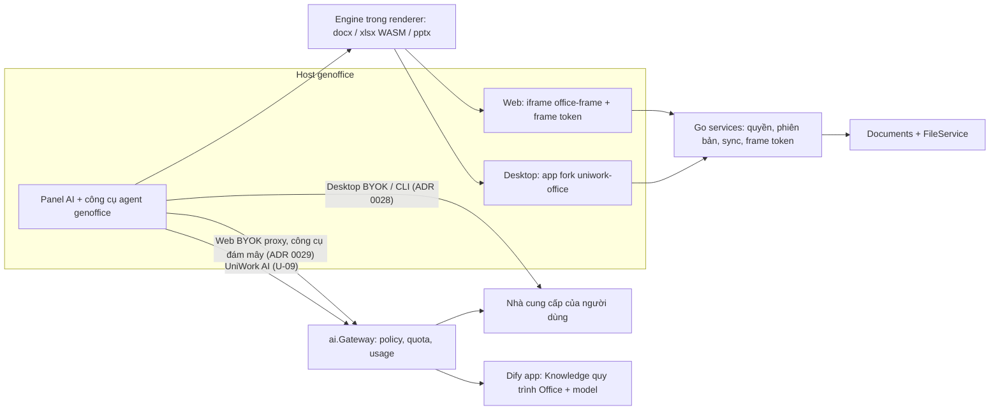

# UniWork Office G5/G6/G7 — Đồng bộ, AI Office với Dify và nghiệm thu phát hành

> **Trạng thái:** in-progress — spec v1.1 bàn giao (đề xuất, chờ duyệt), ngày 2026-10-11 (v1.0 ngày 2026-10-02). Đội lập phase này không triển khai;
> G5/G6/G7 giao cho đội khác (quyết định người dùng 2026-10-11). Chưa khởi chạy triển khai, nạp Knowledge, cấu hình Dify hoặc nghiệm thu sản phẩm.

**Issue tài liệu:** UNI-923, parent UNI-437; Roadmap C-01, liên quan C-15/C-16.
**Issue triển khai:** G5 UNI-660 · G6 UNI-635 · G7 UNI-661 (đội nhận bàn giao giữ các issue này).
**Phạm vi tài liệu:** một phase với ba luồng song song và các mốc bàn giao; không hợp nhất ba issue thành một.
**Nguồn quyết định:** trao đổi người dùng ngày 2026-10-02 trong chat `01a0fbad-e4fb-7321-9009-37d2b12b351e`;
v1.1 cập nhật theo pivot genoffice (UNI-1001, 2026-10-08), ADR 0028/0029 và trao đổi người dùng ngày 2026-10-11.

**Thay đổi chính của v1.1:** hai host editor không còn là G3 (`packages/views/office`) và `apps/office-desktop`
mà là genoffice: app desktop ở repo fork `UNIAI-TEAM/uniwork-office`, web nạp renderer genoffice trong iframe
`office-frame`. AI trong editor là AI có sẵn của genoffice (ADR 0028/0029); Dify vào UniWork như **một nhà cung cấp
"UniWork AI"** sau `ai.Gateway`, không phải một đường AI riêng có tool broker và proposal service (§6, §8).

## 1. Mục tiêu, quyết định đã có và đầu vào

### 1.1 Kết quả sản phẩm

Người dùng mở cùng Document trên web và desktop, chủ động lưu và nhìn thấy đúng phiên bản ở thiết bị khác;
desktop có thư viện được chọn để dùng offline, hàng đợi bền và cách xử lý xung đột không mất dữ liệu.
Trong editor, người dùng hỏi hoặc yêu cầu AI xử lý nội dung qua panel AI của genoffice. Khi chọn nhà cung cấp
"UniWork AI", Dify truy xuất kiến thức về **cách thực hiện**; công cụ của genoffice đọc và xử lý **dữ liệu thật**
trong editor; người dùng xem kết quả trong editor và tự bấm Lưu.
G7 kiểm đường đi đầy đủ trên API, renderer, trình duyệt và bộ cài thật trước khi phát hành.

Ví dụ bắt buộc của G6: “Tính doanh thu từ các cột X, Y, Z” trong XLSX. AI xác định đúng sheet/range,
ý nghĩa cột và kiểu dữ liệu; hỏi khi mơ hồ; tính bằng engine/công cụ, kiểm chứng và trả kết quả có nguồn.
Nếu yêu cầu ghi công thức, thay đổi chỉ nằm trong editor để người dùng xem/hoàn tác; không tự lưu hoặc tạo phiên bản.

### 1.2 Quyết định đã xác nhận

| ID | Quyết định | Hệ quả |
| --- | --- | --- |
| U-01 | G5/G6/G7 được thiết kế thành một phase, có thể chạy song song | G7 chuẩn bị QA ngay; nghiệm thu cuối chờ các phần phụ thuộc |
| U-02 | Dùng Dify cho kiến thức RAG về thao tác Office | Có deliverable Knowledge + Dify app + integration + eval, không chỉ một bộ Markdown |
| U-03 | Xây bộ kiến thức/hướng dẫn AI Office trong phase này | Spec quy định cấu trúc và nghiệm thu; phiên viết spec chưa tạo corpus hay deploy Dify |
| U-04 | Ưu tiên use case XLSX chat/tính toán trên cột/vùng và AI sửa DOCX | Thứ tự bàn giao, không âm thầm thu hẹp phạm vi sáu định dạng |
| U-05 | File Office lưu thủ công; web không autosave (xác nhận lại 2026-10-09) | Checkpoint local, reconnect, phản hồi AI không tự tạo save intent |
| U-06 | ~~AI đề xuất → người xác nhận → service thực thi~~ — thay bởi U-09 | ADR 0010 vẫn giữ cho agent runtime phía server; AI trong editor theo ADR 0028/0029 |
| U-07 | Desktop dùng được với file cục bộ không cần đăng nhập (hành vi sẵn có của genoffice) | Không nhập nhằng file cục bộ với thư viện cloud offline; giữ gate phát hành riêng |
| U-08 | Pivot genoffice (UNI-1001, 2026-10-08): desktop = repo fork `UNIAI-TEAM/uniwork-office`; web = renderer genoffice trong iframe; G3 web editors và `apps/office-desktop` bị gỡ (mục GO-B7/UNI-1017 của plan; người dùng 2026-10-11 gộp việc gỡ vào lane UNI-1240, ghi ở nhật ký điều phối local, nhánh lane `c4-5-remove-g3`; coordinator cần thêm comment trên UNI-1240 và UNI-1017) | Mọi việc phía host của G5/G6 nằm trong repo fork hoặc frame protocol, không trong `packages/views/office` |
| U-09 | Hướng A (2026-10-11): Dify chỉ là một đầu API — nhà cung cấp "UniWork AI" trong panel AI genoffice, gọi qua UniWork API → `ai.Gateway` → Dify | Công cụ đọc/sửa là của genoffice ở client; người dùng áp dụng trong editor rồi tự Lưu; không dựng tool broker hay proposal service riêng |
| U-10 | G5/G6/G7 do đội khác triển khai (2026-10-11) | Spec này là tài liệu bàn giao; đội nhận lập plan, sub-issue và chốt các gate §13 |
| U-11 | Mọi việc liên quan chứng chỉ (ký số, notarization, kênh stable, update feed có ký) ở backlog đến khi có chứng chỉ | Không là gate của G7 cho bản dev; chỉ thành gate khi người dùng mở lại |

“Training RAG” trong phạm vi này là biên soạn kiến thức, lập chỉ mục, chỉnh retrieval/prompt/workflow và
đánh giá. Không có fine-tuning trọng số, tự học từ hội thoại khách hàng hay cam kết model ghi nhớ lâu dài.

### 1.3 Baseline đã đọc và độ tin cậy

| Nguồn | Revision đã đọc / cách sử dụng |
| --- | --- |
| `dev-uniwork` `origin/develop` | `b4f917cb8` (2026-10-11); đã gồm G1/G2 và G3/G4 (UNI-819) |
| `dev-uniwork` `feature/UNI-1001-office-genoffice` | Đọc tại `72d925c9b`; PR #219 (gồm #214, #215) đang mở và head tiếp tục tiến (`1f64737f0` ngày 2026-10-11). ADR 0028/0029, frame web, hợp đồng app ↔ UniWork |
| `dev-uniwork` `feature/UNI-1001-office-genoffice-plan` | head `945266504`, **chỉ có ở local** (manifest điều phối `office-g3g4`, mục `genoffice_pivot.plan`, ghi commit đầu `7d8bcf85e`, "local, not pushed"); người dùng dặn không đẩy plan ngày 2026-10-08, chỉ ghi trong ghi chú của coordinator, chưa có trên issue; nội dung cần cho spec tóm tắt ở §1.4 |
| Repo fork `UNIAI-TEAM/uniwork-office` | `main` `fcfcd29d`, tag `v0.11.0-dev.6`. Bản cài mà server đang trỏ tới trên PR #219 là `0.11.0-dev.5`. Pin bundle web là nội dung `apps/web/platform/office-frame/*.pin.json` tại SHA bàn giao (PR #219: `web-0.1.0-8b2e84a`; lane UNI-1240 đổi pin sang fork `fcfcd29`) |
| Tracker G5/G6/G7 | Mô tả issue đã đọc ngày 02/10, trạng thái `todo`. Không dùng trạng thái đó thay kiểm tra trước triển khai |
| Dify | Đọc tài liệu chính thức ngày 02/10/2026 (§14); chưa kiểm một deployment Dify cụ thể |

Tài liệu nền trên `develop`:
[Documents](2026-09-08-documents-design.md),
[FS-C1](2026-09-24-file-service-contract.md),
[DOC-005](../../office/g0/login-sync-contract.md),
[ADR 0010](../../adr/0010-ai-khong-ghi-truc-tiep-de-xuat-xac-nhan-thuc-thi.md),
[ADR 0021](../../adr/0021-runtime-engine-office-da-dinh-dang.md),
[Work Product](2026-09-16-work-products-design.md),
`docs/office/g3g4/host-contract.md` và `launch-bridge-contract.md` (mô hình Lưu, mở từ web sang app).
Spec [G3](2026-09-27-office-g3-web-editors-design.md), [G4](2026-09-27-office-g4-desktop-design.md) và
local mode (UNI-922) được đánh `superseded` phần editor/host trên nhánh PR #219; trên `develop` chúng vẫn là
`in-progress` cho tới khi PR merge. Chỉ dùng phần hợp đồng còn hiệu lực.
`host-contract.md` là **mô hình Lưu ở mức sản phẩm** (upload chưa là đã lưu, `Idempotency-Key`, `base_revision`,
409 giữ bản cục bộ) và được giữ làm hợp đồng; implementation G3 của nó (save coordinator trong `packages/core/office`)
bị gỡ cùng G3. Hai implementation còn lại mà đội nhận bàn giao mở rộng là `api.save` + hộp thoại conflict của frame web
và luồng Lưu GO-A6 của app fork.

Tài liệu đến cùng PR #219 (đọc tại `72d925c9b` cho tới khi merge):
`docs/adr/0028-ai-phia-client-cua-uniwork-office.md`; `docs/adr/0029-ai-cua-office-tren-web-qua-ai-gateway.md`;
`docs/office/docs-web-frame.md`; `docs/office/office-web-modules.md` (frame token, draft recovery C18, AI trong frame, giới hạn Sheets);
`docs/office/g3g4/uniwork-office-app-api-contract.md` (đăng nhập, mở/lưu, AI đám mây).

### 1.4 Tóm tắt plan genoffice (UNI-1001) mà spec dựa vào

Plan `docs/superpowers/plans/2026-10-08-uniwork-office-genoffice.md` chưa có trên remote (§1.3). Phần cần cho G5/G6/G7:

| Mục | Nội dung | Trạng thái 2026-10-11 |
| --- | --- | --- |
| Q1 | Hai repo: `dev-uniwork` giữ server, web, FileService, tài khoản; app desktop là repo fork genoffice; nối bằng API | Đã chốt |
| Q3 / GO-D2 | Web dùng renderer genoffice trong iframe cùng origin + `postMessage`; token đi qua message, không dựa cookie | Đã chốt, đã chạy (flag `*_web` mặc định bật) |
| Q4 | AI giữ như genoffice; phần tốn credit UniWork đi qua server và `ai.Gateway` | ADR 0028/0029 accepted |
| GO-D3 = C | Sheets web chạy engine WASM; workbook vượt giới hạn mở bằng app | Đã chốt |
| GO-A5 (UNI-1006) | Đăng nhập UniWork trong app (luồng UNI-966) | Đã merge vào fork |
| GO-A6 (UNI-1007) | Mở từ UniWork / Lưu ngược về qua FileService + Documents | Đã merge vào fork (`apps/shell/src/main/uniwork-docs/`); đoạn "Chưa xây" ở hợp đồng app ↔ UniWork §2 chưa cập nhật (owner GO-C3) |
| GO-A7 (UNI-1008) | Kho khóa BYOK web, proxy, công cụ đám mây UniWork | Trong PR #219 |
| GO-A8 (UNI-1009) | CI fork build bộ cài; ký số ở backlog | Bản dev đang phát hành |
| GO-B7 (UNI-1017) | Gỡ editor G3 và `apps/office-desktop` | Gộp vào lane UNI-1240 (người dùng 2026-10-11) |

UNI-1240 còn bốn việc khác, trong đó hai việc là đầu vào của G6: "My AI" theo từng tài khoản và model đã chọn
lưu phía server theo credential. Nhà cung cấp UniWork AI (§6) phải dùng cùng chỗ lưu cài đặt đó.

Tài liệu mô tả mục tiêu không chứng minh tính năng đã chạy. Trước triển khai phải nhận SHA và handoff packet
thực tế của cả hai repo (dev-uniwork và fork) cùng pin bundle web đang phục vụ.
Quyết định mới có bằng chứng ưu tiên hơn mô tả cũ; khác biệt phải reconcile cùng owner, không sửa fake để che lệch.

## 2. Phạm vi và phần không nằm trong phase

| Luồng | Phạm vi phải bàn giao | Giữ ở owner hiện có |
| --- | --- | --- |
| G5 / UNI-660 | Change feed, snapshot/cursor/tombstone; online sync; thư viện cloud offline desktop; queue bền; conflict/recovery; sync UI | G1 quyền/version; FileService byte/claim/GC; app fork: phiên thiết bị, kho khóa, I/O cục bộ, Mở/Lưu UniWork (GO-A5/A6); frame web: draft recovery C18 |
| G6 / UNI-635 | Nhà cung cấp "UniWork AI" (endpoint + adapter Dify sau Gateway); kiến thức quy trình Office, Dify app, eval; đánh giá AI genoffice trên các ca bắt buộc XLSX/DOCX và ma trận §6.5 | AI Gateway policy/metering, BYOK proxy và công cụ đám mây (GO-A7, ADR 0029); panel AI và công cụ agent của genoffice (fork, đồng bộ upstream); Documents commit; Work Product owner ACL |
| G7 / UNI-661 | Harness xuyên host và xuyên hai repo; format/fault/privacy/AI eval; số đo; bộ cài/update/rollback bản dev; hồi quy sau mỗi lần đồng bộ upstream; support matrix và runbook | Không tự nghiệm thu hộ provider; không tự cấp quyền phát hành; phần chứng chỉ ở backlog (U-11) |

Ngoài phạm vi: coauthoring đồng thời/CRDT (UNI-662), Knowledge/wiki và search toàn công ty của A-04,
fine-tuning, OCR PDF scan, model chạy offline, arbitrary code/macros do model thực thi, tự tải dữ liệu từ URL
trong workbook, tự ghi nghiệp vụ không có người duyệt, dựng lại panel AI hoặc bộ công cụ agent song song với genoffice.
Offline web đầy đủ không được thêm vào G5; web giữ draft recovery của frame (C18) và online sync.
Page JSON giữ autosave C-01; quy tắc file Office không thay page.

Sáu định dạng vẫn là DOCX/XLSX/PPTX/PDF/Markdown/HTML. G6 không cam kết mọi thao tác Office đều có
AI automation tương đương; phải có ma trận thao tác AI riêng (§6.5) gắn capability thật của genoffice. Hàng đã cam kết mà
chưa hỗ trợ được giữ blocker; không biến thành pass bằng nút disabled.

## 3. Kiến trúc và các bất biến chung



Ba đường AI tồn tại song song và **không trộn**:

| Đường | Ai trả tiền / đo đếm | Ghi chú |
| --- | --- | --- |
| Desktop BYOK / CLI cục bộ | Người dùng; UniWork không thấy | ADR 0028; ngoài Gateway, ngoài ADR 0010 |
| Web BYOK proxy | Người dùng; UniWork đo usage, `credits=0` | ADR 0029; pass-through, khóa lưu mã hóa phía server |
| UniWork AI (Dify) và công cụ đám mây | Credit UniWork, meter `ai.tokens` | Qua `ai.Gateway`, entitlement của tổ chức; G6 xây đường UniWork AI |

Các adapter Dify/endpoint UniWork AI chưa có sẵn. Không đưa Dify credential, khóa nhà cung cấp của UniWork
hay token thiết bị vào renderer, prompt hoặc bundle.

1. Documents giữ identity/quyền/version; FileService giữ byte/upload/provider-output/claim/GC.
   Một đường commit: `POST /documents/{documentID}/uploads` rồi
   `POST /documents/{documentID}/versions/commit` với `{upload_id, base_revision}` và `Idempotency-Key`.
   Cả app fork (GO-A6) và frame web dùng pipeline này; không dựng kho blob, API save hoặc GC thứ hai.
2. Identity đầy đủ: deployment, account, organization, workspace, document; version id, base revision,
   session generation và snapshot checksum. Revision wire là chuỗi thập phân, không ép sang JS Number.
3. Capability = định dạng + thao tác + host (web frame / desktop) + build genoffice (fork SHA, pin bundle) + contract version;
   quyền là kiểm tra độc lập. Thao tác chỉ có ở desktop (ví dụ một số thao tác Sheets, GO-D3 = C) ẩn trên web bằng capability key.
4. Realtime chỉ invalidation; change feed là đường bù. Trên host web, TanStack Query giữ server state, Zustand chỉ UI state;
   trong renderer genoffice, state theo kiến trúc của fork. Store queue/draft bền nằm sau host (Electron main hoặc
   IndexedDB của frame) và không thành nguồn quyền.
5. Scope do Go/host xác thực suy ra (phiên, frame token); không tin org/account/workspace mà Dify, model hoặc renderer tự khai.
6. Thay đổi nghiệp vụ, audit, outbox và kết quả idempotency cùng transaction. Không log payload tài liệu, prompt hay response.
7. Receipt khớp intent mới là đã lưu; upload, tool success hoặc câu “đã xong” của model không là receipt.
8. Không xóa queue/nháp chưa xác định kết quả của **desktop** vì lỗi khóa, rollback hoặc GC cloud; logout khóa chúng, không xóa.
   Nháp của frame web là recovery theo phiên đăng nhập và bị xóa khi đăng xuất theo C18 (§5.3); UI phải nói đúng điều đó.
9. Thay đổi frame protocol (ba file `packages/core/office/docs-frame-{protocol,endpoint,host}.ts` ↔ `web/docs/protocol/{types,endpoint,host}.ts` của fork) là thay đổi hai repo:
   sửa ở fork, vendor lại nguyên văn vào dev-uniwork, đổi pin bundle; không vá tay một phía.

## 4. G5 — Change feed và đồng bộ online

### 4.1 Protocol bắt buộc

G5 triển khai DOC-005 §5 trên service thật, không port model thử G0 làm backend.
Wire schema/endpoint và cursor version phải giao cùng G1 trước khi consumer triển khai.

- Cursor opaque, có xác thực, buộc account/deployment/org/workspace và phiên bản protocol; không dùng timestamp
  client làm cursor. Cursor giả/sai scope bị từ chối, không trả thông tin phạm vi khác.
- Cold start mở snapshot nhất quán tại high-water mark; membership và giá trị snapshot ổn định qua phân trang.
  Thay đổi xảy ra trong lúc tải snapshot được giữ để catch up sau trang cuối; không mất khoảng giữa snapshot/feed.
- Snapshot có TTL; incremental feed có retention. Hết hạn trả `change_cursor_expired` 410; client full resync
  rõ ràng, không âm thầm nhảy tới “mới nhất”. Trình tự transaction/outbox bảo đảm feed không mất commit.
- Cursor tiến qua sự kiện bị lọc quyền; sự kiện chỉ chứa id/revision/kind theo catalogue được duyệt,
  không title, path, nội dung. Grant/revoke đúng reader; revoke chỉ removal id-only cho người từng có quyền.
- Quyền Work Product fan-out tới Documents được sở hữu. Move khác workspace loại khỏi scope cũ,
  grant ở scope mới; không lộ workspace đích cho người mất quyền.
- Rename/move giữ document id. Archive/restore khác delete; tombstone không được resurrect bởi queue cũ.
- Cursor mới chỉ được ghi bền khi trang đã áp dụng nguyên tử; crash/replay xử lý idempotent.
  Scope A không cập nhật cursor/cache B khi chuyển account hoặc deployment.

### 4.2 Nhận cập nhật khi đang mở editor

| Trạng thái local | Thay đổi server | Hành vi |
| --- | --- | --- |
| Clean, không save/AI đang chạy | Có version mới | Nạp phiên bản mới theo host contract; giữ vị trí đọc khi có thể, hiện thông báo |
| Dirty hoặc có queue/commit outcome chưa rõ | Có version mới | Giữ snapshot local, đánh dấu remote newer; không thay base/nội dung editor |
| AI đang chạy hoặc vừa sửa trong editor | Có version mới | Coi như dirty; kết quả AI chỉ thuộc bản đang mở, không tự áp lên bản mới |
| Bất kỳ | Revoke/delete | Ngừng read/write, bỏ plaintext đúng policy; giữ nháp bảo vệ ở blocked/deleted, không replay |
| Full resync | Snapshot mới hoàn tất | Đối chiếu theo id; loại committed cache không còn quyền, giữ nháp riêng; không coi nháp là file cần tạo lại |

Refetch không đồng nghĩa đã merge. Không **tự** merge binary hoặc **tự** áp lại thay đổi cũ lên base mới.
Ngoại lệ duy nhất là lựa chọn "Ghi đè" mà người dùng bấm sau khi đã thấy conflict (§5.3).
Renderer genoffice hiện không có hook "có version mới / nạp lại": G5 phải thêm message vào frame protocol
(web) và IPC tương ứng trong app fork, theo bất biến 9 ở §3, kèm test ở cả hai repo.

## 5. G5 — Offline library, queue, conflict và UX

### 5.1 Ba loại dữ liệu khác nhau

| Loại | Quyền và hành vi |
| --- | --- |
| File cục bộ chưa bind cloud | Hành vi sẵn có của app genoffice, không cần login; không tự nhập vào cloud. AI trên file này theo ADR 0028 (khóa của người dùng), không dùng UniWork AI khi chưa đăng nhập |
| Committed Document chọn “Dùng khi không có mạng” | Bản cache mã hóa, pin version/checksum/assets; chỉ sẵn sàng sau tải và kiểm đầy đủ |
| Nháp/queue của Document cloud | Bảo vệ theo account/deployment; giữ base và generation; không trở thành file cục bộ tự do |

Thư viện offline và queue bền chỉ thuộc **app desktop** (Electron main của fork). Web không có offline library;
web giữ draft recovery của frame (C18).

Chọn offline là thao tác chủ động, không tải cả tổ chức. Tải có progress/cancel, giới hạn dung lượng và kiểm
checksum; mất mạng giữa chừng chưa báo “sẵn sàng”. Bỏ pin chỉ dọn committed cache khi không còn reader;
không xóa nháp, intent hoặc kết quả chưa reconcile. Disk full giữ bản cũ và hiện lỗi.
Assets phải cùng snapshot được cấp quyền; cache metadata không cấp quyền payload.

**Gate G5-D1 — quyền offline.** DOC-005 yêu cầu live ACL khi recovery; một cache không thể tự thay thế
yêu cầu đó. Đề xuất bổ sung offline lease do server ký, giới hạn account/device/scope/document/version,
quyền read/edit, policy epoch và thời hạn; app quản lý khóa (kho khóa OS mà fork dùng cho phiên GO-A5) và phát hiện clock rollback.
Giá trị khởi điểm để duyệt: lease tối đa 24 giờ, gia hạn khi online và ACL còn hợp lệ.
Thu hồi từ server khi thiết bị mất mạng chỉ có hiệu lực lúc thiết bị nhận revoke hoặc lease hết hạn;
không hứa revoke tức thì offline. Logout khóa ngay. Không offline cold-login bằng credential mới,
không dùng lease để phục hồi nháp đã biết bị blocked.

Đây là thay đổi có chủ đích so với live-ACL recovery của DOC-005, cần chủ auth/phân quyền duyệt amendment
và threat model trước khi mở tính năng. Khi chưa duyệt: giữ offline library capability tắt, vẫn làm
protocol/queue/harness; không nghiệm thu G5 chỉ bằng file cục bộ. Lease hết hạn/OS keystore locked:
khóa cloud payload, giữ ciphertext và checkpoint có thể ghi bền, hướng dẫn kết nối lại; không plaintext fallback.

### 5.2 Hàng đợi giữ nguyên ý định lưu thủ công

**Đề xuất G5 v1 giữ tối đa một save intent chưa giải quyết trên mỗi Document trong host.**
Đây là mở rộng durability của lần Lưu trong app (host contract, GO-A6), không thêm auto-save hoặc xếp nhiều generation.

1. Người dùng bấm Lưu khi offline: chụp snapshot N bất biến, ghi snapshot + intent nguyên tử vào store mã hóa.
   Chỉ khi ghi bền thành công mới hiện “Đã xếp hàng lưu — chưa lưu lên UniWork”.
2. N+1 vẫn sửa/checkpoint được, nhưng lệnh Lưu mới bị chặn tới khi intent N có outcome xác định hoặc được
   hủy an toàn. UI cho thấy bản đang chờ và việc còn thay đổi mới chưa gửi. Không thay snapshot N bằng N+1.
3. Reconnect chỉ tiếp tục intent đã được người dùng yêu cầu, sau kiểm session, ACL, lease/scope, tombstone,
   engine và base. Không quét mọi dirty draft để upload.
4. Queue giữ identity, logical intent id, commit key/fingerprint, base revision/version, snapshot generation,
   checksum/length, engine/protocol, trạng thái attempt, retry time, receipt và lỗi cuối.
   Credential không nằm trong payload queue; không ghi plaintext file names vào log.
5. Mỗi Document có lock/lease xử lý nội bộ chống hai cửa sổ/process chạy cùng intent; retry backoff có jitter,
   phân loại lỗi tạm thời/vĩnh viễn. Có giới hạn concurrency giữa Documents để một file lỗi không chặn toàn queue.
6. Nhận receipt N: ghi receipt và chuyển trạng thái bền trước cleanup; chỉ tiêu đúng snapshot N.
   N+1 vẫn dirty, muốn lưu phải bấm Lưu mới. Crash ở bất kỳ bước nào không sinh version trùng.
7. Nếu mất phản hồi hoặc hủy sau khi bắt đầu commit: `reconciling`, không coi là failed chắc chắn.
   Tra kết quả intent rồi mới cho thao tác mới; hết timeout client không là chứng cứ server chưa commit.

| Trạng thái queue | Ý nghĩa / đường ra |
| --- | --- |
| queued / paused_offline | Snapshot bền; chờ mạng hoặc người dùng resume |
| validating / uploading / committing | Đang kiểm quyền, gửi byte, commit đúng base |
| reconciling | Outcome chưa rõ; tra receipt, không tạo key thay thế để “thử lại” |
| committed | Receipt khớp; cleanup đúng generation |
| conflict | Base thay; người dùng giải quyết, không tự retry ghi |
| blocked | Session/quyền/lease không hợp lệ; giữ byte được bảo vệ |
| failed | Lỗi không tự retry như engine incompatible, quota, payload mismatch; nêu cách khắc phục |
| cancelled | Chỉ khi biết chưa commit; hủy queue không tự xóa nháp |

**Hợp đồng resume bắt buộc với G1/FileService:** upload claim có thể hết hạn trước khi thiết bị online.
Không thay `upload_id` rồi dùng lại commit key có fingerprint cũ. Service cần operation tra/reconcile theo
logical intent; chỉ khi xác định attempt cũ chưa commit và không thể late-commit mới được cấp attempt/key mới
gắn cùng logical intent và snapshot. Kết quả committed giữ đủ lâu để retry không nhân đôi sau restart.
Nếu chưa chứng minh được trạng thái, giữ reconciling và cho người dùng hướng dẫn, không tạo version mới.
Retention idempotency/resume là gate G5-D2, không suy ra từ TTL staged của FileService.

### 5.3 Conflict, quyền và trung tâm đồng bộ

Conflict hiển thị bản local và server cùng version/thời điểm, cho xem khác biệt theo khả năng format.
Người dùng có thể tải lại server sau khi chọn giữ/bỏ nháp rõ ràng; tạo bản sao chỉ khi còn quyền và đi qua
Documents/owner policy với provenance, không mở ACL rộng hơn. Không có đường ghi nào bỏ kiểm revision. Frame web hiện có ba lựa chọn khi Lưu gặp 409: "Tải bản mới nhất", "Ghi đè",
"Hủy"; "Ghi đè" đọc lại head rồi commit bản cục bộ với `base_revision` mới. G5 giữ hành vi này như cách giải quyết
conflict hợp lệ, vì người dùng đã thấy conflict và tự chọn; nó tạo một version mới (không xóa version của người khác)
và ghi audit như mọi commit. Queue desktop dùng cùng ba lựa chọn: ở trạng thái `conflict`, "Ghi đè" tạo intent mới trên
base mới, không sửa intent cũ. Không bao giờ ghi đè tự động.
Không có quyền thì khóa nháp; không cung cấp export/copy/clipboard để né quyền.
Delete/tombstone dừng replay; không tự tạo Document thay thế. Thu hồi device/session ghi audit.

Trung tâm đồng bộ (app desktop) dùng chung trạng thái với editor, có: kết nối, lần đồng bộ cuối, tài liệu đã pin offline,
hàng đang chờ, bản có conflict/blocked, retry/pause/cancel theo trạng thái; không dùng một dấu “đã lưu” cho cả
checkpoint, queued và committed. Giao diện theo shell genoffice đã rebrand: keyboard, screen reader, vi/en và dark/light.
Logout/đổi tài khoản trên desktop xóa plaintext/cache RAM, khóa queue cũ, không mất ciphertext.
Update/rollback giữ store schema/key namespace và đọc được dữ liệu bền; không restart khi checkpoint thất bại.

**Web khác desktop.** Draft recovery của frame (`uniwork-office-frame-drafts`, khóa AES-GCM theo người dùng, C18)
bị xóa cùng khóa khi đăng xuất hoặc đổi người dùng; lời hứa với người dùng là "khôi phục sau crash, đóng tab, tải lại,
cho tới khi bạn đăng xuất". G5 không đổi hành vi này. Nếu cần giữ nháp web qua đăng xuất, đó là thay đổi riêng
phải chốt quyền, khóa và TTL; không suy ra từ quy tắc queue desktop.

## 6. G6 — Chat và tác vụ AI Office

### 6.1 Trải nghiệm trong editor

AI dùng panel AI có sẵn của genoffice ở cả sáu module, trên desktop và trong frame web. G6 **không** dựng panel mới.
Fork đã có seam **UniWork cloud** (`packages/ai-provider/src/uniwork-cloud.ts`): công cụ đám mây trả bằng "credit UniWork AI",
trạng thái `signed-out` / `not-entitled` / `subscription-inactive` / `credits-exhausted` / `unavailable` / `ready`,
lấy từ `GET /orgs/{orgID}/ai/cloud`. G6 **mở rộng seam này**, không tạo nhãn "UniWork AI" thứ hai:
thêm công cụ `chat` vào danh sách công cụ cloud, và thêm một mục nhà cung cấp `uniwork` trong
`packages/ai-provider/src/providers.ts` (bên cạnh `anthropic`, `openai`, `codex`, `custom`…) mà panel chỉ hiện khi
trạng thái cloud là `ready` và `tools.chat` bật. Khi chọn, lượt chạy dùng credit UniWork và kiến thức quy trình Office trên Dify.

- **Desktop** phát hiện qua `GET /orgs/{orgID}/ai/cloud` (trường mới `tools.chat`), bằng phiên thiết bị.
- **Web**: grant `ai` của frame token hiện chỉ bật khi có `office.ai_byok` và kho khóa đã cấu hình (`AIBYOKService.Enabled`),
  và các khóa cloud chỉ đi kèm `ai`. G6 phải tách UniWork AI khỏi BYOK: thêm trường grant `uniwork_ai` (cấp khi
  `RequireMember` + entitlement + Dify đã cấu hình, không cần BYOK) và capability key `uniworkAi` trong frame protocol;
  panel mở được khi chỉ có `uniworkAi`. Đây là thay đổi hai repo (bất biến 9, §11).
- Thiếu bất kỳ điều kiện nào thì ẩn mục, không hiện lỗi giả. Người chỉ có quyền xem vẫn hỏi được (như AI web hiện nay)
  nhưng không Lưu được.
- File cục bộ chưa bind cloud: không dùng UniWork AI khi chưa đăng nhập; đã đăng nhập thì dùng credit của
  tổ chức đang chọn và UI nói rõ nội dung file được gửi lên UniWork. Không tự upload file thành Document.
- Không mạng: UniWork AI không chạy; không xếp hàng yêu cầu AI để tự gửi sau reconnect.
- Chat không mở thành Ask UNI toàn workspace; muốn thêm nguồn phải chọn rõ và server kiểm quyền.
  Tài liệu thuộc Work Product giữ cùng workspace và owner ACL theo C-14, không có ACL phụ của Office AI.
- Kết quả phân biệt **trả lời**, **cần làm rõ**, **đã sửa trong editor**, **không hỗ trợ**, **lỗi**; có hủy.

**Ngữ cảnh là nội dung đang mở trong editor**, kể cả phần chưa lưu, vì công cụ genoffice đọc thẳng editor.
Đây là thay đổi so với đề xuất G6-D3 cũ (chỉ chạy trên bản đã commit). Hệ quả: nội dung chưa lưu đi tới
UniWork và nhà cung cấp model trong lượt chạy. Phần nào tới **Dify** phụ thuộc cách nối ở §6.2 (quy tắc dựng query);
chính sách lưu giữ và xóa ở Dify thuộc gate G6-D2. Kết quả AI không gắn với một version server;
trả lời phải nói rõ là theo nội dung đang mở.

### 6.2 Luồng một lượt UniWork AI

1. Panel genoffice gửi request theo wire format nhà cung cấp mà nó vốn dùng (ví dụ openai-compatible có tool calling),
   tới endpoint UniWork AI bằng phiên UniWork (desktop) hoặc frame token (web). Không khóa nhà cung cấp nào nằm ở client.
2. Server: `RequireMember` → entitlement → `CheckQuota(ai.tokens)` → `ai.Gateway`. Scope (user, org, document nếu có)
   suy từ phiên hoặc frame token, không từ body.
3. Gateway gọi Dify qua adapter trong `server/internal/ai/provider` (luật `TestProviderSDKOnlyInAIProvider`).
   Dify truy xuất procedure đã duyệt (§7) theo filter cứng do server đặt (release corpus, format, locale).
4. Model trả lời hoặc trả **tool calls**. Tool calls về client nguyên trạng; công cụ genoffice chạy trong renderer,
   đọc/tính/sửa trong editor, rồi gửi tool result ở request tiếp theo. Dify không gọi ngược API UniWork trong v1.
5. Gateway ghi usage cho mọi lượt model/embedding/rerank thuộc run (§8.2), kể cả khi client ngắt kết nối.
6. Panel hiển thị kết quả. Không có side effect ghi phía server; Lưu là thao tác riêng của người dùng (§6.4).

Hai cách nối Dify là lựa chọn của gate G6-D1, phải POC trước khi chốt:

| Cách | Mô tả | Ưu / nhược |
| --- | --- | --- |
| (a) Knowledge API | Gateway gọi Dify Knowledge Retrieval API lấy chunks, chèn vào prompt, rồi gọi model qua `Complete` của Gateway, sau một façade mới (dưới) | Đề xuất. Tool calling giữ nguyên định dạng; streaming theo quyết định G6-D1 (façade); usage đo trực tiếp; Dify chỉ là đầu API truy xuất |
| (b) Chatflow | Gateway gọi một Dify chatflow app; Dify gọi model | Phải chứng minh Dify chuyển tool calls/streaming đúng định dạng client cần và cho Gateway đo từng lượt model; nếu không được thì loại |

**Quy tắc dựng query gửi Dify.** Cách (a): server dựng query từ câu của người dùng cộng gợi ý mức schema
(định dạng, intent, tên cột/heading), giới hạn độ dài; **không** gửi giá trị ô, đoạn văn hay nội dung tài liệu.
Khi đó Dify chỉ nhận câu hỏi và tên cột/heading (vẫn là dữ liệu của khách hàng, có giới hạn độ dài), không nhận giá trị ô
hay đoạn văn; G6-D2 vẫn phải chốt log và retention của query ở Dify.
Cách (b): Dify nhận cả hội thoại và nội dung công cụ trả về, nên G6-D2 phải đóng trước khi có dữ liệu thật.

**Hợp đồng đề xuất (chốt ở G6-D1, chưa phải API đã có):**

| Mục | Đề xuất |
| --- | --- |
| Route phiên | `POST /orgs/{orgID}/ai/uniwork/chat/completions` |
| Route frame | `POST /office-frame/documents/{documentID}/ai/uniwork/chat/completions` (mount qua `handler.NewAIMountable` như ADR 0029 D9) |
| Wire | openai-compatible, SSE, tool calling. Phía fork là adapter `uniwork` riêng (base URL theo host, auth theo host, run id, allowlist), **không** phải pass-through BYOK |
| Định danh lượt chạy | Do server cấp ở request đầu, adapter `uniwork` gửi lại ở các request tool-result (header `X-UniWork-AI-Run` hoặc trường trong body, chốt ở G6-D1); server từ chối id không thuộc người dùng/tổ chức |
| Rate limit | Nhóm `ai-uniwork`, theo danh tính, như ADR 0029 D6 |
| Trạng thái | `GET .../ai/cloud` thêm `tools.chat`; frame thêm grant `uniwork_ai` |
| Lỗi | Bộ lỗi chuẩn ADR 0029, thêm `run_limit_reached` khi vượt trần lượt (dưới) |

Sau khi chốt, hợp đồng app ↔ UniWork (`uniwork-office-app-api-contract.md` §3) thêm mục cho route này.

**Façade là việc mới ở dev-uniwork.** Gateway hiện có `Complete` (một request, một `CompletionResponse` có `ToolCalls`)
và `Embed`; `provider.Provider` không có method stream; SSE pass-through chỉ có ở proxy BYOK, vốn không dịch giao thức
(ADR 0029 D3). Endpoint UniWork AI vì vậy là một façade mới: dịch request openai-compatible ↔ `ai.Request`/`ai.Response`;
khai báo công cụ của allowlist qua `ai.Request.Tools` để tool call lạ bị từ chối bằng `ErrToolNotAllowed`
(`server/internal/ai/gateway.go`); mỗi request tool-result là một lượt `Complete` mới cùng run id.
G6-D1 chốt streaming thật (thêm method stream vào `provider.Provider`) hay SSE một chunk ở v1; adapter `uniwork`
phải chịu được cả hai.

**Giới hạn công cụ và vòng lặp.** Agent của fork còn có MCP server, skills và công cụ đám mây tốn credit, ngoài công cụ editor.
Với nhà cung cấp UniWork AI trong v1:
- Allowlist cứng: chỉ công cụ editor của module đang mở. MCP và skills tắt; nếu sau này bật thì theo từng lượt, có thông báo rõ.
  Công cụ đám mây chỉ khi tổ chức có `office.ai_cloud`.
- Server từ chối tool call ngoài allowlist mà model trả về (lọc trong response trước khi tới client) và client cũng không thực thi.
- Trần số vòng tool và số lượt gọi model cho mỗi lượt chạy, đếm ở server theo run id (bảng hợp đồng ở trên); vượt trần trả `run_limit_reached`.
  Mỗi request tool-result là một lượt model có tính credit.

Lịch sử hội thoại là nguồn không tin cậy. Nội dung tài liệu, công thức, comment và tool result không phải system
instruction; prompt injection không được đổi policy, mở URL hoặc lấy scope khác.

### 6.3 Công cụ — dùng của genoffice

Công cụ đọc/tính/sửa là công cụ agent của từng module genoffice (fork, đồng bộ upstream). G6 không dựng tool broker
phía server trong v1. Việc của G6:

- Lập bảng công cụ theo module và host (tên, input/output, giới hạn, có ghi editor hay không, chỉ desktop hay cả web),
  lấy từ code fork tại SHA đã pin; bảng này là nguồn cho nhóm "Tool contracts" của corpus (§7.2).
- Đối chiếu với ma trận §6.5. Thiếu công cụ → yêu cầu thay đổi ở fork (ưu tiên đẩy lên upstream để giảm lệch),
  không vá trong dev-uniwork.
- Kiểm các ràng buộc an toàn trên công cụ genoffice: không chạy macro/VBA/DDE, không tự tải URL trong workbook,
  không ghi file ngoài tài liệu đang mở, không gọi API UniWork bằng quyền khác phiên người dùng.
  Vi phạm là blocker, sửa ở fork.
- Tính toán số liệu do công cụ/engine làm (Sheets: engine công thức và xlsx WASM), không do model tự nhẩm.

Nếu sau này cần công cụ phía server (ví dụ đọc tài liệu khác trong workspace), đó là mở rộng riêng có ADR,
phải qua ACL và `TestAskUniToolsAreReadOnly`-style guard; không nằm trong v1.

### 6.4 Áp dụng và lưu

- AI sửa trực tiếp trong editor bằng công cụ genoffice; người dùng xem, hoàn tác bằng undo của editor, rồi tự bấm Lưu.
  Không có autosave; một lượt AI không bao giờ tạo upload, version hay save intent.
- Ghi vào UniWork đi qua API thường bằng phiên người dùng thật (ADR 0028), đúng một đường commit ở §3.
  ADR 0010 vẫn áp cho agent runtime phía server; nó không áp cho panel AI trong editor.
- Thay đổi do AI phải nhìn thấy được trước khi Lưu (đánh dấu vùng sửa hoặc mô tả thay đổi trong panel, theo khả năng
  từng module). Thiếu cách hiển thị ở module nào thì ghi blocker cho hàng đó ở §6.5.
- Lưu sau khi AI sửa đi theo host contract như mọi lần Lưu: `base_revision`, 409 giữ bản cục bộ, conflict theo §5.3.
- Sau commit, hoàn tác là một lần sửa và Lưu mới; không xóa version.

### 6.5 Ma trận tác vụ AI trong phase

Mỗi hàng tách thành capability theo operation/host/build khi lập plan; đây là mục tiêu nghiệm thu,
không tuyên bố genoffice hiện hỗ trợ hết.

| Format | Tác vụ đọc/phân tích | Sửa trong editor (người dùng xem/hoàn tác rồi Lưu) | Oracle |
| --- | --- | --- | --- |
| XLSX | Tổng/count/average, điều kiện, nhóm, đối chiếu sheet, giải thích công thức, phát hiện dữ liệu bất thường | Công thức, giá trị hoặc cột dẫn xuất trong range xác định | Expected cells, types/formulas, recalc, reopen, unchanged regions |
| DOCX | Hỏi/tóm tắt, trích nội dung có anchor, so sánh và giải thích | Viết lại/rút gọn/dịch đoạn được chọn; giữ bảng và phần không sửa | OOXML parts diff, text/structure, render theo ngưỡng; mở lại bằng Word |
| PPTX | Hỏi/tóm tắt theo slide và text shape | Viết lại/dịch text shape | Text/shape/layout preserved, fresh reopen; không hứa AI tạo layout toàn deck |
| PDF có text layer | Hỏi/tóm tắt với page/text anchors | Text patch trong capability đã chứng minh; giới hạn font/layout rõ | Extraction/render và vùng ngoài patch; scan không giả có text/OCR |
| Markdown | Hỏi/tóm tắt theo heading/source range | Sửa vùng chọn, giữ frontmatter/link/assets ngoài vùng | Source diff + render + assets |
| HTML | Hỏi/tóm tắt nội dung | Sửa text/DOM targets được phép | DOM/source diff, assets, CSP/sandbox của frame |

Mỗi hàng chạy với cả UniWork AI và ít nhất một đường BYOK, trên web và desktop, để phân biệt lỗi của corpus/Dify
với lỗi của công cụ genoffice.

Đối với XLSX:
- Phân biệt nhãn cột X/Y/Z với địa chỉ cột Excel; dùng sheet id/range resolved, không chỉ sheet name.
- Kiểm number/date/text/percent/currency, locale dấu phẩy/chấm, ngày serial/timezone khi có, blank/error cells,
  merged headers, filtered/hidden rows, subtotal/totals và named/table ranges.
- Quy tắc bỏ qua hay báo lỗi ô không hợp lệ phải hiện trong câu trả lời; không âm thầm cast text hoặc bỏ dòng.
  Tiền tệ/thuế/rounding phải explicit và tính bằng engine, không mental arithmetic của LLM.
- Formula cache có thể cũ; recalc bằng engine hoặc báo không tính được, không dùng giá trị cache làm chân lý.
- Công cụ tính trên toàn range đã chỉ định, trả row counts/coverage. Sampling chỉ phục vụ hiểu schema; không là tổng.
  Workbook vượt giới hạn của frame web mở bằng app (quyết định GO-C4); AI web không xử lý thay.
- Trả kết quả kèm sheet/range, filter/rounding, số dòng xử lý và cảnh báo.
  Thêm công thức phải cho thấy target range và số ô bị ghi đè trước khi người dùng Lưu.

**Ví dụ nghiệm thu:** người dùng nói “Tính doanh thu X/Y/Z”. Nếu headers chứng minh X=số lượng, Y=đơn giá,
Z=phần trăm giảm giá thì tính `X * Y * (1 - Z)`; nếu Z là số tiền giảm thì công thức khác và phải xác nhận ý
nghĩa khi chưa rõ. Chat chỉ trả kết quả; “ghi vào cột AA” sửa trong editor, không tự Lưu.
Phải có fixture ô Z lưu 10 và 10%, dòng ẩn, hàng tổng, ô lỗi, nhiều sheet và dữ liệu tiếng Việt.

## 7. G6 — Bộ kiến thức RAG cho Dify

### 7.1 Ba lớp không trộn lẫn

| Lớp | Nội dung / nguồn sự thật |
| --- | --- |
| Kiến thức quy trình Office | Corpus do UniWork biên soạn và review: định dạng, intent, playbook, tool contract, ví dụ; quản lý trong Git, nạp Dify theo release |
| Policy và schema bắt buộc | Quyền, capability, tool allowlist, confirmation, budget, schema validation nằm trong code/contract; không phụ thuộc có retrieve đúng một đoạn Markdown |
| Nội dung tài liệu người dùng | Công cụ genoffice đọc trong editor đang mở; không nhập workbook khách hàng vào corpus dùng chung; quyền nằm ở UniWork |

Nguồn nghiệp vụ do người dùng chọn phục vụ tác vụ hiện tại có thể được đưa vào context theo C-14,
cùng workspace/quyền và provenance; phase này không xây kho RAG toàn doanh nghiệp A-04.
Nội dung file, công thức, comment, metadata và tool output là dữ liệu không tin cậy, không là system instruction.

### 7.2 Tám nhóm tài liệu phải xây trong G6

| Nhóm | Nội dung | Điều kiện chất lượng |
| --- | --- | --- |
| Capabilities | Format/operation/host/build, giới hạn, unsupported cases | Trỏ đúng registry/engine evidence; không tự mô tả tính năng chưa có là available |
| Document models | Workbook/sheet/table/cell/formula, DOCX parts/anchors, slide/text, PDF/page, Markdown/HTML | Có locator và semantics dữ liệu, không chỉ hướng dẫn UI |
| Intent catalogue | Cách diễn đạt vi/en, synonyms, slots bắt buộc, quy tắc hỏi lại | Ví dụ mơ hồ lẫn rõ ràng; phân biệt read/compute/propose |
| Playbooks | Preconditions, steps, tool dependencies, branches/errors, output/verification | Một tác vụ tự đọc được; không hardcode sheet name/cột từ fixture thành quy tắc chung |
| Tool contracts | Công cụ agent genoffice theo module/host: chức năng, input/output, limits/errors, side effects | Sinh/đối chiếu từ code fork tại SHA pin (§6.3); đồng bộ upstream đổi công cụ thì corpus liên quan cần review lại |
| Policies/recovery guide | Giải thích confirm/save/conflict/permission/offline cho model và người dùng | Bản giải thích bổ trợ code policy; không được ghi đè policy bằng retrieval |
| Worked examples/anti-examples | Yêu cầu → bước đọc → tool calls → kết quả → lý do kiểm chứng | Dữ liệu tổng hợp hoặc được phép dùng; có ví dụ thất bại và hỏi lại |
| Evaluation specification | Fixture/query, relevant playbooks/tools, expected output/operations và oracle | Test holdout tách khỏi Knowledge và ví dụ huấn luyện prompt |

Phạm vi corpus bắt đầu bằng XLSX và DOCX nhưng phải bao phủ các hàng đã cam kết của §6.5.
Không tải lên toàn repo, logs, secrets hoặc tài liệu khách hàng làm “training” mặc định.

### 7.3 Schema của một tài liệu kiến thức

Cấu trúc source đề xuất là Markdown với metadata riêng được validator đọc, không mặc định Dify hiểu frontmatter.
Pipeline ánh xạ metadata sang document metadata của Dify theo version được chọn.

```yaml
id: office.xlsx.aggregate.filtered-total
revision: 1
status: draft
format: xlsx
intent: aggregate
operation: calculate
locale: vi
risk: read_only
required_capabilities: [range_read, aggregate]
genoffice_tools_ref: uniwork-office@<sha>
owner: office-ai
source_refs: []
eval_case_ids: []
```

Các field trên là schema đề xuất; `genoffice_tools_ref` trỏ bảng công cụ genoffice tại SHA fork đã pin, không phải API UniWork.
Bản approved phải có reviewer, reviewed_at, source refs cụ thể, engine/capability compatibility và content hash.
Dify dataset/document ids nằm trong deployment manifest, không dùng làm stable knowledge id trong source.

Body gồm: mục đích; dùng khi nào/không dùng khi nào; ví dụ utterances; slots đầu vào; dữ liệu cần đọc;
preconditions; từng bước và tool reference; nhánh hỏi lại/lỗi; kiểm chứng; dạng output; ví dụ và phản ví dụ;
liên kết bài liên quan. Không lưu chain-of-thought riêng tư; chỉ cần trình tự thao tác và bằng chứng kiểm.

### 7.4 Chunking, retrieval và tính nhanh

- Chunk theo một procedure hoặc section có nghĩa. Preconditions/warnings/verification phải đi cùng procedure
  bằng chunk đầy đủ hoặc cơ chế fetch parent; cắt rời một công thức khỏi điều kiện áp dụng là lỗi corpus.
- Map metadata: stable id, revision/status, format, intent, operation, locale, tool contract version và capability.
  Tên mã lỗi/công cụ/công thức được giữ nguyên để tìm chính xác, bổ sung từ đồng nghĩa tiếng Việt.
- Server cung cấp filter cứng: approved corpus release + format + tool contract tương thích. LLM có thể gợi ý
  intent, nhưng không được bỏ scope/version filters. Multi-capability matching kiểm thêm ngoài metadata nếu cần.
- Điểm khởi đầu để đo: hybrid lexical/semantic, top-k 5, rerank tùy kết quả eval; chunk size và threshold được
  tune trên dev set, không gọi một bộ tham số là tối ưu trước khi đo. Có token budget cứng cho retrieved context.
- Explicit workflow/tool identifiers có thể lookup chính xác trước semantic search. Cache chỉ corpus procedure
  theo release/query/locale/capability; không cache chung kết quả tài liệu khách hàng hoặc bỏ kiểm quyền.
- Retrieval trả id/revision/chunk/source/score; runtime lưu dấu vết chọn playbook. Không match đáng tin thì hỏi lại
  hoặc báo chưa hỗ trợ, không gọi tool ngoài allowlist để thử.
- Dữ liệu số lớn không đi qua RAG để tính; gửi về model schema/summary và kết quả tool vừa đủ.
  Đo latency riêng retrieval, tool/engine, model và end-to-end để biết phần nào chậm.

### 7.5 Vòng đời corpus và bàn giao

Draft → kiểm schema/link/tool references → reviewer duyệt → import staging → retrieval/agent eval →
release manifest → rollout. Corpus dùng release id/hash, Dify DSL hash, model/embedding/rerank revisions
và capability contract; workflow chỉ dùng bộ tương thích.

Xây staging dataset riêng rồi switch manifest sau khi indexing sẵn sàng và smoke pass; không trộn các
revision đang index dở. Import có idempotency/mapping source id → Dify ids, xử lý remove/deprecate và verify
không còn retrieve bản cũ. Model embedding thay đổi phải reindex và chạy lại eval.
Rollback trỏ về manifest tương thích, không chỉ đổi prompt trong UI.

Dify DSL export không bao gồm dữ liệu Knowledge; gói bàn giao phải có source corpus, metadata, import mapping,
rebuild procedure và eval riêng. Secret/env nhạy cảm phải được loại khỏi DSL trước commit.
Yêu cầu này dựa trên Dify [Manage Apps](https://docs.dify.ai/en/cloud/use-dify/workspace/app-management);
không coi export DSL là backup đầy đủ của một ứng dụng RAG.

## 8. G6 — Tích hợp Dify với AI Gateway

### 8.1 Trách nhiệm

Dify là **một đầu API phía sau `ai.Gateway`** (U-09): kho Knowledge quy trình Office và, tùy cách nối ở §6.2,
một ứng dụng gọi model. Deployment/model/plugin/version chưa chốt. UniWork giữ danh tính, entitlement, quota,
usage, audit; genoffice giữ panel và công cụ. Dify không giữ quyền đọc tài liệu, không gọi API UniWork,
không có quyền ghi.

Spec không giả định Dify tự cung cấp ACL Document, tính đúng XLSX, hay đo đếm thay Gateway.
Các khả năng cụ thể cần kiểm lại trên phiên bản deployment được chọn:
[Knowledge Retrieval](https://docs.dify.ai/en/cloud/use-dify/nodes/knowledge-retrieval),
[Tool node](https://docs.dify.ai/en/cloud/use-dify/nodes/tools).

### 8.2 Không bỏ qua AI Gateway

Gateway hiện đã có đường completion, proxy BYOK pass-through và công cụ đám mây (`server/internal/ai/cloud.go`,
ADR 0029). UniWork AI thêm một façade mới (§6.2) — không dùng lại proxy pass-through — nhưng theo cùng khuôn về route và bảo vệ: route dưới `/orgs/{orgID}/ai/...` và bản mount trên frame token
(`handler.NewAIMountable`, `AIActorResolver`), rate limit theo nhóm route, lỗi chuẩn của ADR 0029
(`entitlement_required` 403, `credits_exhausted` 402, 429, `provider_unreachable` 502, `cloud_unavailable` 503).

Gate G6-D1 yêu cầu chứng minh:
- Run identity do server cấp, đi theo mọi lượt gọi Dify/model/embedding/rerank của lượt chạy, kể cả retry và
  các request tool-result tiếp theo của cùng hội thoại; không lấy từ input người dùng hoặc model.
- `CheckQuota` trước, `RecordUsage` theo usage thật; usage thiếu là unknown/reconciliation, không mặc định 0.
  Không đếm trùng lượt bao ngoài và từng lượt model con. Chốt usage trên context tách khỏi request như ADR 0029.
- Entitlement: đề xuất v1 **dùng lại `office.ai_cloud`**, để `chat` là một công cụ cloud như các công cụ khác và máy trạng thái
  của seam (`enabled` / `not-entitled`) không đổi; grant `uniwork_ai` của frame đọc cùng khóa. Nếu chủ sản phẩm muốn khóa riêng
  (ví dụ `office.ai_uniwork`), thì `enabled` phải đổi thành "có ít nhất một công cụ được entitlement" và mỗi công cụ mang
  entitlement riêng, cả ở `GET .../ai/cloud` lẫn grant frame. Khóa mới seed bằng migration, đọc qua `EntitlementService.Can` (fail-closed).
- Provider transport đúng boundary repo; `internal/ai` không import service nghiệp vụ hoặc đọc business tables
  (`TestAIPackageOnlyCallsAiQueries`).
- Dify timeout/cancel không đồng nghĩa vendor chưa tốn token; không tự chạy lại.
- Knowledge ingestion embeddings là công việc quản trị có quota/attribution riêng, không gán vào tenant bất kỳ.

Nếu deployment Dify được chọn không cho Gateway kiểm soát/đo các lượt gọi model, dùng cách (a) ở §6.2
(Dify chỉ truy xuất) hoặc trình ADR thay đổi ranh giới. Không chấp nhận bypass Gateway bằng “Dify có log”.
PoC có thể dùng data tổng hợp trong staging; không là quyền đưa dữ liệu khách hàng lên dịch vụ chưa duyệt.

### 8.3 Privacy, hội thoại, cache và vận hành

- Client chỉ gọi UniWork; Dify app API key và model credentials ở secrets của server/deployment, không trong DSL Git,
  không trong bundle fork.
- Mỗi lượt chạy bind actor + tenant (+ document khi chạy trong frame). Không dùng chung conversation hoặc memory
  của Dify giữa tài liệu/tài khoản để tiết kiệm token; ở cách (a) Dify không giữ hội thoại.
- Nội dung đang mở (kể cả chưa lưu, §6.1) đi tới UniWork và nhà cung cấp model. Tới Dify chỉ phần mà quy tắc dựng query
  ở §6.2 cho phép. Corpus procedure trên Dify không chứa nội dung khách hàng.
- Log/audit vận hành chỉ ids, tool names, status, durations, counts, hashes và correlation;
  raw prompt, response, cell contents, titles hoặc token không được ghi vào log chung.
- Các bản sao trong Dify history/tracing, model provider và cache phải có inventory và chính sách xóa.
  G6-D2 chốt cloud/self-host, region, retention và ai được truy cập Dify admin trước khi dùng dữ liệu thật.
  Tắt tracing chứa content nếu deployment cho phép; không chứng minh được thì chưa mở UniWork AI cho tenant production.
- Dify/LLM/retrieval outage chỉ làm UniWork AI unavailable; editor, Lưu, BYOK và G5 vẫn hoạt động.
  Không fallback âm thầm sang nhà cung cấp khác.
- Phiên bản Dify app/corpus đã phát hành bất biến theo manifest. Cập nhật prompt trên production đi qua
  quy trình release/eval. Lưu dấu vết kỹ thuật đủ truy ngược kết quả tới model, prompt, corpus và build genoffice.

## 9. G7 — Ma trận nghiệm thu và bằng chứng

### 9.1 Chuẩn bị song song, nghiệm thu theo dependency

G7 tạo fixture, oracle, runner, data reset, OS/browser matrix và reporting ngay khi có contract.
Fake phục vụ unit/contract tests; full acceptance cần service/DB/FileService/engine/Dify và binary thật.
Mọi dòng bằng chứng có requirement id, SHA, platform/build, fixture/hash, command, result,
artifact, người kiểm và blocker. “Chưa chạy”, “skip”, “không có máy” là BLOCKED, không là PASS.

| Mã | Điều phải chứng minh |
| --- | --- |
| G5-A01 | Snapshot nhiều trang + concurrent writers + retention không mất thay đổi; cursor tiến qua sự kiện bị lọc |
| G5-A02 | Grant/revoke/tombstone/move/Work Product ACL không lộ metadata và không resurrect file |
| G5-A03 | Web lưu → desktop nhận và desktop lưu → web nhận, cùng version/checksum; dirty editor không bị thay |
| G5-A04 | Offline pin đủ file/assets/checksum; interrupted download/disk full/corrupt cache không báo ready giả |
| G5-A05 | Save offline → crash/restart → reconnect: một receipt/version; N+1 còn dirty, không tự lưu |
| G5-A06 | Expired upload/idempotency, timeout-after-commit, cancel race và late response không duplicate/overwrite |
| G5-A07 | Lease/expiry/clock rollback/revoke/logout A→B/deployment switch/keystore lock đúng policy được duyệt |
| G5-A08 | Conflict giữ hai bản, copy giữ owner/ACL/provenance; queue cancel không mất nháp |
| G6-A01 | XLSX xác định đúng sheet/range/types/filters; phép tính toàn phạm vi đúng oracle, không dựa sample |
| G6-A02 | Yêu cầu mơ hồ hỏi lại; unsupported formula, cache stale, blank/error/locale/rounding được xử lý rõ |
| G6-A03 | Một lượt AI (mọi nhà cung cấp) không tạo upload/version/save intent; chỉ thao tác Lưu của người dùng mới commit |
| G6-A04 | Thay đổi do AI nhìn thấy được và hoàn tác được trước khi Lưu; Lưu sau AI đúng `base_revision`, 409 giữ bản cục bộ, double click/retry không nhân đôi version |
| G6-A05 | DOCX mở → AI sửa trong editor → người dùng xem và Lưu → version mới → tải và mở Word; version cũ checksum không đổi |
| G6-A06 | Các format còn lại theo §6.5, có oracle structure/render và giới hạn capability đúng host (web frame / desktop) |
| G6-A07 | Entitlement/frame token/ACL mất quyền giữa chừng/cross-org/cross-workspace/prompt injection/history replay đều được chặn; UniWork AI ẩn khi không đủ điều kiện và hiện khi chỉ có `uniworkAi` (không BYOK); tool call ngoài allowlist bị từ chối; vượt trần lượt trả `run_limit_reached`; theo cách (a), query tới Dify không chứa giá trị ô/nội dung |
| G6-A08 | Dify/retrieval/model timeouts, `credits_exhausted`, rate limit, disconnect và cancel có bounded outcome; không phá editor, BYOK vẫn chạy |
| G6-A09 | Từng model/embedding/rerank call có attribution/quota/usage; unknown usage được reconcile, không bỏ sót |
| G6-A10 | Corpus version/filter/deprecation/index switch/rollback không retrieve procedure sai hoặc bịa tool |
| G7-A01 | Full loop: web edit-save → mở bằng app từ web → desktop offline edit-save → reconnect → web thấy version → AI sửa + Lưu → hai host thấy cùng kết quả |
| G7-A02 | Lượt AI đang chạy gặp G5 remote update/conflict/revoke; kết quả không tự áp lên bản mới, revoke chặn lượt gọi tiếp |
| G7-A03 | Upgrade/rollback bản dev, namespace/key/store migration; file cục bộ không gọi mạng khi chưa đăng nhập; signed update/tamper/wrong channel chỉ khi mở backlog chứng chỉ (U-11) |
| G7-A04 | i18n vi/en, keyboard/screen reader, dark/light, responsive, performance và fidelity đủ bằng chứng |
| G7-A05 | Corpus + Dify app/DSL + bảng công cụ genoffice + runtime manifest (SHA fork, pin bundle) dựng lại được; runbook outage/recovery và support matrix khớp artifact |

### 9.2 Bộ đánh giá AI độc lập

G6 giao ví dụ authoring/dev set; G7 giữ test set độc lập không nhập Knowledge, không đặt đáp án vào prompt.
Đề xuất tối thiểu 100 tình huống test giữ riêng: 40 XLSX, 20 DOCX, 5 mỗi PPTX/PDF/Markdown/HTML,
20 trường hợp liên định dạng về quyền, stale version, ambiguity, lỗi và prompt injection.
Mỗi case có query vi/en, fixture/version, source anchors, expected relevant knowledge ids,
allowed/required tool operations, expected numeric/structural outputs, expected writes (thường là zero) và oracle.

Không bắt model theo một chuỗi call duy nhất khi nhiều cách đều đúng; chấm ràng buộc, kết quả và side effects.
Dùng ground truth deterministic cho cells/formulas/parts/permissions, reviewer rubric cho chất lượng ngôn ngữ.
LLM judge chỉ bổ trợ, không được tự xác nhận phép tính hoặc bảo mật là đúng.

**Ngưỡng khởi điểm để duyệt tại G7-D1, chưa là số đo:**

| Chỉ số | Đề xuất |
| --- | --- |
| Retrieval recall@5 với query có relevant procedure đã gán nhãn | ≥95%; đo riêng vi/en và từng format |
| Lấy nhầm procedure revoked/incompatible hoặc vượt scope filter | 0 ca trong suite |
| Kết quả numeric/formula required cases | 100% khớp oracle theo rounding/tolerance ghi từng case |
| Unauthorized write/leak, stale apply, silent overwrite, lost acknowledged draft | 0 ca; bất kỳ lỗi nào chặn phát hành |
| End-to-end task success cho tác vụ AI được hỗ trợ | ≥95% tổng thể và không format nào dưới 90%; lỗi critical vẫn chặn |
| Retrieval latency | p95 ≤1,5 giây warm và ≤3 giây cold trên môi trường/corpus đã pin |
| Tính ổn định | Chạy suite AI ít nhất 3 lần trên release tuple; báo phân bố, không chọn lần đẹp nhất |

Đo retrieval độc lập với model/tool; cold/warm definition, concurrency, corpus size, query count và phần mạng
phải được ghi. Đề xuất ít nhất 100 queries đo mỗi chế độ. Trần end-to-end, compute job, peak memory,
offline library size và chi phí/run phải chốt theo fixture/load profile tại G7-D1; không suy số liệu G0 thành SLO.
“0 lỗi trong suite” chỉ là kết quả phạm vi đã thử, không chứng minh không thể có lỗi ngoài suite.

### 9.3 Platform và fidelity

Web: frame genoffice trên các trình duyệt đã cam kết, gồm Safari trên máy Mac thật khi thuộc cam kết; WebKit giả lập không thay.
Desktop: bộ cài do CI của fork build — Windows x64 (NSIS), macOS arm64 + x64 (dmg, CI luôn build cả hai), Linux x64
(AppImage + deb; rpm chỉ build cục bộ, chưa phát hành vì server tải chưa có khóa rpm). Bản server đang phục vụ có thể
chậm hơn tag mới nhất của fork; ghi cả hai trong bằng chứng.
Bản hiện tại là dev, chưa ký (U-11): dmg chưa ký cần bước gỡ quarantine, đây là giới hạn đã biết, không phải lỗi G7.
G7-D2 chốt stage/channel cho từng platform; ký số/update feed có ký chỉ vào phạm vi khi người dùng mở lại backlog chứng chỉ.

Fidelity render/edit là của genoffice (upstream). G7 không dựng lại oracle G3-D3; G7 kiểm hồi quy: sau mỗi lần
đồng bộ upstream (GO-A2) và mỗi pin bundle web mới, chạy bộ fixture sáu định dạng trên cả hai host, kiểm brand
(không còn GenOffice/Genspark) và các vùng không sửa giữ nguyên. Export không có capability thì không hứa.
Kiểm không chạy trên GitHub Actions ngoài các lần tự chạy của fork `main` và PR vào `develop`;
suite đầy đủ chạy trên cloud runner của nhóm (quy tắc 2026-10-09).

## 10. Dữ liệu, lỗi và hợp đồng bàn giao

### 10.1 Thực thể logic cần thiết kế, không tự quyết migration

| Thực thể | Owner / dữ liệu chính |
| --- | --- |
| Change feed, snapshot và targeted removals | Documents service; scope, high-water, revision/kind, retention |
| Offline lease/pin/cache | G5 + app fork (main process, kho khóa); scope, rights/expiry/epoch, manifest/checksum/key reference |
| Durable save queue | Host store; logical intent, attempts, immutable snapshot, base, receipt và trạng thái |
| AI run và usage | `ai.Gateway`; tái dùng bảng usage/meter `ai.tokens` của ADR 0029; scope, budget, release tuple, child calls |
| Knowledge release | Source Git + deployment manifest; corpus/DSL/model/tool versions, source→Dify mapping, eval evidence |

Không tạo bảng duplicate khi owner đã có thực thể tương đương. Schema review tuân ULID TEXT,
organization scope, no FK, index CONCURRENTLY, attribution pair và transaction audit/outbox của repo.
Số migration và endpoint mới chốt khi lập plan/contract với provider, không lấy tên trong spec làm API đã ship.

### 10.2 Lỗi và phản ứng của client

| Lỗi / điều kiện | Phản ứng |
| --- | --- |
| `document_version_conflict` 409 / `revision_conflict` 422 | Conflict theo loại tài liệu; giữ local, không tự đổi base |
| `document_deleted` 410 | Dừng replay, không resurrect; giữ nháp theo quyền/chính sách |
| `change_cursor_expired` 410 | Full resync, không mất queue/draft |
| `idempotency_in_flight` | Backoff/reconcile cùng intent; không tạo key mới |
| `idempotency_payload_mismatch` / `idempotency_key_reuse` | Dừng retry, báo lỗi; không sửa fingerprint để vượt |
| `document_upload_invalid` với claim expired | Resume theo logical intent, chỉ re-upload sau khi fenced attempt cũ |
| `quota_exceeded` 403 / file quá lớn 413 | Giữ nháp, nêu quota/size; quota org không phải 50 MiB |
| Unauthorized/revoked/forbidden | Khóa đúng scope, giữ ciphertext, không trả model output/content cũ |
| Engine incompatible / recovery locked | Không fallback ghi rỗng hoặc dùng engine khác chưa chứng minh |
| AI timeout/cancel/retrieval no-match/tool limit, `credits_exhausted` 402, `entitlement_required` 403 | Trạng thái có cấu trúc trong panel, không tự Lưu hoặc claim answer đúng |

Các mã Office dùng bảng lỗi C-01 §5.5 và amendment §14.5 (bảng gộp, `error_class` trên wire); không dùng lại HTTP quota 413 từ model G0.
Mã mới của AI/offline lease chỉ là semantic categories trong spec; owner phát hành code/error_class/HTTP,
SDI/SDO, malformed-response tests và event catalogue trước consumer.

### 10.3 Handoff packet tối thiểu

SHA của dev-uniwork và fork, pin bundle web; schema/contract/frame protocol revision; owner; import/API; fixtures/hashes; sample request/response;
errors; lệnh và kết quả thực; scope/capability limits; migration compatibility; source/binary artifacts.
AI thêm Dify version/DSL hash/corpus release/model/embedding/rerank, bảng công cụ genoffice và eval report.
Không chứa token, PII, file khách hàng hoặc signing key trong issue/evidence công khai.

## 11. Các luồng song song và mốc phase

Đây là phân ranh giới thiết kế cho đội nhận bàn giao, chưa là implementation plan. Khi lập plan, mỗi task lớn
ánh xạ sub-issue của UNI-660/635/661; việc trong repo fork theo luật của repo đó (branch mang key sub-issue).

| Nhóm bàn giao | Có thể làm song song | Đầu vào phải nhận trước phần tích hợp |
| --- | --- | --- |
| G5 protocol + server | Feed/snapshot/cursor và fixtures | G1 quyền/version/outbox, owner ACL contract |
| G5 host + UX (fork) | Queue/draft trong Electron main, sync center, message "có version mới" trong frame protocol/IPC, test fault | Mở/Lưu UniWork GO-A6, phiên thiết bị GO-A5, frame protocol đã vendor |
| G6 knowledge + Dify | Corpus schema, intent/playbooks, dev examples, Dify staging trên data tổng hợp | Bảng công cụ genoffice tại SHA pin; G6-D1/D2 trước data thật |
| G6 UniWork AI provider | Façade openai-compatible mới trên `Complete` (§6.2) + adapter Dify sau Gateway, mount frame token, entitlement, usage, trần lượt chạy; `tools.chat` trong `GET .../ai/cloud`; grant `uniwork_ai`; mục `uniwork` trong `providers.ts` và allowlist công cụ (fork) | ADR 0029 routes (GO-A7), PR #219 đã merge; capability key `uniworkAi` thêm ở fork, vendor lại ba file protocol, đổi pin bundle; chỗ lưu "My AI"/model theo tài khoản của UNI-1240 |
| G7 QA + release | Holdout eval, E2E harness hai repo, platform inventory, evidence runner, hồi quy upstream | Từng handoff thật để chạy integration; không cần đợi phase cuối mới kiểm |

| Mốc | Điều kiện ra | Mở khóa |
| --- | --- | --- |
| P0 — Contract | Handoff revisions hai repo, owner từng seam, quyết định chặn thiết kế được xác định; G5/G6/G7 test matrix | Triển khai các lát đủ dependency, fake được version cùng provider |
| P1 — Vertical slices | Một vòng G5 save/reconcile thật trên app; façade UniWork AI chạy với adapter `uniwork` của fork; UniWork AI trả lời ca XLSX X/Y/Z và sửa DOCX trong editor rồi Lưu; POC Gateway–Dify (§6.2) đạt | Mở rộng format và fault cases; không gọi là pilot |
| P2 — Hội tụ | G5 offline policy đạt, corpus/Dify đạt eval, mọi hàng AI/format trong phạm vi có evidence | Full suite G7 trên release candidate |
| P3 — Nghiệm thu | G7-A01..05, quyết định còn chặn release đã đóng, support matrix/runbooks/reviewer đầy đủ | Người có thẩm quyền quyết định phát hành và human-only done |

P0..P3 là mốc nội bộ phase G5/G6/G7. G6 không cần đợi offline queue G5; G5/G6 cùng dùng commit/ACL contract
và phải test race ở P2 (AI sửa trong editor rồi Lưu khi đang có intent G5). Một owner cho mỗi shared seam:
frame protocol, danh sách nhà cung cấp AI trong fork, registry entitlement, migration sequence.

Luồng Document thông thường có thể đi trước C-14. Luồng tài liệu thuộc Work Product phải nhận owner resolver,
provenance/representation của C-14 trước nghiệm thu; phần chọn nguồn từ Work Graph cần C-11.
Không tự tạo ACL riêng khi owner contract chưa sẵn sàng; phần đó ghi blocked.

## 12. Rollout, rollback và vận hành

1. Chốt contract/ADR cần thiết và deployment profile; dựng staging với synthetic fixtures.
2. Rollout server compatible trước client; feature flags tách sync/offline/AI và per-format capabilities.
   Flag không cấp quyền, không tắt recovery hoặc xóa dữ liệu.
3. Từng vertical slice qua G7 rồi tăng phạm vi; Dify/corpus release manifest đi cùng capability và SHA fork.
4. Production/pilot chỉ khi gate đúng platform/channel đạt và được người có thẩm quyền phát hành.
   Spec không cấp signing credential hay quyền deploy.

Kill switch UniWork AI dừng lượt chạy mới và ẩn nhà cung cấp trong panel, không ảnh hưởng BYOK; vẫn đối soát usage
đang chạy. Tắt sync write dừng dispatch intent mới, giữ queue/draft và khả năng reconcile.
Rollback Dify app/corpus phải tương thích bảng công cụ genoffice đang phát hành.
Không down migration/purge FileService như cách rollback.

Runbook phải có: cursor expired/resync; queue mắc reconciling; upload expired; quota/engine outage;
keystore/lease lỗi; revoke; Dify/model outage; corpus index/import hỏng; usage reconciliation;
installer/update rollback; cảnh báo mất khả năng checkpoint.
Metrics không nội dung: feed lag, oldest queued age, retry/conflict counts, blocked leases,
retrieval latency/no-match, tool failures, usage unknown,
end-to-end latency/cost và crash rate. Alert thresholds chốt từ load profile và trực vận hành.

## 13. Quyết định mở, điều kiện duyệt và bước kế tiếp

### 13.1 Quyết định chỉ chặn phần liên quan

| ID | Đề xuất để duyệt / owner | Chặn |
| --- | --- | --- |
| G5-D1 | Chủ auth/quyền + owner app fork + G5: offline lease có TTL, đề xuất tối đa 24h; quy tắc cold start/clock/revoke; amendment live-ACL recovery của DOC-005 | Unlock cloud offline, nghiệm thu offline library |
| G5-D2 | G1/FileService/G5: feed/snapshot/idempotency retention, durable logical intent lookup, attempt fencing và claim refresh; phải định lượng windows trước code | Durable retry và cursor production |
| G5-D3 | G5 + UX: một outstanding intent/Document, N+1 chờ outcome N; queue/cache limits và cách pause/cancel | Queue UX/acceptance |
| G6-D1 | AI Platform + Dify + owner fork: cách nối (a) Knowledge API hay (b) chatflow và quy tắc dựng query (§6.2), hợp đồng route/wire/run id (header hay body)/rate limit, streaming thật hay SSE một chunk ở v1, deployment version, model/embedding/rerank, khóa entitlement, quota semantics, trần lượt chạy | UniWork AI production; cần ADR nếu thay boundary |
| G6-D2 | Chủ dữ liệu/OPS: Dify self-host hay cloud, region, history/tracing retention/purge, quyền admin, secrets và backup | Dữ liệu thật vào Dify/provider |
| G6-D3 | ~~v1 AI chỉ dùng committed snapshot~~ — đóng: AI genoffice đọc nội dung đang mở (§6.1); phần còn lại chuyển vào G6-D2 (lưu giữ nội dung chưa lưu) | — |
| G6-D4 | G6 + owner fork + Product: chốt ma trận §6.5 theo bảng công cụ genoffice; cách hiển thị thay đổi AI trước khi Lưu theo từng module | Tiêu chí AI từng format |
| G7-D1 | QA + Product + OPS: duyệt thresholds §9.2, fixture/load profile, cost/run và end-to-end SLO | Kết luận chất lượng/hiệu năng |
| G7-D2 | Owner fork + OPS + QA: máy/OS/arch, stage/channel từng platform; ký số theo backlog chứng chỉ (U-11) | Cam kết platform và phát hành |

Chỉ U-01..11 là quyết định đã có; bảng trên là đề xuất có chủ đích, chưa được duyệt.
Gate chưa đóng không cấm chuẩn bị độc lập, nhưng không cho runtime fallback vượt policy.
Không đặt ngày hoàn thành từ số nhóm; estimate sau khi đội nhận bàn giao có capacity và thử P1.

### 13.2 Điều kiện chuyển thành plan triển khai

- Spec được duyệt về phạm vi và các lựa chọn ảnh hưởng kiến trúc; decision còn chờ có owner và điểm dừng.
- PR #219 (UNI-1001) đã merge vào `develop`, hoặc plan ghi rõ SHA dùng làm nền; việc gỡ G3/`apps/office-desktop`
  (GO-B7, trong lane UNI-1240) đã xong để không có hai host editor cùng tồn tại trong phạm vi nghiệm thu.
- Plan genoffice đã vào `develop`; nếu chưa, §1.4 là bản tóm tắt chính thức mà đội nhận bàn giao dùng.
- Nhận handoff của app fork (SHA, bản dev, bảng công cụ AI theo module) và pin bundle web.
- Coordinator đối chiếu UNI-660/635/661 và roadmap với scope được duyệt. Mô tả UNI-635 cũ ("web không làm trình soạn
  thảo khối", AI panel riêng) phải reconcile với U-08/U-09.
- Plan ánh xạ task lớn thành sub-issue, DAG/owner/file boundaries theo repo, public contracts, tests/oracles và evidence.
- Hạng mục **xây corpus, nhập Knowledge, Dify app, endpoint UniWork AI và eval** phải hiện thành việc thực sự
  trong G6/G7, không đánh dấu hoàn thành bằng tài liệu spec này.

### 13.3 Trạng thái giao tài liệu

Phiên UNI-923 chỉ viết spec, plan bàn giao và tham chiếu roadmap ở mức đề xuất. Không tạo corpus/knowledge dataset,
không cấu hình Dify/model, không chạy E2E acceptance và không thay đổi status của issue implementation.
Triển khai do đội khác (U-10); chỉ người dùng quyết định duyệt spec và giao phase.

## 14. Tham chiếu Dify đã kiểm tra

Các nguồn dưới đây hỗ trợ khả năng nền tảng, không thay nghiệm thu deployment của UniWork. Ngày đọc: 2026-10-02.

- [Dify Knowledge Retrieval](https://docs.dify.ai/en/cloud/use-dify/nodes/knowledge-retrieval): query, metadata filtering, retrieval output và nối vào workflow.
- [Dify Tool node](https://docs.dify.ai/en/cloud/use-dify/nodes/tools): kết nối external service/API qua tools.
- [Dify Manage Apps](https://docs.dify.ai/en/cloud/use-dify/workspace/app-management): DSL import/export và các thành phần không được đóng gói cùng.
- [Dify Knowledge Pipeline](https://www.dify.ai/rag): xử lý tài liệu và tổ chức knowledge cho ứng dụng.

Các đề xuất về ACL, offline lease, Gateway, tool scopes, approval và numeric oracles trong spec là thiết kế
của UniWork dựa trên hợp đồng repo; không phải lời khẳng định Dify mặc định đã cung cấp những bảo đảm đó.


