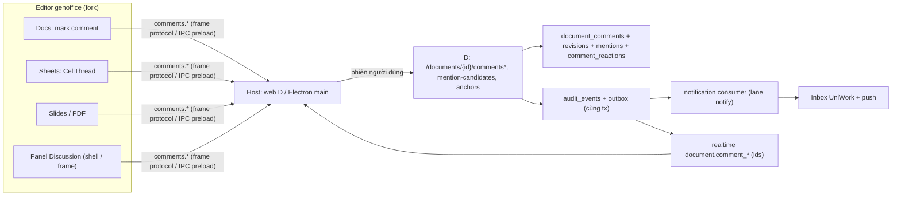

# UniWork Office G5/G6/G7 — Phụ lục G8: Cộng tác trên tài liệu và liên kết sau đăng nhập

> **Trạng thái:** in-progress — phụ lục v0.2 của spec G5/G6/G7 v1.2, soạn 2026-10-13 theo yêu cầu người dùng (2026-10-13 00:40 UTC+7: "phần comment, mention... nằm trong 2 issue 1331 1328 trên uniai, kiểm tra và bổ sung task vào phase này luôn"). v0.3 (2026-10-13): đóng 5 finding medium của review delta r2 (§4.3 `base_version_id`, §4.5 claim trong tx consumer, §4.6 nguồn slug + cổng batch, §4.7 `list_token`). v0.2 (2026-10-13): G8-D1, G8-D2, G8-D4, G8-D5, G8-D6 và Q6–Q10 **đã ký** theo khuyến nghị của decision packet — Advisor ký thay theo ủy quyền của người dùng (đêm 2026-10-13, "tự duyệt theo gợi ý"); G8-D3 **đã ký 2026-10-14 15:45 UTC+7** (luật ở [phụ lục mức quyền](2026-10-14-documents-permission-levels-addendum.md); không còn giá trị tạm); đã xử lý review FE r1 + BE r1 (`reports/plan-collab/review-resolution-r2.md` của Run).

**Issue:** UNI-1331 (Comment, Mention, Inbox; con UNI-1333, UNI-1335, UNI-1336, UNI-1337, UNI-1389, UNI-1390) và UNI-1328
(đăng nhập + liên kết dữ liệu; con UNI-1329, UNI-1330); phase UNI-923.
**Quan hệ với spec chính:** [spec G5/G6/G7 v1.2](2026-10-02-office-g5-g6-g7-design.md) giữ nguyên; phụ lục này thêm luồng G8.
Khi phụ lục và spec chính lệch, spec chính thắng (bất biến §3 áp nguyên cho G8). Plan: [plan v2.8 §5.7](../plans/2026-10-12-office-g5-g6-g7.md).
Spine UX G8: [`docs/office/g5g6g7/ux/EXPERIENCE-G8.md`](../../office/g5g6g7/ux/EXPERIENCE-G8.md) (final; G8-09 đã ký 2026-10-13).
**Bằng chứng hiện trạng:** bản phân tích khoảng trống của Run (`.uniwork-dev/office-g5g6g7/reports/plan-collab/gap-analysis.md`,
mọi dữ kiện có `file:line`).

## 1. Kết quả sản phẩm

Người dùng đăng nhập UniWork Office bằng tài khoản UniWork, chọn đúng doanh nghiệp, thấy các tài liệu mình có quyền (kể cả
tài liệu được chia sẻ trực tiếp) với thuộc tính, quyền và phiên bản; tạo, đổi tên, lưu trữ tài liệu UniWork từ app mà không
sinh bản sao. Trong editor (DOCX, XLSX, PPTX, PDF) người dùng bình luận tại một vị trí, trả lời, sửa, xóa, giải quyết, mở lại; với
mọi định dạng (gồm Markdown, HTML) có một Discussion chung của tài liệu. Bình luận và Discussion là **một bộ dữ liệu** dùng
chung giữa web UniWork và UniOffice. Mention trỏ tới tài khoản UniWork; thông báo vào Inbox UniWork và mở thẳng tới đúng
tài liệu, bình luận và vị trí (đoạn, ô, slide, trang) — trên web và trong app desktop.

## 2. Quyết định (đã ký 2026-10-13; G8-D3 ký 2026-10-14)

Ký: Advisor (Run `run_a635eef8717c`) thay người dùng theo ủy quyền đêm 2026-10-13 ("tự duyệt theo gợi ý"), đúng khuyến nghị
của decision packet Q1–Q10. G8-D3 (Q5) do người dùng ký 2026-10-14 15:45 UTC+7 (đúng ba khuyến nghị); luật ở [phụ lục mức quyền](2026-10-14-documents-permission-levels-addendum.md).

| ID | Quyết định | Hệ quả |
| --- | --- | --- |
| G8-D1 (Q1) | Kho dữ liệu: **server UniWork** (`document_comments` của G1-07) là nguồn duy nhất; editor đọc/ghi qua host. Bình luận gốc có sẵn trong tệp hiện ở mục "Bình luận trong tệp" chỉ đọc, byte giữ nguyên khi Lưu, không nhập vào server ở v1 | Không đổi đường commit (§3 bất biến 1), không vi phạm U-05; dùng lại audit/outbox/isolation/Inbox |
| G8-D2 (Q2) | Neo lưu ở server dạng JSON theo định dạng, kèm `anchor_version_id` và trạng thái `exact`/`stale`/`lost`; editor giữ neo trong model khi mở và gửi bản đồ neo mới sau mỗi receipt Lưu (luật so phiên bản ở §4.3) | Neo sống qua phiên bản mà không ghi bình luận vào byte |
| G8-D3 (Q5, **đã ký 2026-10-14 15:45**) | Ba luật: (1) mention người không xem được tài liệu → cảnh báo lúc gửi + "chia sẻ quyền Xem rồi gửi" cho người được phép chia sẻ; bỏ qua thì mention lưu **không thông báo**; mention không bao giờ cấp quyền. (2) Mức **Comment** riêng giữa View và Edit; viết bình luận cần Comment hoặc Edit. (3) Resolve: tác giả luồng cộng bất kỳ ai có Edit. Bảng quyền, ánh xạ, lỗi/SDO và thẻ code: [phụ lục mức quyền](2026-10-14-documents-permission-levels-addendum.md) | Mở khóa G8-18 và hàng G8-A10; thay giá trị tạm cũ (viết/resolve cần `edit`, mention im lặng) |
| G8-D4 (Q4) | Người nhận thông báo theo đúng bảng UNI-1337 (tạo mới không thông báo; bỏ thông báo `document_commented` cho chủ ACL và người bình luận trước); một thông báo mỗi người mỗi sự kiện, ưu tiên mention > reply > resolve; push bật cho mention, tắt cho reply/resolve | Đổi hành vi Inbox đang chạy của G1-07 |
| G8-D5 (Q6) | Dòng `document_comments` hiện có (không neo) thành Discussion | Không mất dữ liệu; web hiện ở tab Discussion |
| G8-D6 (Q3) | Phạm vi v1: bình luận cần online (không hàng đợi bình luận offline); Markdown/HTML chỉ có Discussion; neo PPTX là slide (+ id đối tượng khi editor cấp); quan hệ Task/Project/Meeting ↔ Document hoãn | Danh sách hoãn ở mục 6 |
| Q7 | Epic E5 riêng, lane L21–L24 | Không chạm đường găng G5/G6 |
| Q8 | Xóa thật nội dung và lịch sử sửa; khung "Nội dung đã bị xoá" giữ cấu trúc chuỗi; audit chỉ ghi hành động | Bất biến 4 |
| Q9 | Tác giả khi chưa đăng nhập/tệp cục bộ: nhãn trung tính, không bao giờ tên tài khoản máy (giá trị ghi vào tệp là hằng cố định, §4.4) | G8-02 |
| Q10 | Tài khoản nhiều tổ chức: bắt chọn lần đầu, nhớ lựa chọn, đổi trong Cài đặt › Tài khoản | G8-16, spine S16 |

## 3. Kiến trúc

Bất biến riêng của G8 (thêm vào §3 của spec chính, không thay):

1. Một kho: không editor nào giữ bình luận UniWork trong byte của tệp; không bản sao bình luận khi mở bằng editor khác.
2. Tác giả là tài khoản UniWork từ phiên của host; renderer không tự khai tác giả, server lấy actor từ phiên. Tên tài khoản hệ
   điều hành không bao giờ là tác giả, kể cả với tệp cục bộ.
3. Neo không phải quyền: xem bình luận theo quyền tài liệu tại thời điểm đọc; deep link kiểm quyền lúc mở.
4. Xóa giữ cấu trúc: comment/thread có phản hồi bị xóa thành khung "Nội dung đã bị xoá" (nội dung, lịch sử sửa và reaction
   của chính nó xóa thật khỏi DB); chưa có phản hồi thì bỏ khỏi luồng; audit giữ hành động, không giữ nội dung.
5. Thông báo chỉ sinh sau khi sự kiện nguồn đã commit (outbox); một thông báo mỗi người nhận mỗi sự kiện; thông báo không mang
   nội dung tài liệu, snippet bình luận ẩn khi người nhận không còn quyền xem (kiểm lúc đọc danh sách, §4.6).
6. Mention không cấp quyền; payload realtime chỉ id; log chỉ id.
7. **AI theo ADR 0010.** Công cụ AI của editor không tạo, sửa, xóa, resolve bình luận server trực tiếp. Trên tài liệu bind, AI
   chỉ đề xuất (bản nháp bình luận hiện trong composer, hoặc thẻ đề xuất); bình luận chỉ thành bản ghi server khi người dùng
   bấm Gửi, và actor là người đó (`service.Human`, `created_by_kind=human`). Không có bình luận `created_by_kind=agent` nào từ
   editor ở v1. Tệp cục bộ giữ hành vi AI hiện có của fork.
8. **Một panel mỗi host** (chi tiết: spine S12/S13 › Panel theo host). Web: khi frame editor mở và host quảng bá capability
   `comments`, panel của frame là panel duy nhất — host D ẩn `DocumentCommentsPanel` và chuyển `?comment=` thành
   `comments.reveal`; trang tài liệu không có frame (chưa mở, định dạng không có module, frame cũ không khai `comments`) dùng
   panel D. Desktop: panel của editor (S12) + panel Discussion của shell (S13), không có panel thứ hai.

## 4. Mô hình dữ liệu và hợp đồng (logic; G8-01 ghi vào `contract-collab.md`, G8-03 chốt migration)

| Thực thể | Trường chính | Ghi chú |
| --- | --- | --- |
| `document_comments` (mở rộng) | `comment_type` mở rộng thành `comment`/`discussion` (một cột duy nhất cho loại luồng; không thêm cột `thread_kind`), `anchor` JSONB, `anchor_version_id`, `anchor_state`, `deleted_at`, `deleted_by_id` + `deleted_by_kind` | Bảng cũ (migration `9991790532871902`, sau 065) đã mang `organization_id` và dùng `author_id`/`author_kind`, không phải `created_by`; cột mới không FK. CHECK: `comment_type IN ('comment','discussion')` (thay CHECK cũ), `anchor_state IN ('exact','stale','lost')` hoặc NULL khi không neo, `deleted_by_kind IN ('human','agent','system')` (ADR 0007) |
| `document_comment_revisions` (mới) | id, `organization_id`, `workspace_id`, `document_id`, `comment_id`, `body`, `revision`, `created_by` + `created_by_kind`, `created_at` | Lịch sử sửa (UNI-1335); xóa thật khi comment bị xóa |
| `document_comment_mentions` (mới) | id, `organization_id`, `workspace_id`, `document_id`, `comment_id`, `user_id`, `state` (`active`/`removed`/`no_access`), `notified_at` (NULL tới khi đã giao), `created_by` + `created_by_kind`, `created_at`, `updated_at` | CHECK `state IN (...)`; unique (`comment_id`, `user_id`) bằng index CONCURRENTLY; nguồn của "chỉ người mới được mention nhận thông báo" (§4.5) |
| `comment_reactions` (có sẵn) | — | Không đổi cột; xóa theo comment khi tombstone, theo tài liệu khi purge |

Mọi query sqlc mới mang tham số tenant (`organization_id = $n` hoặc `workspace_id = $n`, cộng `document_id` khi đọc theo tài
liệu) hoặc một dòng `-- tenant:` đúng nghĩa (`TestEveryQueryNamesItsTenant`); không query nào lọc chỉ theo `comment_id`.

### 4.1 Loại luồng và route

`kind` ở API/protocol = cột `comment_type`. `GET /documents/{documentID}/comments` không tham số trả **cả hai** loại (client cũ
giữ nguyên); `?kind=comment|discussion` lọc. Fingerprint idempotency của lệnh tạo gồm `comment_type`, `body`, cha như hiện tại cộng `anchor` (hash JSON chuẩn tắc) và `base_version_id`, để replay khác neo không trả lại bản cũ. Dòng cũ
được migration chuyển thành `discussion` (G8-D5). Một Discussion mỗi tài liệu = mọi dòng `discussion` của `document_id`
(tài liệu liên kết nhiều Task/Workspace vẫn một Discussion). Có `resolve` và `reopen` (route sẵn có); reaction giữ ở web,
editor fork chưa vẽ reaction ở v1 (§6).

### 4.2 Nội dung bình luận và mention

- **Một định dạng:** `body` là Markdown con (đoạn, xuống dòng, **đậm**, *nghiêng*, `code` dòng, liên kết `http(s)`) cộng token
  mention theo ngữ pháp duy nhất của D `[@Nhãn](mention://member/<ULID>)` (`server/internal/mentions/mentions.go`). Trần độ dài
  giữ con số của route hiện có (G8-01 đọc từ SDI và ghi vào hợp đồng); không HTML thô.
- **Hiển thị:** mọi host vẽ tối thiểu: văn bản, xuống dòng, liên kết (mở ngoài), mention chip. Chip lấy **tên hiện tại** theo id
  (đổi tên hiển thị → chip đổi theo), nhãn trong token chỉ là dự phòng; người dùng không còn tồn tại/không đọc được → nhãn
  trong token, không link. Cú pháp Markdown khác hiện nguyên văn, không vỡ bố cục.
- **Soạn:** gõ `@` mở picker (`mentions.search` → `mention-candidates`); chọn một người chèn token. `@Tên` gõ tay không qua
  picker là văn bản thường, không phải mention. Dán văn bản có token hợp lệ giữ token.
- Escape: `[`, `]`, `(`, `)` trong nhãn token được escape theo Markdown; server chỉ tin id trong token.

### 4.3 Neo theo định dạng và theo phiên bản

Neo là JSON có `format` và `v`: docx `{para_id?, path, start, end, quote, prefix, suffix}`; xlsx `{sheet, range}` (A1, sheet theo
id ổn định của workbook khi có); pptx `{slide_id, slide_index, object_id?}`; pdf `{page, rect}`. Trần 4 KiB mỗi neo; trích dẫn
≤ 500 ký tự.

`PUT /documents/{documentID}/comments/anchors {version_id, anchors:[{comment_id, anchor, state}]}`.
Lệnh **tạo** comment có neo mang `base_version_id` (version editor đang mở hoặc vừa Lưu; editor có thể đang giữ chỉnh sửa chưa Lưu so với head, nên không
gắn mặc định head): server áp luật 1 bên dưới cho `base_version_id` (không thấy → 400 `anchor_version_invalid`), lưu `anchor_version_id =
base_version_id` và `anchor_state = exact` chỉ khi đó là head, ngược lại `stale` tới `PUT` đầu tiên. Luật của `PUT`:

1. Tra `document_versions` theo (`organization_id`, `workspace_id`, `document_id`, `version_id`). Không thấy (version của tài
   liệu khác, đã bị dọn, không tồn tại) → 400 `anchor_version_invalid`, không ghi gì; câu trả lời giống nhau mọi trường hợp
   (không lộ version có tồn tại ở tài liệu khác). Client coi neo đang hiện là `stale`, thử lại ở receipt Lưu sau.
2. So bằng số `document_versions.version` (số nguyên tăng theo tài liệu), **không** so chuỗi ULID. Với từng comment: nhận khi
   số của `version_id` ≥ số của `anchor_version_id` đang lưu (bằng = ghi lại, idempotent); version đang lưu không còn tồn tại
   coi như cũ hơn; nhỏ hơn → bỏ qua comment đó (trả trong `skipped`), không lùi neo.
3. `anchor_state` lưu là `exact` khi `version_id` là head lúc ghi, ngược lại `stale`; `lost` khi editor báo vậy. Comment không
   thuộc tài liệu (hoặc tenant khác) → bỏ qua, không lộ (`isoReferences`).
4. PUT idempotent tự thân: không dùng ledger `Idempotency-Key`; lặp lại cùng payload không đổi dòng nào và không phát sự kiện.
   Có thay đổi → audit + outbox `document.comment_anchors_updated {document_id, workspace_id, version_id}` cùng tx.
5. Không bao giờ lưu `anchor_version_id` trỏ tới version không thuộc tài liệu.

### 4.4 Tác giả khi không có tài khoản UniWork

Tệp cục bộ / chưa đăng nhập: giá trị **ghi vào tệp** là hằng `"User"` (và `personId` cố định cho sheets), không phụ thuộc
locale; nhãn hiển thị trong UI dịch theo locale ("Người dùng"/"User"…). Đổi ngôn ngữ không tạo person mới.

### 4.5 Mention bền và chống trùng thông báo

Service ghi `document_comment_mentions` cùng transaction khi tạo/sửa: so tập id mới với dòng hiện có — thêm → `active`
(`notified_at` NULL), bỏ → `removed`, người không đọc được tài liệu → `no_access` (luật G8-D3 đã ký: không thông báo, trả `mentions_without_access`; chi tiết, lỗi và SDO ở [phụ lục mức quyền](2026-10-14-documents-permission-levels-addendum.md) mục 3). Dòng `removed` được thêm
lại → `active` nhưng giữ `notified_at` cũ (không thông báo lại). Luật thông báo của sự kiện tạo/sửa chỉ xét dòng `active` có
`notified_at IS NULL` và đưa vào `Draft` một `Claim{MentionID}`; luật **chỉ đọc** (rule không có transaction). Việc **giành** dòng nằm ở `write()` của
`server/internal/notification/consumer.go`: `UPDATE … SET notified_at = now() WHERE id = $1 AND notified_at IS NULL` chạy trong **cùng một
transaction** với `InsertNotificationDelivery`, `UpsertNotification` và `outbox_events` của thông báo — claim và thông báo cùng commit hoặc cùng
rollback; 0 dòng bị cập nhật → bỏ draft. Nếu người nhận tắt `InApp`, `deliver` chạy một tx chỉ-claim (cùng câu `UPDATE`, không ghi thông báo),
nên mention cũ không bật lại khi họ bật preference rồi một lần sửa giữ nguyên mention. Chỉ bên giành được tạo thông báo. Vì vậy hai lần sửa trước khi consumer chạy, replay outbox,
hay sửa vẫn giữ A đều cho đúng một thông báo cho A. Xóa toàn bộ nội dung → mọi mention `removed`, thông báo cũ giữ nguyên.

### 4.6 Inbox, snippet và deep link

Thông báo tài liệu mang `resource_type=document`, `resource_id` = document id, `params.comment_id`, `params.kind`; thông báo chỉ mang id (`workspace_id`, `organization_id`), payload không
đổi. **Nguồn slug** theo đúng cách Inbox hôm nay điều hướng (danh sách lọc theo workspace đang mở, `resourceHref(n, workspace)` dựng từ object
`Workspace`): web tra `n.workspace_id` trong `useWorkspaces()` (`workspaceKeys.list()`); không có trong danh sách (người nhận đọc qua chia sẻ trực
tiếp, không thuộc workspace của tài liệu) → rơi về workspace đang mở, như thư viện "Được chia sẻ với tôi" mở tài liệu ngoài workspace hôm nay
(`GET /documents/{id}` phân quyền theo chính tài liệu). Push (`ResourceURL`) dùng cùng luật qua `ListWorkspacesForUser(n.UserID)`: workspace của thông
báo nếu người nhận ở trong danh sách, nếu không thì workspace đầu tiên cùng tổ chức, nếu không có thì `/workspaces`.

`Service.List` gom `document_id` của trang kết quả và gọi cổng batch mới `FilterReadableDocuments(ctx, userID, documentIDs)` trên
`DocumentService` (một người trên nhiều tài liệu; `FilterDocumentReaders(ctx, documentID, userIDs)` của `document_access.go` lọc nhiều người trên một
tài liệu và giữ nguyên cho consumer). v1 = khử trùng id (≤ 100 mỗi trang), một truy vấn `ListExistingDocumentIDs` (tồn tại/lưu trữ), cổng tổ chức một
lần mỗi tổ chức và `resolveLevel` một lần mỗi tài liệu: chi phí tối đa theo số tài liệu của trang, chỉ cho hàng `resource_type=document`. Tài liệu
không còn đọc được → bỏ snippet khỏi `params`, gắn cờ `resource_access_lost`; lưu trữ/xóa → `resource_deleted` (thông báo và link vẫn còn; mở link →
màn hình "không có quyền" hoặc "không còn").

Vé launch desktop (`office_launch`) mang thêm `comment_id` tùy chọn; app mở tài liệu rồi gửi `comments.reveal` cho editor.

### 4.7 Realtime và desktop

Web: `document.comment_*` và `document.comment_anchors_updated` invalidate `documentKeys.comments(wsId, document_id)` ở
`packages/core/realtime/use-realtime-sync.ts`; host D chuyển thành `comments.changed` cho frame. Desktop không có realtime:
panel tải lại khi tab hiển thị được focus và mỗi 30 s **chỉ khi** panel đang mở và tab đang hiển thị, gửi `since_token` (giá
trị `list_token` của lần tải trước) để server trả `{unchanged:true, list_token}` khi không đổi. `list_token` băm `(id, updated_at,
anchor_state)` của mọi dòng còn lại của tài liệu, nên một xóa cứng (thread không phản hồi, Q8) làm token đổi dù không dòng nào mới hơn: máy
khách **không bao giờ suy xóa từ "không thấy dòng"** mà chỉ thay cả danh sách khi token khác, nên thread đã xóa biến mất ở desktop trong một chu kỳ
poll. Sửa, resolve/reopen, tombstone và `PUT anchors` có đổi đều đặt `updated_at` cùng tx; reaction chưa vào token vì editor fork chưa vẽ reaction (§6).
Không giữ tombstone cho xóa cứng (nội dung và lịch sử xóa thật theo Q8). Tải lại không phá composer đang mở: nháp giữ nguyên; nếu thread
đích đã bị xóa, composer báo "Bình luận này đã bị xóa." và giữ văn bản để sao chép. Đổi tên tài liệu thấy trên desktop qua
`document.updated` của feed G5-01a/b khi có, không thì làm mới metadata khi focus; server không có sự kiện `file.renamed` (catalogue), đó chỉ là host event của frame protocol (X-02) — shell/host
phát nó cho editor **sau khi** đã biết tên mới từ hai nguồn trên.

## 5. Bảng UNI-13xx → hành vi

Chi tiết ở plan §5.7. Tóm tắt: UNI-1333 → G8-03/04 + editor G8-12..15 + G8-20; UNI-1335 → G8-03, G8-10, G8-11; UNI-1336 → G8-05,
G8-06 (+ G8-18 pending); UNI-1337 → G8-05; UNI-1389 → G8-07 (+ `comments.reveal` ở G8-08, G8-12..15); UNI-1390 → G8-08, G8-04;
UNI-1328/1329/1330 → G8-16, G8-17 (spine S16–S18).

## 6. Hoãn ngoài v1 (có lý do)

| Yêu cầu | Lý do hoãn |
| --- | --- |
| Quan hệ Task/Project/Meeting ↔ Document đọc từ Office (UNI-1329) | Chưa có mô hình liên kết ở UniWork (không bảng nào mang `document_id`); thuộc Work Graph C-14/C-11 (spec §11) |
| Bình luận khi offline (hàng đợi bình luận) | G5-D3 giữ một intent Lưu mỗi tài liệu; hàng đợi bình luận là store mới cần hợp đồng store G5-04 — đề xuất sau P2 |
| Nhập bình luận gốc trong tệp lên server / xuất bình luận server vào tệp khi tải về | Cần quy tắc tác giả ngoài UniWork và quyền riêng tư; v1 giữ byte nguyên |
| Neo Markdown/HTML | Editor không có mô hình bình luận; Discussion phủ nhu cầu |
| Reaction trong editor fork | Web D giữ reaction (sẵn có); editor chưa có UI reaction, không thuộc issue G8 |
| Bình luận do AI tạo trực tiếp (`created_by_kind=agent`) | ADR 0010: chỉ đề xuất → người xác nhận (bất biến 7) |
| Sự kiện bình luận scope theo người (người được chia sẻ ở workspace khác) | Đổi scope realtime là thay đổi catalogue/ADR 0015 vùng khác; v1 panel tải lại khi focus |
| Tìm kiếm trong bình luận | Không có trong issue |
| Mention trong bình luận task (cú pháp `@tên`) | Ngoài Office |
| Dòng "Các phản hồi được tạo đồng thời…" của UNI-1390 bị cắt | Product bổ sung mô tả; v1 đã đảm bảo mỗi lần gửi là một bản ghi |
