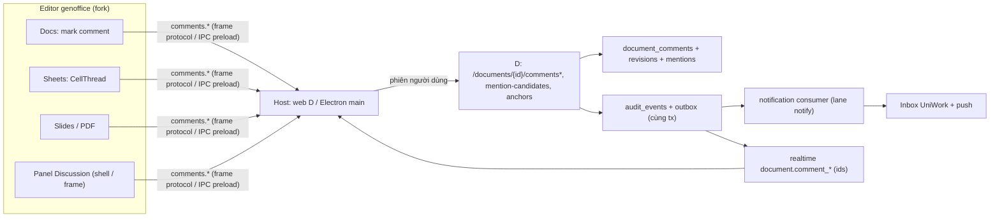

# UniWork Office G5/G6/G7 — Phụ lục G8: Cộng tác trên tài liệu và liên kết sau đăng nhập

> **Trạng thái:** in-progress — phụ lục v0.1 của spec G5/G6/G7 v1.2, soạn 2026-10-13 theo yêu cầu người dùng (2026-10-13 00:40 UTC+7: "phần comment, mention... nằm trong 2 issue 1331 1328 trên uniai, kiểm tra và bổ sung task vào phase này luôn"); chờ review FE + BE và ký decision packet `reports/plan-collab/decision-packet.md` của Run.

**Issue:** UNI-1331 (Comment, Mention, Inbox; con UNI-1333, UNI-1335, UNI-1336, UNI-1337, UNI-1389, UNI-1390) và UNI-1328
(đăng nhập + liên kết dữ liệu; con UNI-1329, UNI-1330); phase UNI-923.
**Quan hệ với spec chính:** [spec G5/G6/G7 v1.2](2026-10-02-office-g5-g6-g7-design.md) giữ nguyên; phụ lục này thêm luồng G8.
Khi phụ lục và spec chính lệch, spec chính thắng (bất biến §3 áp nguyên cho G8). Plan: [plan v2.7 §5.7](../plans/2026-10-12-office-g5-g6-g7.md).
**Bằng chứng hiện trạng:** bản phân tích khoảng trống của Run (`.uniwork-dev/office-g5g6g7/reports/plan-collab/gap-analysis.md`,
mọi dữ kiện có `file:line`).

## 1. Kết quả sản phẩm

Người dùng đăng nhập UniWork Office bằng tài khoản UniWork, chọn đúng doanh nghiệp, thấy các tài liệu mình có quyền (kể cả
tài liệu được chia sẻ trực tiếp) với thuộc tính, quyền và phiên bản; tạo, đổi tên, lưu trữ tài liệu UniWork từ app mà không
sinh bản sao. Trong editor (DOCX, XLSX, PPTX, PDF) người dùng bình luận tại một vị trí, trả lời, sửa, xóa, giải quyết; với
mọi định dạng (gồm Markdown, HTML) có một Discussion chung của tài liệu. Bình luận và Discussion là **một bộ dữ liệu** dùng
chung giữa web UniWork và UniOffice. Mention trỏ tới tài khoản UniWork; thông báo vào Inbox UniWork và mở thẳng tới đúng
tài liệu và bình luận.

## 2. Quyết định đề xuất (chờ ký trong decision packet)

| ID | Đề xuất | Hệ quả |
| --- | --- | --- |
| G8-D1 | Kho dữ liệu: **server UniWork** (`document_comments` của G1-07) là nguồn duy nhất; editor đọc/ghi qua host. Bình luận gốc có sẵn trong tệp hiện ở mục "Bình luận trong tệp" chỉ đọc, byte giữ nguyên khi Lưu, không nhập vào server ở v1 | Không đổi đường commit (§3 bất biến 1), không vi phạm U-05; dùng lại audit/outbox/isolation/Inbox |
| G8-D2 | Neo lưu ở server dạng JSON theo định dạng, kèm `anchor_version_id` và trạng thái `exact`/`stale`/`lost`; editor giữ neo trong model khi mở và gửi bản đồ neo mới sau mỗi receipt Lưu | Neo sống qua phiên bản mà không ghi bình luận vào byte |
| G8-D3 | Phần **pending chờ nghiệp vụ phân quyền** (UNI-1336): mention người chưa có quyền, mức quyền "bình luận" riêng, ai được resolve. Tới khi ký: giá trị tạm = hành vi hiện có (viết cần `edit`, đọc cần `view`, resolve cần `edit`; mention người không đọc được thì không thông báo, không báo lỗi) | Chỉ chặn G8-18 |
| G8-D4 | Người nhận thông báo theo đúng bảng UNI-1337 (tạo mới không thông báo; bỏ thông báo `document_commented` cho chủ ACL và người bình luận trước); gộp một thông báo mỗi người mỗi sự kiện, ưu tiên mention > reply > resolve | Đổi hành vi Inbox đang chạy của G1-07 |
| G8-D5 | Dòng `document_comments` hiện có (không neo) thành Discussion | Không mất dữ liệu; web hiện ở tab Discussion |
| G8-D6 | Phạm vi v1: bình luận cần online (không hàng đợi bình luận offline); Markdown/HTML chỉ có Discussion; neo PPTX là slide (+ id đối tượng khi editor cấp); quan hệ Task/Project/Meeting ↔ Document hoãn | Danh sách hoãn ở mục 6 |

## 3. Kiến trúc

Bất biến riêng của G8 (thêm vào §3 của spec chính, không thay):

1. Một kho: không editor nào giữ bình luận UniWork trong byte của tệp; không bản sao bình luận khi mở bằng editor khác.
2. Tác giả là tài khoản UniWork từ phiên của host; renderer không tự khai tác giả, server lấy actor từ phiên. Tên tài khoản hệ
   điều hành không bao giờ là tác giả, kể cả với tệp cục bộ.
3. Neo không phải quyền: xem bình luận theo quyền tài liệu tại thời điểm đọc; deep link kiểm quyền lúc mở.
4. Xóa giữ cấu trúc: comment/thread có phản hồi bị xóa thành khung "Nội dung đã bị xoá" (nội dung xóa thật khỏi DB, kể cả lịch
   sử sửa); chưa có phản hồi thì bỏ khỏi luồng; audit giữ hành động, không giữ nội dung.
5. Thông báo chỉ sinh sau khi sự kiện nguồn đã commit (outbox); một thông báo mỗi người nhận mỗi sự kiện; thông báo không mang
   nội dung tài liệu, snippet bình luận ẩn khi người nhận không còn quyền xem.
6. Mention không cấp quyền; payload realtime chỉ id; log chỉ id.

## 4. Mô hình dữ liệu (logic; task G8-03 chốt migration)

| Thực thể | Trường chính | Ghi chú |
| --- | --- | --- |
| `document_comments` (mở rộng) | `thread_kind` (`comment`/`discussion`), `anchor` JSONB, `anchor_version_id`, `anchor_state`, `deleted_at`, `deleted_by_id` + `deleted_by_kind` | Bảng cũ có trước migration 065 nhưng đã mang `organization_id`; cột mới không FK |
| `document_comment_revisions` (mới) | id, `organization_id`, `workspace_id`, `document_id`, `comment_id`, `body`, `revision`, `created_by` + `created_by_kind`, `created_at` | Lịch sử sửa (UNI-1335); body xóa khi comment bị xóa |
| `document_comment_mentions` (mới) | id, `organization_id`, `workspace_id`, `document_id`, `comment_id`, `user_id`, `state` (`active`/`removed`/`no_access`), `created_by` + `created_by_kind`, thời điểm | Nguồn của "chỉ người mới được mention nhận thông báo" |

Neo theo định dạng (JSON có `format` và `v`): docx `{para_id?, path, start, end, quote, prefix, suffix}`; xlsx `{sheet, range}`
(A1, sheet theo id ổn định của workbook khi có); pptx `{slide_id, slide_index, object_id?}`; pdf `{page, rect}`. Trần 4 KiB mỗi
neo; trích dẫn ≤ 500 ký tự (không gửi cả đoạn).

## 5. Bảng UNI-13xx → hành vi

Chi tiết ở plan §5.7. Tóm tắt: UNI-1333 → G8-03/04 + editor G8-12..15; UNI-1335 → G8-03, G8-10, G8-11; UNI-1336 → G8-05,
G8-06 (+ G8-18 pending); UNI-1337 → G8-05; UNI-1389 → G8-07; UNI-1390 → G8-08, G8-04; UNI-1328/1329/1330 → G8-16, G8-17.

## 6. Hoãn ngoài v1 (có lý do)

| Yêu cầu | Lý do hoãn |
| --- | --- |
| Quan hệ Task/Project/Meeting ↔ Document đọc từ Office (UNI-1329) | Chưa có mô hình liên kết ở UniWork (không bảng nào mang `document_id`); thuộc Work Graph C-14/C-11 (spec §11) |
| Bình luận khi offline (hàng đợi bình luận) | G5-D3 giữ một intent Lưu mỗi tài liệu; hàng đợi bình luận là store mới cần hợp đồng store G5-04 — đề xuất sau P2 |
| Nhập bình luận gốc trong tệp lên server / xuất bình luận server vào tệp khi tải về | Cần quy tắc tác giả ngoài UniWork và quyền riêng tư; v1 giữ byte nguyên |
| Neo Markdown/HTML | Editor không có mô hình bình luận; Discussion phủ nhu cầu |
| Sự kiện bình luận scope theo người (người được chia sẻ ở workspace khác) | Đổi scope realtime là thay đổi catalogue/ADR 0015 vùng khác; v1 panel tải lại khi focus |
| Tìm kiếm trong bình luận | Không có trong issue |
| Mention trong bình luận task (cú pháp `@tên`) | Ngoài Office |
| Dòng "Các phản hồi được tạo đồng thời…" của UNI-1390 bị cắt | Product bổ sung mô tả; v1 đã đảm bảo mỗi lần gửi là một bản ghi |
